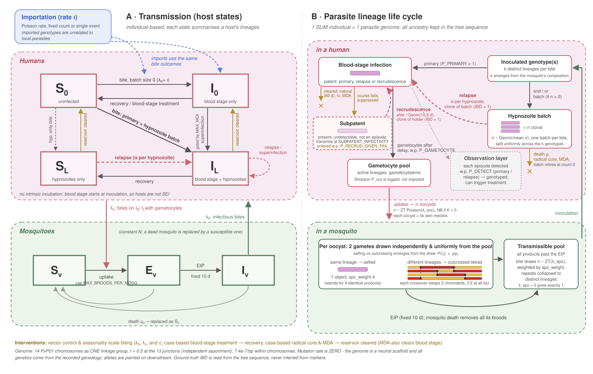
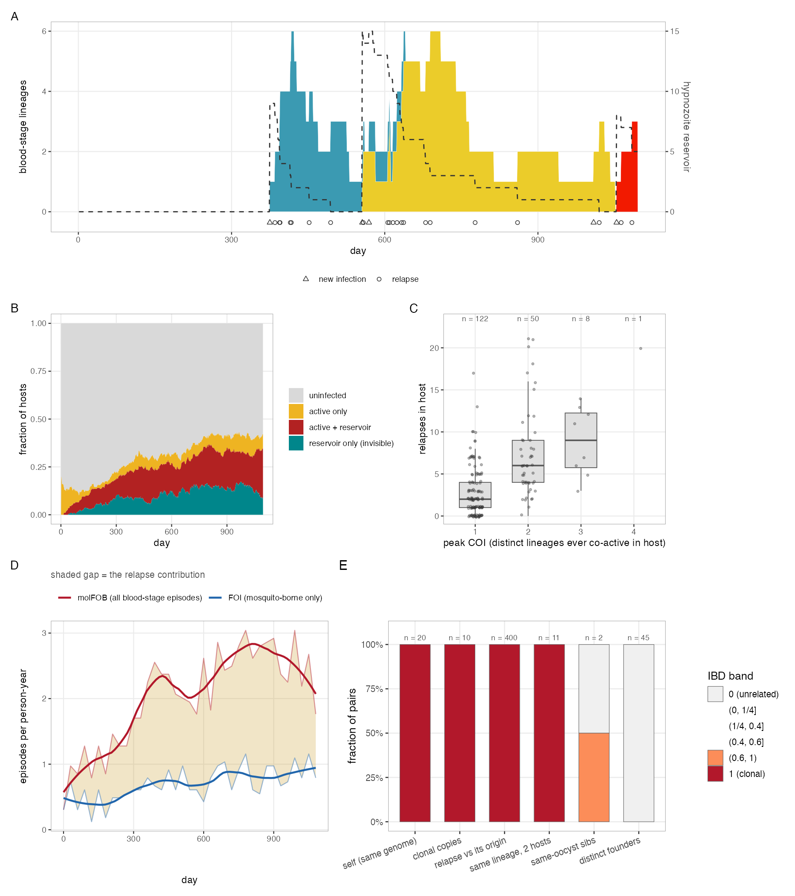
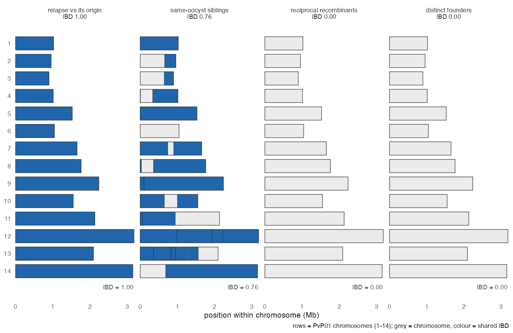

# malariafwd v0.1.0 — model description

A forward, individual-based, genotype-resolved simulator of *Plasmodium vivax* transmission with
an explicit hypnozoite reservoir, implemented in SLiM 5 (Eidos) with tskit tree-sequence recording
and an R interface.

Engine: `inst/slim/malariafwd_vivax.slim`. Everything below was read from that file; where a
default is quoted it is the shipped value.



**A representative run** — 200 hosts, 400 mosquitoes, 3 years, `BITING_RATE` 0.08, 40 founder
hosts carrying 10 lineages, ν = 3. Emergent: prevalence **0.246**, COI **1.14**, **13.3%**
polyclonal, reservoir **0.9** hypnozoites/host, relapse fraction **0.657**, **2.23** relapses per
person-year — all inside published vivax bands.



**A** one host's lineage trajectory: coloured bands are blood-stage lineages, the dashed line is
that host's hypnozoite reservoir, and the marks below show new infections (triangles) against
relapses (circles). **B** population host-state composition over time — note the teal
*reservoir-only* band, which is invisible to any blood survey. **C** peak COI against the number
of relapses a host goes on to experience (boxes drawn only where there are enough hosts; every
level labelled with its n). **D** **molFOB vs FOI** — the compound force of blood-stage infection
against the mosquito-borne force alone; the shaded gap is the relapse contribution. **E** the
realised IBD ladder, as the composition of each relationship class across relatedness bands.

Panel D carries the central vivax quantity: **molFOB 2.02 vs FOI 0.69 episodes per person-year,
so 66% of blood-stage episodes are relapses**, and the gap widens through the run as the reservoir
accumulates. Any method that reads new episodes as new transmission is reading that whole shaded
area as something it is not. (Panel E is deliberately a composition plot rather than a box: most
relationship classes are point masses, and the one informative split — same-oocyst siblings
dividing 50/50 between high sharing and the reciprocal products that share nothing — is only
legible this way. `plot_relatedness_ladder(style = "points")` gives the continuous view, and
`plot_relapse_km()` the time-to-first-relapse curve.)



Ground-truth IBD read from the ARG, painted along the 14 PvP01 chromosomes. A relapse is clonal to
its originating hypnozoite (IBD 1.00); same-oocyst siblings share a **mosaic** with visible
crossover breakpoints (0.76); the reciprocal recombinant of that same meiosis shares **nothing**
(0.00), because reciprocal products are complementary by construction; distinct founders likewise
share nothing.

**Demonstrating the observation layer.** The same configuration rerun with
`P_DETECT_PRIMARY = 0.60` and `P_DETECT_RELAPSE = 0.15` — relapses are often sub-patent, so a
surveillance system sees them less often than primaries.


**A** true blood-stage episodes against detected ones. **B** the composition of each. The effect
is not a uniform thinning but a **reweighting**: the true burden is **65.7% relapse / 34.3%
reinfection**, while the detected line list reads **29.7% relapse / 70.3% reinfection**. Detection
*inverts* the apparent mix, which is why any method that infers transmission from the observed
origin split — Rc from case counts included — inherits a bias it cannot see.

> At this transmission level outcrossing is rare — **168 recombinant against 3,277 clonal uptake
> events (4.9%)** — so mosaics like the second panel are genuinely uncommon and most pairs sit at
> 0 or 1. That is a model output, not a plotting limitation, and it is the same effect that makes
> relapse hard to distinguish genetically in low-transmission settings.

---

## 1. What the model is for

**One SLiM individual = one parasite genome.** Humans and mosquitoes are SLiM subpopulations;
the individuals inside them are parasite lineages, not hosts. The whole genealogy is recorded in a
tree sequence, so **identity-by-descent is ground truth read from the ARG, never inferred from
markers**.

That combination — genotype resolution *and* a hypnozoite reservoir — is what the model exists
for. It is built to answer questions of the form *"what can genetic data recover about vivax
recurrence, and where does that break down?"*: relapse vs reinfection identifiability, the value of
sequencing effort, reservoir dynamics under control and resurgence.

**It is not** a tool for predicting case counts, fitting incidence time series, or costing
interventions. Compartmental vivax models (White, Mehra/Flegg, Champagne) do those far better and
faster. See §12.

---

## 2. Scale and the tick cycle

Time advances in **daily ticks**. Each tick runs in this order:

| phase | what happens |
|---|---|
| `reproduction()` | hypnozoite activation (relapses) decided and seeded; biting; human→mosquito uptake and meiosis; mosquito→human inoculation; importation |
| `early()` | hypnozoite cleanup (retired batches killed); blood-stage clearance; mosquito death and replacement; interventions; `state.tsv` logging |

Ordering matters for one subtlety: a batch exhausted or age-capped during `reproduction()` is
**retired** by setting `batch_count = 0`, and killed by the cleanup pass at the top of `early()` in
the **same** tick, so there is no activation lag. (This replaced a queue that an Eidos scoping slip
had made function-local — the fix is WS-G, §13.)

Population sizes are **fixed**: `N_HOSTS` humans, `N_MOSQ` mosquitoes. A mosquito that dies is
replaced by a susceptible one, so vector density is constant and there is no larval or
density-dependent vector ecology.

### 2.1 Tick pseudocode

```
for each tick t:

  reproduction():
    # --- relapse ---
    for each host h, for each dormant batch b in h:
        if age(b) > MAX_HYPNOZOITE_AGE:        retire b (batch_count <- 0)
        n_act ~ Binomial(batch_count(b), alpha_eff)      # activation
        n_die ~ Binomial(batch_count(b) - n_act, mu)     # competing death
        batch_count(b) <- batch_count(b) - n_act - n_die
        if n_act > 0:  seed ONE blood-stage episode, addCloned(b)   # IBD = 1 to origin
        if batch_count(b) == 0:  retire b

    # --- biting ---
    for each mosquito m:
        if runif(1) >= biting_rate_eff(t):  continue
        h <- a uniformly chosen host
        if m infectious and runif(1) < P_TRANS_VH:
            if NOT (h infected and active_lineages(h) >= MAX_MOI):
                broods <- sampleTransmissibleMosqBroods(m)   # n ~ ZT(LAMBDA_SPOROZOITES)
                inoculateMosquitoToHuman(broods, h)          # ONE Geom(nu) batch, split over k
        if h infectious and runif(1) < P_TRANS_HV:
            if active_lineages(m) < MAX_BROODS_PER_MOSQ:
                seedBroodFromHuman(m, h)                     # n ~ ZT(LAMBDA_OOCYSTS) meioses

    # --- importation ---
    n_imp <- N_IMPORTS_PER_TICK + Poisson(IMPORT_RATE_PER_TICK * IMPORT_RATE_BOOST)
    inoculate n_imp unrelated founder genotypes into random hosts

  early():
    kill every dormant batch with batch_count == 0        # WS-G cleanup, same tick
    for each active blood-stage lineage:
        if age > MAX_BROOD_AGE or runif(1) < P_BLOOD_CLEAR:  clear it
    apply MDA / case-based treatment if scheduled
    kill mosquitoes w.p. MU_MOSQ; replace each as susceptible
    write state.tsv
```

---

## 3. Human hosts

Hosts carry a set of parasite lineages and are summarised by four states (Panel A):

| state | meaning |
|---|---|
| S₀ | uninfected, no reservoir |
| I₀ | blood-stage infection, no reservoir |
| S_L | hypnozoites only — **invisible to blood surveys** |
| I_L | blood stage **and** hypnozoites |

**No intrinsic incubation.** Blood stage begins at inoculation, so hosts are *not* SEI. Liver-stage
development time (~9 days in reality) is not represented.

**No immunity, by design.** There is no acquired blood-stage, anti-parasite, pre-erythrocytic or
transmission-blocking immunity, and no age structure. This is a deliberate scope decision: immunity
would confound the genetic signals the model exists to measure, and vivax immunity parameters are
poorly identified. It is the single largest simplification in the model (§11, §14).

**Blood-stage duration** is geometric (discrete-time exponential): each active lineage clears
independently each day with probability

```
P_BLOOD_CLEAR = 1 - exp(-1 / MEAN_BLOOD_STAGE_DURATION)     # = 0.01653 at 60 days
```

with a hard ceiling `MAX_BROOD_AGE` = 180 days. Clearance is **per-lineage**, so a polyclonal host
loses lineages independently and MOI decays rather than collapsing at once.

**Superinfection** is allowed and gated by `MAX_MOI` = 20. The gate is checked once, in the
infected-mosquito-bites-infected-human branch: a host already carrying `MAX_MOI` active lineages
has the **whole** inoculation skipped — primary *and* hypnozoite batch, so the reservoir also stops
being topped up. **Relapses bypass the gate entirely**, so realised MOI can exceed it. At 20 it is
a runaway guard that essentially never binds (COI is typically 1–3); set it low and you are
measuring the cap, not the biology.

---

## 4. Mosquitoes

Standard S_v → E_v → I_v, with:

- **Biting:** `BITING_RATE` = 0.1 is the per-*mosquito* daily biting probability. The
  Ross–Macdonald per-human rate is `ma = BITING_RATE × N_MOSQ / N_HOSTS`, **not** this value
  directly — a frequent source of confusion when comparing to the literature.
- **Transmission probabilities:** `P_TRANS_VH` = 0.5 (`b`, bite infects human),
  `P_TRANS_HV` = 0.5 (`c`, mosquito infected by biting an infected human).
- **Lifespan:** exponential, mean `MOSQ_LIFESPAN` = 10 days.
- **EIP:** **fixed** at `EIP_DAYS` = 10 days — not temperature-dependent, not distributed.
- **Carrying capacity:** `MAX_BROODS_PER_MOSQ` = 20 lineages; uptake is skipped above it. No
  fitness cost of burden (mortality and transmissibility do not decline with parasite load).

Mosquito death removes all of its broods, so a mosquito is a hard transmission bottleneck.

### 4.1 Mapping to Ross–Macdonald quantities

```
m  = N_MOSQ / N_HOSTS                      # vector-to-host ratio
a  = BITING_RATE                           # per-mosquito daily biting probability
ma = BITING_RATE * N_MOSQ / N_HOSTS        # bites per human per day
s  = fraction of mosquitoes with >= 1 transmissible (post-EIP) brood
EIR = ma * s * 365                         # infectious bites per person-year
MU_MOSQ = 1 / MOSQ_LIFESPAN                # daily mosquito mortality
```

`EIR` is **emergent**, not a parameter; `malariafwd` computes it from `state.tsv`
(`n_transmissible > 0` gives the sporozoite rate `s`).

**Seasonality** modulates the biting probability:

```
biting_rate_eff(t) = BITING_RATE * (1 + SEASONAL_AMP * cos(2*pi*(t - SEASONAL_PHASE)/365))
```

clamped at ≥ 0, with `SEASONAL_PHASE` the day-of-year of the **peak** (`cos`, not `sin` — an
earlier `sin` put the peak ~91 d late). `SEASONAL_AMP` ≈ 0.85 gives strong annual peaks swinging
biting between roughly 0.15× and 1.85× the mean.

> **Scale warning.** Because `ma` depends on `N_MOSQ / N_HOSTS`, prevalence and COI are
> **scale-dependent**. A biting rate calibrated at 150 hosts does **not** transfer to 400 hosts.
> Always calibrate at the scale you intend to publish.

---

## 5. The hypnozoite reservoir

Follows the **White et al. 2014** batch model.

- Each transmitted genotype may cause an **active primary infection** with probability
  `P_PRIMARY` = 1.0 (White's base model treats this as certain given successful inoculation), and
  **independently** establishes a batch of hypnozoites.
- **Batch size** is geometric with mean `NU_HYPNOZOITE_BATCH` (ν) = 5.
  **Since WS-F the batch is drawn once per *bite*** and split uniformly across the co-inoculated
  genotypes, matching White's per-bite parameterisation (§12). Both, either, or neither of primary
  and batch can occur for a given genotype.
- **Activation:** each hypnozoite activates at `ALPHA_ACTIVATE` = 1/170 per day (Mehra; White 2014
  would give 1/344). An activation produces **one blood-stage episode** representing however many
  clonal hypnozoites activated that tick.
- **Death:** `MU_HYPNOZOITE` = 1/442 per day (White 2014), competing with activation.
- **Latency:** `K_LATENCY` = 0 (tropical) or 2 (temperate), with `DELTA_LATENCY` = 1/100 governing
  progression when enabled.
- **Age ceiling:** `MAX_HYPNOZOITE_AGE` = 1500 days — a safety ceiling only, ~3.4× White's 442-day
  mean lifespan, so death is governed by the exponential and the long late-relapse tail survives.

**A relapse is a clone of its originating hypnozoite** (`addCloned`), so relapse-to-origin IBD is
exactly 1. Relative to a host's *prior observed* infection it can be clonal, sibling, half-sibling
or unrelated — which is the whole point of the identifiability work.

> **Structural consequence worth stating explicitly.** Because the batch is divided among the
> genotypes that establish primaries, and `P_PRIMARY` = 1, **reservoir genotypes are a subset of
> blood-stage genotypes**; at the default (one genotype per bite) both are the same single
> genotype. Heterologous relapse can therefore only arise across separate bites. See §13.

### 5.1 Formal specification

**Batch size.** `N ~ Geometric(ν)` on the non-negative integers:

```
P(N = n) = 1/(1 + nu) * (nu / (1 + nu))^n ,    n = 0, 1, 2, ...      E[N] = nu
```

So a non-trivial fraction of bites deposit **no** hypnozoites at all: `P(N = 0) = 1/(1 + ν)` —
**16.7% at ν = 5**, 25.0% at ν = 3, 11.1% at ν = 8.

**Activation and death are competing risks** applied daily, per hypnozoite, with activation drawn
first and death drawn from the survivors:

```
n_act ~ Binomial(batch_count, alpha)
n_die ~ Binomial(batch_count - n_act, mu)
```

For the continuous-time analogue, each hypnozoite's fate is governed by the first of two
exponential clocks, giving

```
P(activate rather than die) = alpha / (alpha + mu)
E[time to either event]     = 1 / (alpha + mu)
```

At the shipped `ALPHA_ACTIVATE` = 1/170 and `MU_HYPNOZOITE` = 1/442:

| quantity | value |
|---|---|
| α + μ | 0.008145 /day |
| P(activate rather than die) | **0.722** |
| mean time to activation-or-death | **122.8 days** |
| expected relapsing hypnozoites per bite at ν = 5 | **3.61** |
| …at ν = 3 | 2.17 |
| …at ν = 8 | 5.78 |

**Note the episode/hypnozoite distinction.** Multiple hypnozoites in the *same* batch activating on
the same tick collapse into **one** blood-stage episode (they are clonal, so they are genetically
one thing). The expected number of relapse *episodes* is therefore lower than 3.61, and depends on
batch size — a larger batch yields more simultaneous activations and so proportionally fewer
episodes per hypnozoite. This is why relapse *rate* is not linear in ν.

**Temperate latency.** With `K_LATENCY = k > 0`, a hypnozoite must traverse `k` Erlang stages at
rate `DELTA_LATENCY` before it becomes eligible to activate, producing the long-latency phenotype.
`K_LATENCY = 0` (tropical) makes activation immediately eligible.

**Resurgence boosts.** From `RESURGENCE_TRIGGER_TICK`, `alpha_eff = ALPHA_ACTIVATE ×
ALPHA_ACTIVATE_BOOST` (clamped so `alpha_eff <= 1 - mu`) and `nu_eff = ν × NU_HYPNOZOITE_BATCH_BOOST`.

---

## 6. The mosquito stage: uptake, meiosis, sporozoites

This is where the genetics are generated, and where v0.1.0 (WS-F) changed most.

**Uptake.** A successful blood meal forms `n ~ zero-truncated Poisson(LAMBDA_OOCYSTS)` oocysts
(negative binomial if `K_OOCYSTS > 0`, var = λ + λ²/K). Each oocyst is an independent meiosis with
its own `oocyst_id`; all oocysts from one meal share a `brood_id`.

> **λ is the PRE-truncation rate, not the mean count.** Conditioning away the zeros pulls the
> realised mean up: λ = 1 → 1.58, λ = 2 → 2.31; with K = 1, λ = 2 → 3.0. Use `uptake_moments()` /
> `uptake_calibrate()` to convert between a literature target and λ. Zero-*truncation* (not
> inflation) is correct because `P_TRANS_HV` already decides whether the event succeeds — allowing
> zeros would count failure twice.

**Gamete draw.** Each oocyst draws **two gametes independently and uniformly** from the host's
gametocyte pool. Selfing vs outcrossing **emerges** from whether the two happen to share a lineage;
it is not rolled as a coin flip. This reproduces P(outcross) = 1 − Σpᵢ² as a marginal *and* gives
the correct pairing P(i,j) ∝ pᵢpⱼ (Wong et al. 2018), which the previous "roll outcross, then pick
two distinct lineages" did not.

> `computeOutcrossingProb()` (Simpson) still exists but is **logged only**, as the `p_outcross`
> column. It no longer drives anything.

**Meiosis.** An outcrossed oocyst yields a full **tetrad**: two reciprocal recombinants (R12, R21,
sharing breakpoints and therefore IBD 0 to each other) plus two parental clones. A selfed oocyst
yields four identical products, stored as **one** object with `spz_weight = 4` — a storage
optimisation that keeps object count from scaling with clonal output, corrected for at sampling.

**Gametocyte gating.** A blood-stage infection is transmissible only from
`gametocyte_ready_tick = start + GAMETOCYTE_DELAY` and only if it carries gametocytes (per-infection
Bernoulli, `P_GAMETOCYTE`). Defaults are the identity (0 and 1.0). Vivax gametocytes appear early —
at or near symptom onset, unlike ~10–12 d in falciparum — so a realistic preset is a short delay
plus high carriage (≈3 and ≈0.9).

**Inoculation.** A bite draws `n ~ ZT(LAMBDA_SPOROZOITES)` products from everything past the EIP,
**weighted by `spz_weight`**, then collapses repeat draws to one object per distinct lineage.

> **`LAMBDA_SPOROZOITES` defaults to 0, which `drawZTCount` maps to exactly 1.** So at the shipped
> default **every bite delivers exactly one genotype, regardless of what the mosquito carries** —
> co-transmission is structurally impossible. Measured: mosquitoes carry a mean of 4.5 distinct
> lineages while 1.00 is inoculated. This is the subject of a pending change (§13).

`N_OOCYSTS_PER_BITE` is **retired**; it capped lineages rather than oocysts and now stops the run
if set to anything but 1.

### 6.1 The zero-truncated count distributions

Both `LAMBDA_*` parameters feed `drawZTCount(lambda, k)`:

```
lambda <= 0           -> returns exactly 1          (the shipped default)
k <= 0                -> X ~ ZT-Poisson(lambda)
k >  0                -> X ~ ZT-NegBinomial, i.e. Poisson(Gamma(lambda, k)) rejected until > 0
```

ZT-Poisson pmf and realised mean:

```
P(X = x | X > 0) = lambda^x * exp(-lambda) / (x! * (1 - exp(-lambda))) ,   x = 1, 2, ...
E[X | X > 0]     = lambda / (1 - exp(-lambda))
```

| λ | realised mean |
|---|---|
| 1 | 1.582 |
| 2 | 2.313 |
| 3 | 3.157 |
| 4 | 4.075 |
| 5 | 5.034 |

The negative-binomial case has `var = λ + λ²/K`, so Poisson is the `K → ∞` limit and the NB option
is a strict superset. Use `uptake_moments(lambda, k)` to see what a setting produces and
`uptake_calibrate(mean, var)` to invert a literature target.

> **Zero-truncation, not zero-inflation.** `P_TRANS_HV` / `P_TRANS_VH` already decide whether the
> event happens at all, so the zeros in a membrane-feeding dataset are already represented;
> inflating here would double-count them. Between-donor gametocytaemia variation is likewise
> already emergent. `K_OOCYSTS` therefore captures only **residual within-feed overdispersion**.

### 6.2 Tetrad genetics and the expected IBD ladder

Every oocyst produces four meiotic products. For an **outcrossed** oocyst these are
`{R12, R21, P1c, P2c}` — two reciprocal recombinants sharing the same breakpoints, plus clones of
each parent. Reciprocity is the key structural fact: **R12 and R21 inherit complementary segments,
so they share nothing.**

Expected IBD, used throughout as a validation ladder:

| pair | expected IBD | note |
|---|---|---|
| a lineage with itself / a clone | **1.000** | verified exact |
| relapse vs its originating hypnozoite | **1.000** | `addCloned`; verified |
| reciprocal recombinant pair (R12, R21) | **0** | complementary by construction |
| recombinant vs parental clone, same oocyst | ~1/2 | |
| **mean over same-oocyst pairs** | **~1/3** | measured 0.371 mean / 0.332 median on one chromosome |
| full siblings (same two parents, different oocysts) | 1/2 | |
| half siblings (one parent shared) | 1/4 | |
| unrelated founders | 0 | independent roots |

Under one chromosome the same-oocyst distribution is **bimodal** (near 0 or near 1); with all 14
chromosomes and independent assortment it **tightens toward the centre** (0.4–0.8), which is the
signature used to verify that assortment is working.

### 6.3 Recombination

```
within-chromosome crossover rate:  7.4e-7 per bp   (13.5 kb/cM; euchromatic core rate)
at each of the 13 chromosome junctions:  r = 0.5   (independent assortment)
```

The 14 chromosomes are concatenated into **one linkage group** with `r = 0.5` inserted at the
junctions. This is genetically equivalent to explicit multi-chromosome simulation for all IBD
metrics, and keeps a single `.trees` file — explicit SLiM multi-chromosome writes a *directory* of
per-chromosome tree sequences, which would require rewriting the entire IBD pipeline.

---

## 7. Genome and genetics

- **PvP01 reference** (Auburn et al. 2016; GCA_900093555), 14 nuclear chromosomes.
- Implemented as **one concatenated linkage group** with recombination rate **0.5 at each of the 13
  junctions** (independent assortment) and **7.4 × 10⁻⁷ /bp within chromosomes** (13.5 kb/cM,
  euchromatic core rate, Jiang 2011). Genetically equivalent to explicit multi-chromosome for all
  IBD metrics, and keeps a single `.trees` file.
- `GENOME_MODE` is a pure **coordinate** switch: `"full"` (24.2 Mb, default) or `"core"`
  (subtelomere-masked, ~21.8 Mb). Both use the same recombination rate.
- **`initializeMutationRate(0.0)` — the genome carries no mutation at all.** It is a neutral
  scaffold; all genetics come from the recorded genealogy, and alleles are painted on downstream
  (PLAF/panel simulation). This is a strength for IBD (ground truth, no ascertainment) and a
  limitation for anything needing sequence divergence or selection.

> **The genealogy is a FOREST, not a tree.** Founder lineages have independent roots and ~93% of
> pairs never coalesce. Consequently **tskit branch-mode divergence is not a relatedness measure
> here** — use the IBD functions, not `diversity()`/`divergence()`.

**Gotcha for anyone writing new tskit code:** SLiM haploid individuals get **two** tskit nodes — the
real haplosome (`is_vacant = [0]`) and a null placeholder (`is_vacant = [1]`, isolated, IBD 0 with
everything). About half of `ts.samples()` are vacant and **must be filtered**. The package's
`ibd_pairs()` / `ibd_index()` already do this.

---

## 8. Importation

Three mechanisms, additive:

| parameter | behaviour |
|---|---|
| `IMPORT_RATE_PER_TICK` | genuine Poisson arrival rate — the realistic "leaky border" |
| `N_IMPORTS_PER_TICK` | deterministic floor, between `IMPORT_START`/`IMPORT_END` |
| `IMPORT_TICK` / `N_IMPORTS` | single pulse event |

Imports use the **same bite outcomes** as local transmission (primary and/or batch) and are
labelled `is_imported`, which is **carried through to relapses** so an imported relapse is a
distinct truth category.

**v0.1.0 limitation:** imported genotypes are drawn as unrelated founders — there is no structured
source population, so imports are maximally distinguishable from local parasites (measured founder
overlap 0.03). A structured source pool is planned (§15).

---

## 9. Interventions and the observation layer

**Interventions** (all off by default):

- **Vector control / seasonality** scale biting. Seasonality is
  `BITING_RATE × (1 + SEASONAL_AMP·cos(2π(t − SEASONAL_PHASE)/365))`, with `SEASONAL_PHASE` the
  day-of-year of the **peak**.
- **Case-based radical cure** (`RADCURE_COVERAGE`, efficacy `1 − P_RAD_SURVIVAL`) is **liver-stage
  only** — primaquine/tafenoquine. It deliberately does **not** clear the current blood-stage
  infection.
- **Case-based blood-stage treatment** (`BLOODCURE_COVERAGE`, efficacy `1 − P_BLOODCURE_SURVIVAL`)
  clears the active infection only.
- **MDA** (`MDA_TICK`) clears both.
- **Resurgence triggers** from `RESURGENCE_TRIGGER_TICK`: multiplicative boosts on biting
  (`BITING_RATE_BOOST`), activation (`ALPHA_ACTIVATE_BOOST`), batch size
  (`NU_HYPNOZOITE_BATCH_BOOST`) and imports (`IMPORT_RATE_BOOST`) — so one scenario can run a quiet
  baseline and then switch on a single mechanism.

**Observation layer.** A true episode becomes a *detected* (reported, genotyped) case with
probability `P_DETECT_PRIMARY` / `P_DETECT_RELAPSE`. Relapses are often sub-patent, so a realistic
setting is much lower for relapses (e.g. 0.15). Detected cases form the observed line list and can
trigger case-based treatment.

> **Known gap:** detection is not origin-dependent beyond the primary/relapse split, so
> *active vs passive* surveillance modes cannot currently be distinguished. This made one arm of
> the survey-design work come out null.

---

## 10. Parameters

λ values are **pre-truncation rates**; `GENOME_LENGTH`, `N_CHROMOSOMES`, `RECOMB_WITHIN` are
derived and written to `params.tsv` for provenance.

### Population and epidemiology

| parameter | default | meaning / source |
|---|---|---|
| `N_HOSTS` | 40 | humans |
| `N_MOSQ` | 100 | mosquitoes (constant) |
| `N_FOUNDERS` | 12 | legacy; decomposed below |
| `N_FOUNDER_HOSTS` | `N_FOUNDERS` | infected hosts at t = 0 (**establishment**) |
| `N_FOUNDER_LINEAGES` | `N_FOUNDER_HOSTS` | distinct founding genomes (**diversity** knob — the clean genealogical axis) |
| `BITING_RATE` | 0.1 | per-**mosquito** daily biting probability |
| `P_TRANS_VH` | 0.5 | `b` |
| `P_TRANS_HV` | 0.5 | `c` |
| `MOSQ_LIFESPAN` | 10 d | exponential |
| `EIP_DAYS` | 10 d | fixed |
| `MAX_MOI` | 20 | superinfection gate (relapses bypass) |
| `MAX_BROODS_PER_MOSQ` | 20 | mosquito lineage cap |
| `MEAN_BLOOD_STAGE_DURATION` | 60 d | |
| `MAX_BROOD_AGE` | 180 d | ceiling |

### Hypnozoite reservoir

| parameter | default | source |
|---|---|---|
| `P_PRIMARY` | 1.0 | White 2014 base model |
| `NU_HYPNOZOITE_BATCH` | 5.0 | White 2014 §2, geometric. **Placeholder** — calibrate per setting |
| `ALPHA_ACTIVATE` | 1/170 /d | Mehra (White 2014 = 1/344) |
| `MU_HYPNOZOITE` | 1/442 /d | White 2014 |
| `K_LATENCY` | 0 | 0 tropical, 2 temperate |
| `DELTA_LATENCY` | 1/100 | used only if `K_LATENCY > 0` |
| `MAX_HYPNOZOITE_AGE` | 1500 d | safety ceiling, ~3.4× mean lifespan |

### Mosquito-stage genetics

| parameter | default | note |
|---|---|---|
| `LAMBDA_OOCYSTS` | 0.0 | → exactly 1 oocyst. Field vivax DMFA median is **7.2/midgut** (wild *An. arabiensis*, Ethiopia) |
| `K_OOCYSTS` | 0.0 | 0 = Poisson; > 0 = NB. Vivax DMFA counts are overdispersed |
| `LAMBDA_SPOROZOITES` | 0.0 | → exactly 1 genotype per bite. **Co-transmission impossible at the default** |
| `N_OOCYSTS_PER_BITE` | 1 | **retired**; tripwire |
| `GAMETOCYTE_DELAY` | 0 | vivax realistic ≈ 2–3 d |
| `P_GAMETOCYTE` | 1.0 | vivax realistic ≈ 0.9 |

### Genome

| parameter | default |
|---|---|
| `GENOME_MODE` | `"full"` (24.2 Mb) |
| `CHROMOSOMES` | `"1-14"` |
| `RECOMB_RATE` | −1 (auto → 7.4e-7/bp) |
| mutation rate | **0** (hard-coded) |

### Interventions, observation, importation

| parameter | default |
|---|---|
| `INTERVENTION_START` / `_END` / `_EFFICACY` | 99999 / 99999 / 0 |
| `SEASONAL_AMP` / `SEASONAL_PHASE` | 0 / 0 |
| `P_DETECT_PRIMARY` / `P_DETECT_RELAPSE` | 1.0 / 1.0 |
| `RADCURE_COVERAGE` / `P_RAD_SURVIVAL` | 0 / 0.05 |
| `BLOODCURE_COVERAGE` / `P_BLOODCURE_SURVIVAL` | 0 / 0 |
| `MDA_TICK` | 99999 |
| `RESURGENCE_TRIGGER_TICK` + 4 boosts | 99999, all 1.0 |
| `IMPORT_*` | off |
| `RETAIN_FULL_HISTORY` | `T` — needed for IBD to already-cleared infections |
| `VERBOSE` | `F` |

---

## 11. Assumptions and simplifications

Stated plainly, because several matter for interpretation.

| # | assumption | consequence |
|---|---|---|
| 1 | **No immunity of any kind** | no age-prevalence gradient, no density/detectability decline with exposure, no transmission-blocking immunity. Deliberate — immunity would confound the genetic signal. **Largest simplification in the model.** |
| 2 | **No liver-stage delay** | blood stage starts at inoculation; recurrence-interval distributions are shifted ~9 d early |
| 3 | **Neutral genome, zero mutation** | no selection, no drug resistance, no sequence divergence; IBD is exact |
| 4 | **Fixed vector population, fixed EIP** | no larval ecology, no temperature dependence, no vector fitness cost of burden |
| 5 | **One genotype per bite at the default** | co-transmission structurally impossible; reservoir ⊆ blood-stage genotypes |
| 6 | **Equal oocyst productivity** | every oocyst contributes weight 4; real oocysts vary (~1,500–5,000 sporozoites) |
| 7 | **Gametocyte pool = infection counts** | outcrossing draws uniformly over *Individuals*; real outcrossing depends on each clone's gametocyte **density**, governed by replication and immunity |
| 8 | **Within-host densities not modelled** | no competition between clones, no density-dependent detectability |
| 9 | **Imports unrelated to local parasites** | imports maximally distinguishable; an upper bound on import-detection performance |
| 10 | **Detection not origin-dependent** | active vs passive surveillance indistinguishable |
| 11 | **Homogeneous mixing** | no spatial structure, no household clustering, no heterogeneous biting |
| 12 | **`NU_HYPNOZOITE_BATCH` is a placeholder** | shipped at 5; calibrate per setting against relapse rate / fraction |

---

## 12. Relationship to existing models

Two literatures, which this model sits between.

### Vivax hypnozoite models — rich reservoir mathematics, no genotypes

| model | inoculation step | genotypes |
|---|---|---|
| White 2014 (eLife) | primary **+** Geom(ν) batch per bite | no |
| White 2016 / 2018 | same, + exposure heterogeneity | no |
| Mehra 2022 (superinfection), 2024 (hybrid), Mehra & Taylor 2025 | same, + MOB / immunity / branching process | no |
| Anwar 2022 multiscale | White-derived | no |
| Champagne 2022 (Swiss TPH, `VivaxModelR`) | extends White 2016; case management + importation; **inverts an endemic steady state** to get λ and Rc from routine incidence | no |

The Anwar 2024 scoping review covers **48** vivax transmission models (38 compartmental, 9
agent-based): **none represent genotypes**, and White 2018 and descendants "do not account for the
variability in hypnozoites across mosquito bites" — which our per-bite geometric draw does.

Notably, Mehra 2022 **states** the biology we do not model — "a *P. vivax* parasite (sporozoite)
injected into a human host has two possible fates: it either gives rise to a primary (blood-stage)
infection … or develops into a hypnozoite" — but implements primary **and** batch in parallel, as
we do. Without genotypes the two are observationally identical, so there was nothing to gain.

### Genotype-resolved vector genetics — no hypnozoites

| model | inoculation step | hypnozoites |
|---|---|---|
| Wong et al. 2018 | oocyst count **and infected hepatocyte count** drawn; sporozoites sampled abundance-weighted into hepatocytes; hepatocyte count = 1 excluded as degenerate | no (Pf) |
| IDM within-vector 2017 | ~3,000 spz/oocyst (Poisson), 20% reach glands, **10 sporozoites per bite drawn from the pool, duplicates retained** | no (Pf) |
| EMOD genetics module | genotype-resolved Pf: chromosome structure, 25 loci, trackable recombination | vivax module unverified |
| SIMPLEGEN / PlasmoSim | genetic-model docs still in development | — |
| recombuddy | no mosquito stage; downstream block-mosaic painting (we use it this way) | — |

**Our position:** we are, as far as this review found, the only model with **both** genotype
resolution and a hypnozoite reservoir. That is the contribution, and it also means several
inoculation-step decisions have no precedent to defer to.

### Conventions we follow

Per-bite (not per-genotype) hypnozoite batches: White 2014, malariasimulation (batch = one
infective bite), OpenMalaria ("brood" = primary + relapses from the same bite), Mehra/Anwar (i.i.d.
batches across bites). Independent, uniform gamete draws giving P(i,j) ∝ pᵢpⱼ: Wong et al. 2018.

---

## 13. Verification, fixed defects, and calibration status

### Defects found and fixed in v0.1.0 (WS-G)

All five were reproduced empirically before fixing. Four were instances of the same Eidos trap: a
plain assignment to a global inside a callback or function creates a **local**.

| id | defect | measured impact |
|---|---|---|
| WS-G1 | hypnozoite batches never retired — exhausted and age-capped batches kept activating | **64% of batches over-drew**; relapses/host-yr fell ~3× after the fix (4.7 → 1.55 at ν = 3) |
| WS-G2 | duplicate event ids (`INOCULATION_ID` never incremented) | all inoculations shared id 1 — grouping by `inoculation_id` is invalid in pre-v0.1.0 output |
| WS-G3–5 | deferred radical-cure flag, MDA empty-host guard, tick-event id | corrected |

**Consequence for older output:** group bites by `(tick, mosq_id, human_id)`, not
`inoculation_id`, in anything produced before v0.1.0.

### Validation suite

`inst/validation/` ships five scripts. Last full run (v0.1.0, this document):
**103 assertion checks, 103 passed, 0 failed**, plus two numeric audits of the recombination
machinery.

| script | checks | result |
|---|---|---|
| `audit_events_and_ibd.R` | 62 (36 event-log + 26 ARG/IBD, over two uptake configurations) | all pass |
| `check_parameters.R` | 41 | all pass |
| `audit_arg_recombination.R` | numeric audit | see §13.1 |
| `audit_arg_junctions.R` | numeric audit | see §13.1 |
| `explain_ibd.R` | worked explainer | — |

#### Event-log integrity

| property | expectation | observed |
|---|---|---|
| every emitted `event_type` documented in `event_types()` | 0 undocumented | 0 |
| `event_id` unique | no duplicates | 4,119 / 4,119 and 17,115 / 17,115 ids |
| creation events mint unique `pedigree_id`s | no reuse | 769 and 1,351 created, all distinct |
| each `inoculation_id` is one bite | 1 tick, 1 host | 203 and 321 bites |
| **no batch draws more hypnozoites than it held** | **0 over-draws** | **170 and 328 batches, 0 over-drawing** |
| every activation references an established batch | 100% | 385 and 604 activations |
| unresolved hypnozoites == final reservoir in `state.tsv` | exact match | 461 vs 461; 762 vs 762 |
| each uptake has its own `oocyst_id` | unique | 1,276 and 5,683 oocysts |
| oocysts per blood meal | ≥ 1; 1 at λ = 0 | mean 1.00 (max 1) and mean 3.04 (max 20) |
| recombinant uptakes record two distinct parents | always | 6.9% and 22.9% recombinant |

The over-draw check is the regression test for WS-G1 — it was **64%** before the fix.

#### ARG and IBD

| property | expectation | observed |
|---|---|---|
| tree sequence loads | — | 1,513 trees / 4,620 nodes and 23,129 trees / 21,870 nodes, 24.21 Mb |
| logged cases retained in the tree sequence | 100% | 100.0% of 588 and of 1,012 cases |
| ARG recombines | > 1 local tree | 155 and 769 trees |
| **genealogy is a forest** | founders never coalesce | 8 and 89 roots/tree, **0% coalesced** |
| **relapse-to-origin IBD** | **exactly 1** | **median 1.000 over 385 and 473 relapses** |
| distinct founder lineages unrelated | IBD ≈ 0 | median 0.000, max 0.000 over 28 pairs |
| clonal founder copies | IBD = 1 | 1.000 |

#### Parameter-response behaviour

Monotonicity and switch checks — that each parameter moves the model in the direction it should.

| property | observed |
|---|---|
| higher biting → higher prevalence | 0.94 vs 0.01 |
| higher biting → higher COI | 2.60 vs 1.00 |
| more founder lineages → more circulating lineages | 21 vs 4 |
| `NU_HYPNOZOITE_BATCH = 0` → no relapses at all | relapse fraction 0.000, reservoir 0.00 |
| faster activation → higher relapse fraction | 0.77 vs 0.52 |
| faster activation → **smaller** standing reservoir | 0.80 vs 2.10 |
| shorter `MAX_HYPNOZOITE_AGE` → smaller reservoir | 1.30 vs 1.90 |
| batch boost enlarges the reservoir | 3.30 vs 1.90 |
| radical cure → smaller reservoir | 0.50 vs 1.90 |
| vector control → lower prevalence | 0.04 vs 0.34 |
| temperate latency delays first relapse | median **142 d** vs **46 d** tropical |
| multi-oocyst uptake → more outcrossing | 7.6% vs 6.6% |
| all three importation modes produce imports | 184 / 1,535 / 64 |
| `MAX_MOI` caps COI | COI 1.91 at `MAX_MOI = 2` |
| detection layer thins the observed list only | baseline 315/315 detected |
| `GENOME_MODE = "core"` shortens the genome | 21.8 vs 24.2 Mb |
| `CHROMOSOMES` subset | 3 chromosomes simulated |
| `run_grid()` completes and returns one row per (set × seed) | 4 runs, 4 rows, 4 dirs |

### 13.1 Recombination machinery audit

| property | expectation | observed |
|---|---|---|
| all 13 chromosome junctions used | yes | **yes** |
| junction share of crossovers | 26.6% (6.5 junction vs 17.9 within per meiosis) | consistent |
| within-chromosome breakpoint density uniform across chromosomes | CV ≈ 0 | **CV = 0.013** (3,149–3,309 per Mb) |
| within-chromosome breakpoint position uniform | KS p > 0.05 | **D = 0.004, p = 0.289** |
| junction behaves as `r = 0.5` (independent assortment) | φ ≈ 0 | **φ = −0.002** at 50.7% co-inheritance |
| within-chromosome control (r = 0.148 over 200 kb) | φ high | **φ = 0.770** at 88.8% |
| IBD segment length between same-oocyst sibs | mean ≈ 1/r = 1.35 Mb | mean 0.89 Mb, median 0.62 Mb |

The junction-vs-control contrast (φ = −0.002 against 0.770) is the direct evidence that
independent assortment is working — a junction transmits chromosomes independently while a
within-chromosome control at 200 kb stays tightly linked.

> The segment-length shortfall (0.89 vs 1.35 Mb expected) is an **expected censoring artefact**,
> not a defect: segments are truncated at chromosome ends, which shortens the realised mean. Worth
> re-checking if it ever drifts further.

### What is calibrated and what is not

| quantity | status |
|---|---|
| `NU_HYPNOZOITE_BATCH` | re-fitted on the corrected model; 3 sits inside all published bands (relapses/py, molFOB, median MOI, relapse fraction). Shipped default is **5** and is a placeholder |
| `BITING_RATE` | **not** calibrated at shipped defaults. Transmission targets are scale-dependent (prevalence and COI depend on `N_HOSTS`/`N_MOSQ`), so calibrate at the scale you will publish |
| hypnozoite rates | literature values (White, Mehra), not fitted |
| genome, recombination | reference values, not fitted |

> **Identification warning.** COI is jointly determined by biting rate *and* the uptake/inoculation
> parameters. Fitting both to COI leaves them confounded. Set the parasite-side parameters from
> biology, then calibrate `BITING_RATE` to prevalence/EIR.

### Pending model change

`LAMBDA_SPOROZOITES = 0` makes co-transmission structurally impossible (§6), which suppresses
heterologous relapse — the characteristic genetic signature of vivax recurrence. Scoped in
[`LIVER_STAGE_RESTRUCTURE.md`](LIVER_STAGE_RESTRUCTURE.md), to land before any full-scale
recalibration.

---

## 14. Where sensitivity analysis is needed

Ordered by how much the answer is likely to move.

| # | target | why | status |
|---|---|---|---|
| S1 | **`LAMBDA_SPOROZOITES`** (genotypes per bite) | no measurement of genotypes per *natural* bite exists; the Saimiri anchor (2–4 genotypes) comes from ~20 bites' worth of sporozoites | **priority** — sweep, don't trust a point value |
| S2 | **`NU_HYPNOZOITE_BATCH`** | placeholder at 5; drives relapse rate, reservoir size and COI | sweep per setting |
| S3 | **`LAMBDA_OOCYSTS` / `K_OOCYSTS`** | vivax DMFA counts overdispersed; field median 7.2 vs our effective 1 | sweep; NB option exists |
| S4 | **Per-oocyst sporozoite productivity** | we assume equal (weight 4); IDM draws ~3,000/oocyst Poisson with 20% gland migration, so an early or productive oocyst would dominate | not implemented; test as sensitivity |
| S5 | **`GAMETOCYTE_DELAY` / `P_GAMETOCYTE`** | shipped at identity; vivax realistic ≈ 3 d and ≈ 0.9 | knobs exist for exactly this |
| S6 | **`P_DETECT_RELAPSE`** | relapses are often sub-patent; everything observational depends on it | sweep 0.15–1.0 |
| S7 | **`ALPHA_ACTIVATE` / `K_LATENCY`** | tropical vs temperate strongly changes relapse periodicity and identifiability | already explored; keep as a reported axis |
| S8 | **`MAX_MOI`** | a runaway guard that becomes the measured quantity if set low | confirm it never binds in published runs |
| S9 | **`MEAN_BLOOD_STAGE_DURATION`** | sets episode overlap and therefore polyclonality and outcrossing | sweep |
| S10 | **Scale (`N_HOSTS`, `N_MOSQ`)** | prevalence and COI are scale-dependent; a rate fitted at preview scale does not transfer | always calibrate at publication scale |

---

## 15. Planned extensions

| extension | motivation |
|---|---|
| Co-transmission by default + independent hypnozoite genotyping | §13; makes heterologous relapse emergent |
| Structured import source pool | currently imports are unrelated founders, so import detection is an upper bound |
| Burden-scaled inoculum | sporozoite inoculum tracks salivary-gland load (Andolina 2024); heavily-infected mosquitoes should seed proportionally more |
| Per-oocyst productivity | S4 |
| Origin-dependent detection | to separate active vs passive surveillance |
| Fate determination (`P_HYPNOZOITE`) | measured at 0.58–0.63 and strain-dependent; **deferred** — would make ν emergent but trades one well-identified parameter for two poorly-identified ones |
| Immunity | explicitly out of scope for now; would require a separate identifiability argument |
| Spatial structure / heterogeneous biting | currently homogeneous mixing |
| Vector fitness cost of burden | `MAX_BROODS_PER_MOSQ` is a hard cap with no graded effect |

---

## 16. Outputs, reproducibility and cost

**Files per run:** `events.tsv` (the event log — one row per transmission, activation, clearance,
treatment event, with lineage/pedigree/oocyst ids, `is_dormant`, `is_imported`, `n_hypnozoites`,
`detected`), `state.tsv` (per-tick host and vector state), `params.tsv` (**all resolved parameters
plus `ACTUAL_SEED`** — full provenance), `plasmo.trees` (tskit tree sequence).

**Identifier hierarchy** — worth internalising, these are not interchangeable:

| id | meaning |
|---|---|
| `pedigree_id` | one SLiM individual = one genome; many per lineage |
| `lineage_id` | genetic identity / clonal group; propagates through clonal, parental and selfed descent; recombinants mint a fresh one. **COI counts distinct `lineage_id`** |
| `oocyst_id` | one meiosis / tetrad, ≤ 4 lineages |
| `brood_id` | one blood meal's co-hatching group, ≥ 1 oocyst |
| `inoculation_id` | one bite (**broken before v0.1.0** — see WS-G2) |

### 16.1 `events.tsv` data dictionary

One row per event. Columns:

| column | meaning |
|---|---|
| `tick` | simulation day |
| `event_id` | `"<tick>_<counter>"`, unique |
| `event_type` | see the vocabulary below |
| `inoculation_id` | one bite (**broken before v0.1.0**, WS-G2) |
| `mosq_id`, `human_id` | entity ids; −1 where not applicable |
| `lineage_id` | genetic identity of the parasite involved |
| `parent1_lineage_id`, `parent2_lineage_id` | gamete lineages for a meiosis |
| `is_recombinant` | 1 if the product came from an outcrossed oocyst |
| `p_outcross` | Simpson diversity of the source gametocyte pool — **diagnostic only** |
| `recipient` | `"human"` or `"mosquito"` |
| `is_dormant` | 1 = this row is a hypnozoite batch, 0 = blood stage, −1 = N/A |
| `is_imported` | 1 if the lineage traces to an import; **carried through to relapses** |
| `pedigree_id` | the SLiM individual (tskit-native; join key to the tree sequence) |
| `parent1_pedigree_id`, `parent2_pedigree_id` | ancestry |
| `n_hypnozoites` | count this row represents (1 for non-batch events; the batch/thinning count otherwise) |
| `oocyst_id` | the meiosis this product came from |
| `detected` | 1 if the observation layer reported the episode; −1 = N/A |

**Event vocabulary** (15 types; `event_types()` returns this as a data frame with an
`ends_episode` flag):

| stage | event types |
|---|---|
| blood | `vh_inoculation`, `vh_inoculation_import`, `vh_inoculation_seed`, `hypnozoite_activation`, `human_clearance`*, `case_bloodstage_clear`*, `mda_bloodstage_clear`* |
| liver | `hypnozoite_clearance`, `radcure_hypnozoite_clear`, `mda_hypnozoite_clear`, `mda_hypnozoite_survived` |
| vector | `hv_uptake_clonal`, `hv_uptake_recombinant`, `hv_uptake_seed`, `mosq_death` |

\* ends an episode (`ends_episode = TRUE`). A `*_no_take` suffix is logged when an inoculation
produces neither a primary nor a batch.

### 16.2 `state.tsv` data dictionary

One row per entity per tick:

| column | meaning |
|---|---|
| `tick`, `entity_type` (`human`/`mosquito`), `entity_id` | |
| `tag` | infection state |
| `moi_active` | distinct active blood-stage lineages (**this is COI**) |
| `moi_dormant` | distinct dormant genotypes in the reservoir |
| `hyp_reservoir_size` | **total hypnozoite count** (sum of batch counts) — the quantity White's ν governs |
| `brood_ids` | the lineages present, pipe-separated |
| `n_transmissible` | post-EIP products (mosquitoes); drives the sporozoite rate |
| `mosq_age_days` | |

Note `moi_dormant` (genotypes) and `hyp_reservoir_size` (individuals) are different quantities and
are routinely confused.

### 16.3 Derived metrics

| metric | definition |
|---|---|
| prevalence | fraction of hosts with `moi_active > 0` |
| COI / MOI | `moi_active` among infected hosts |
| reservoir | mean `hyp_reservoir_size` per host |
| relapse fraction | `hypnozoite_activation` ÷ all new blood-stage episodes |
| relapses per person-year | activations ÷ (hosts × years) |
| molFOB | **all** new blood-stage infections per person-year, relapses included (Mueller/Koepfli) |
| FOI | mosquito-borne infections only — *not* the same as molFOB |
| EIR | `ma × s × 365` (§4.1) |

### 16.4 Reproducibility

`SEED` is recorded as `ACTUAL_SEED` in `params.tsv`, alongside every resolved parameter and the
derived `GENOME_LENGTH` / `N_CHROMOSOMES` / `RECOMB_WITHIN`. Requires SLiM ≥ 5.0 on `PATH` and
Python with `tskit` for IBD. `RETAIN_FULL_HISTORY = T` is required for IBD to already-cleared
infections — without it, relapse-to-prior comparisons silently lose ancestors.

### 16.5 Worked example

```r
library(malariafwd)

p <- vivax_params(
  N_HOSTS = 150, N_MOSQ = 300, SIM_DAYS = 1095,
  BITING_RATE = 0.08,
  N_FOUNDER_HOSTS = 40, N_FOUNDER_LINEAGES = 10,
  NU_HYPNOZOITE_BATCH = 3
)
run <- run_sim(p, seed = 1, outdir = "runs/example")

ev <- load_events(run)
st <- load_state(run)
summarise_run(run)                       # prevalence, COI, reservoir, relapse fraction

cs  <- classify_cases(ev)                # episode-level truth labels
idx <- ibd_index(ibd_pairs(run, ids = cs$pedigree_id))   # ground-truth IBD matrix

plot_host_trajectory(run, host = pick_interesting_host(run))
plot_ibd_pair(run, id1 = cs$pedigree_id[1], id2 = cs$pedigree_id[2])
plot_relatedness_ladder(run)
```

Expect tens of seconds for the simulation and considerably longer for `ibd_pairs()` as the number
of sampled genomes grows (§16.6).

### 16.6 Computational cost

The dominant expense is **pairwise IBD**, not the simulation. Tree-sequence loading is
second. Simulation itself is cheap (a 150-host, 3-year run is tens of seconds). Budget accordingly
when scaling the number of sampled genomes, and prefer cross-matrices over n² where possible.

---

## 17. Scope: what the model can and cannot answer

| can | cannot |
|---|---|
| Can genetic data distinguish relapse from reinfection, and where does that fail? | Forecast case counts or fit an incidence time series |
| How much sequencing effort buys how much classification accuracy? | Cost-effectiveness of interventions |
| How do reservoir diversity and relatedness behave under decline and resurgence? | Age-prevalence patterns (no immunity, no age structure) |
| What do within-host relatedness metrics (iIBD, COI, %unique) actually measure in vivax? | Drug-resistance evolution (neutral genome, no selection) |
| How do survey design and ascertainment distort genetic inference? | Spatial targeting (homogeneous mixing) |
| What is the ground-truth IBD architecture behind an observed recurrence? | Anything requiring within-host parasite densities |

---

## 18. Implementation notes and traps

Recorded because each cost real debugging time.

**Eidos scoping.** A plain assignment to a global *inside a callback or function creates a local*.
Use `defineGlobal()`. Four of the five WS-G defects were instances of this; the batch-retirement
queue silently never reached `early()`.

**Vacant tskit nodes.** SLiM haploid individuals get **two** nodes — the real haplosome
(`is_vacant = [0]`) and an isolated null placeholder (`is_vacant = [1]`, IBD 0 with everything).
~50% of `ts.samples()` are vacant and **must be filtered**. Any new tskit code must do this.

**The genealogy is a forest.** Founders have independent roots; ~93% of pairs never coalesce.
`tskit` branch-mode `divergence()` is therefore **not** a relatedness measure here, and derived
TMRCA formulas give nonsense (a worked error: `dv/2/frac` gave 17,419 ticks against a maximum root
time of 1,094). Use `ibd_pairs()` / `arg_tmrca()`.

**R integer typing.** R passes `0.0` through the SLiM CLI as `-d X=0`, which Eidos types as
integer and then rejects where a float is required. The engine uses the `asFloat()` idiom
throughout; new parameters must too.

**Empty-vector iteration.** Eidos errors on iterating an empty vector; guard with `if (size(x) > 0)`.

**Chromosome-aware joins.** When splitting IBD segments by chromosome, cross-join per segment — a
whole-group comparison against the 14-row chromosome table silently recycles for pairs with more
than one segment.

---

## 19. Glossary

| term | meaning |
|---|---|
| **lineage** | a genetic identity / clonal group. Propagates through clonal, parental and selfed descent; recombinants mint a new one. **COI counts distinct lineages.** |
| **brood** | one blood meal's co-hatching group of oocysts (≥ 1 oocyst) |
| **oocyst** | one meiosis, producing a tetrad of ≤ 4 lineages |
| **tetrad** | the four products of one meiosis: 2 reciprocal recombinants + 2 parental clones |
| **batch** | the hypnozoites deposited by one bite, stored as a single object with a count |
| **episode** | one blood-stage infection event (primary or relapse) |
| **recurrence** | any new episode after a prior one in the same host — relapse, reinfection or recrudescence |
| **homologous / heterologous relapse** | relapse genetically identical to / different from the acute infection |
| **molFOB** | compound force of blood-stage infection, relapses **included** |
| **FOI** | mosquito-borne force of infection only |
| **iIBD** | mean IBD among co-present strains within one host |
| **ground-truth IBD** | IBD read from the recorded genealogy, as opposed to marker-inferred |

---

## 20. Citation and licence

See `DESCRIPTION`, `DECISIONS.md` (ADR log, D1–D16) and `NEWS.md`.

> **Documentation defect to fix:** `NEWS.md` states the genome has "forward mutation". It does not —
> `initializeMutationRate(0.0)`.
