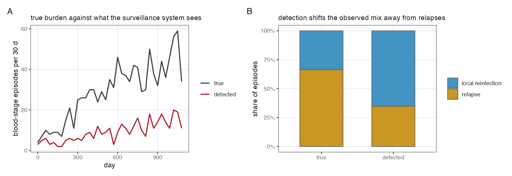

# malariafwd v0.1.0 — model description

A forward, individual-based, genotype-resolved simulator of *Plasmodium vivax* transmission with
an explicit hypnozoite reservoir, implemented in SLiM 5 (Eidos) with tskit tree-sequence recording
and an R interface.

Engine: `inst/slim/malariafwd_vivax.slim`. Everything below was read from that file; where a
default is quoted it is the shipped value.

Recurrence is **three-state** — relapse, reinfection and recrudescence (§9a) — and treatment is
host-level with its own window (§9). Both are off at the shipped defaults, so a default run is an
untreated, two-state-recurrence population.


**A representative run** — 200 hosts, 400 mosquitoes, 3 years, `BITING_RATE` 0.08, 40 founder
hosts carrying 10 lineages, ν = 3. Emergent: prevalence **0.246**, COI **1.14**, **13.3%**
polyclonal, reservoir **0.9** hypnozoites/host, relapse fraction **0.657**, **2.23** relapses per
person-year — all inside the four target bands of §13.


**A** one host's lineage trajectory: coloured bands are blood-stage lineages, the dashed line is
that host's hypnozoite reservoir, and the marks below show new infections (triangles) against
relapses (circles) — and, on a run with treatment failure, recrudescences (diamonds). **B** population host-state composition over time — note the teal
*reservoir-only* band, which is invisible to any blood survey. **C** peak COI against the number
of relapses a host goes on to experience (boxes drawn only where there are enough hosts; every
level labelled with its n). **D** **molFOB vs FOI** — the compound force of blood-stage **clone acquisition** against the
force from bites and imports alone; the distance between the lines is the relapse contribution. (A
recrudescence is a new episode but not a new clone, so it enters neither series; see §9a.) **E** the
realised IBD ladder, as the composition of each relationship class across relatedness bands.

Panel D carries the central vivax quantity: **molFOB 2.02 vs FOI 0.69 new clones per person-year,
so 66% of blood-stage episodes are relapses**, and the gap widens through the run as the reservoir
accumulates. Any method that reads new episodes as new transmission is reading that whole shaded
area as something it is not. (Panel E is deliberately a composition plot rather than a box: most
relationship classes are point masses, while same-oocyst siblings spread out, in two groups around
0.6 and 0.2 of the genome, and this shows both. `plot_relatedness_ladder(style = "points")` gives the continuous view, and
`plot_relapse_km()` the time from an infection to its batch's first relapse.)


Ground-truth IBD read from the ARG, painted along the 14 PvP01 chromosomes. A relapse is clonal to
its originating hypnozoite (IBD 1.00); two products of one oocyst share a **mosaic** with visible
crossover breakpoints, a third of the genome on average for unrelated parents; distinct founders
share nothing.

**Demonstrating the observation layer.** The same configuration rerun with
`P_DETECT_PRIMARY = 0.60` and `P_DETECT_RELAPSE = 0.15` — relapses are often sub-patent, so a
surveillance system sees them less often than primaries.



**A** true blood-stage episodes against detected ones. **B** the composition of each. The effect
is not a uniform thinning but a **reweighting**: the true burden is **65.7% relapse / 34.3%
reinfection**, while the detected line list reads **29.7% relapse / 70.3% reinfection**. Detection
*inverts* the apparent mix, which is why any method that infers transmission from the observed
origin split — Rc from case counts included — inherits a bias it cannot see.

> At this transmission level outcrossing is rare — **168 recombinant against 3,277 clonal uptake
> events (4.9%)** — so mosaics like the second panel are genuinely uncommon and most pairs sit at
> 0 or 1. That is a model output, not a plotting limitation, and it is the same effect that makes
> relapse hard to distinguish genetically in low-transmission settings.

---

## 1. What the model is for

**One SLiM individual = one parasite genome.** Humans and mosquitoes are SLiM subpopulations;
the individuals inside them are parasite lineages, not hosts. The whole genealogy is recorded in a
tree sequence, so **identity-by-descent is ground truth read from the ARG, never inferred from
markers**. Marker genotypes can then be painted on that genealogy, with the truth behind every call
(§16.7).

That combination — genotype resolution *and* a hypnozoite reservoir — is what the model exists
for. It is built to answer questions of the form *"what can genetic data recover about vivax
recurrence, and where does that break down?"*: relapse vs reinfection identifiability, the value of
sequencing effort, reservoir dynamics under control and resurgence.

**It is not** a tool for predicting case counts, fitting incidence time series, or costing
interventions. Compartmental vivax models (White et al. 2014, 2018; Mehra et al. 2024a; Champagne
et al. 2022) do those far better and
faster. See §12.

---

## 2. Scale and the tick cycle

Time advances in **daily ticks**. Each tick runs in this order:

| phase | what happens |
|---|---|
| `reproduction()` | hypnozoite activation (relapses) decided and seeded; biting; human→mosquito uptake and meiosis; mosquito→human inoculation; cloning the second compartment of an import that arrived on the previous tick |
| `early()` | hypnozoite cleanup (retired batches killed); blood-stage clearance; mosquito death and replacement; interventions; importation |
| `late()` | `state.tsv` logging; the tree sequence at the end of the run |

A run ends at `SIM_DAYS`, or earlier if it goes extinct or never starts. It goes extinct on the
first tick on which no parasite is left in any host or mosquito, hypnozoites included, and no
importation is still to come; every further tick would then be empty, so the run ends there. It
writes the tree sequence; its `events.tsv` and `state.tsv` stop on that tick; and its `params.tsv`
ends with the tick as `EXTINCT_TICK` (D37), also when the tick is `SIM_DAYS` itself. `run_sim()`
then gives a message, and the run's `extinct_tick` holds the tick; it is `NA` for a run that did not
go extinct. The functions that summarise a window of a run take its length from `SIM_DAYS`, so the
days after an extinction count as days with no parasite (D61). An importation is still to come until
the run has passed the last day on which one can arrive, the pulse day or the import window's last
day inside the run (§8); a pulse or window that falls outside the run brings nothing. A window
inside the run counts to its last day even while its rate is 0, as under a border closed by
`IMPORT_RATE_BOOST = 0`, so a run that dies out meanwhile goes extinct only once that day has
passed.

A founder-free run (`N_FOUNDER_HOSTS = 0`) starts only from its imports, and they can all fail to
establish a parasite: by chance, through a Poisson rate that draws none or imports that take in
neither compartment, or because the settings let none take, as with `P_PRIMARY = 0` and a
hypnozoite batch mean of 0, or an import rate that is 0 throughout its window. Such a run **never
starts**. It ends on the first tick after its last import day, but not before tick 10, or on its
last day if that comes first, and writes its outputs as an extinct run does. Unlike extinction,
this is decided on the last day whatever the import schedule, so every run that never had a
parasite is marked: its `params.tsv` ends with a `NEVER_STARTED` row, `run_sim()` says so, and the
run's `never_started` is `TRUE` (D43). Such a run holds no parasite: its tree sequence has no
nodes, and its events are at most imports that did not take. Every reader takes it, with empty
tables, zero counts or NA. A founder-free run with no import path inside it at all is refused
before SLiM starts.

Ordering matters for one subtlety: a batch exhausted during `reproduction()` is **retired** by
setting `batch_count = 0`, and killed by the cleanup pass at the top of `early()` in the **same**
tick, so there is no activation lag. A batch emptied by radical cure or MDA, which run later in
`early()`, stays until the next tick's cleanup, and `reproduction()` skips it in between.
(Retirement is recorded on the batch itself rather than in a global list, which sidesteps the
Eidos scoping trap described in §18.)

Population sizes are **fixed**: `N_HOSTS` humans, `N_MOSQ` mosquitoes. A mosquito that dies is
replaced by a susceptible one, so vector density is constant and there is no larval or
density-dependent vector ecology.

### 2.1 Tick pseudocode

```
for each tick t:

  reproduction():
    # --- relapse ---
    for each host h, for each dormant batch b in h:
        if latency_stage(b) > 0:                                        # K_LATENCY > 0
            batch_count(b) <- batch_count(b) - Binomial(batch_count(b), mu)   # latent death
            if batch_count(b) == 0:  retire b
            else if runif(1) < DELTA_LATENCY:  latency_stage(b) <- latency_stage(b) - 1
            continue        # no activation while latent, nor on the day b leaves latency
        n_act ~ Binomial(batch_count(b), alpha_eff)                     # activation
        n_die ~ Binomial(batch_count(b) - n_act, mu / (1 - alpha_eff))  # competing death
        batch_count(b) <- batch_count(b) - n_act - n_die
        if n_act > 0:  seed ONE blood-stage episode, addCloned(b)   # IBD = 1 to origin
        if batch_count(b) == 0:  retire b

    # --- biting ---
    for each mosquito m:
        if runif(1) >= biting_rate_eff(t):  continue
        h <- a uniformly chosen host
        broods <- sampleTransmissibleMosqBroods(m)       # n ~ ZT(LAMBDA_SPOROZOITES), past the EIP
        if m infectious and blood_stage_lineages(h) < MAX_MOI:   # patent, subpatent, or gained today
            if runif(1) < P_TRANS_VH:
                inoculateMosquitoToHuman(broods, h)          # ONE Geom(nu) batch, split over k
        if h infectious and runif(1) < P_TRANS_HV:            # by a clone it held before today
            if active_lineages(m) < MAX_BROODS_PER_MOSQ:
                seedBroodFromHuman(m, h)                     # n ~ ZT(LAMBDA_OOCYSTS) meioses

    # --- second compartment of an import that arrived on the PREVIOUS tick ---
    for each queued import primary still alive:
        clone its hypnozoite batch from it               # IBD 1; see importation below

  early():
    kill every dormant batch with batch_count == 0        # cleanup, same tick
    for each active blood-stage lineage:
        if runif(1) < P_BLOOD_CLEAR:  clear it
    apply MDA / case-based treatment if scheduled
    kill mosquitoes w.p. MU_MOSQ; replace each as susceptible

    # --- importation ---
    n_imp <- (N_IMPORTS if t == IMPORT_TICK)
             + (N_IMPORTS_PER_TICK + Poisson(import_rate_eff(t)) if IMPORT_START <= t < IMPORT_END)
        # import_rate_eff(t): IMPORT_RATE_PER_TICK times the seasonal factor that
        # biting_rate_eff(t) applies to BITING_RATE (not its vector-control factor), and
        # IMPORT_RATE_BOOST from the trigger
    pick min(n_imp, N_HOSTS) distinct hosts uniformly at random      # at most one import per host
    a host already carrying MAX_MOI blood-stage lineages takes none  # vh_inoculation_import_no_take
    for each other host: roll primary and batch as a bite does, and if either takes, mint an
        unrelated founder genotype and move it in (vh_inoculation_import_no_take if neither)
    queue the hypnozoite batch of each import that took both, to be cloned next tick

  late():
    write state.tsv                                       # and the tree sequence at the end
```

Importation is seeded in `early()`, not `reproduction()`: SLiM calls `reproduction()` once per
*existing* individual, so an empty parasite population would never run it and the import could
never land. A genome can only be minted outside `reproduction()` via `addSubpop()`, so an import
is created in a disposable subpopulation and moved into its host with `takeMigrants()`. Its
hypnozoite batch must be a *clone* of that genome to be IBD 1 to it, and SLiM refuses to clone a
genome minted on the same tick, which is why the second compartment waits one tick.

---

## 3. Human hosts

Hosts carry a set of parasite lineages and are summarised by four states (Panel A):

| state | meaning |
|---|---|
| S₀ | uninfected, no reservoir |
| I₀ | blood-stage infection, no reservoir |
| S_L | hypnozoites only — **invisible to blood surveys** |
| I_L | blood stage **and** hypnozoites |

**No intrinsic incubation.** Blood stage begins at inoculation, so hosts are *not* SEI. Liver-stage
development time (~9 days in reality) is not represented.

**No immunity, by design.** There is no acquired blood-stage, anti-parasite, pre-erythrocytic or
transmission-blocking immunity, and no age structure. This is a deliberate scope decision: immunity
would confound the genetic signals the model exists to measure, and vivax immunity parameters are
poorly identified. It is the single largest simplification in the model (§11, §14).

**Blood-stage duration** is geometric: each active lineage clears independently each day with
probability

```
P_BLOOD_CLEAR = 1 / MEAN_BLOOD_STAGE_DURATION     # = 0.01667 at 60 days: mean duration 60 days
```

This is White et al. (2014)'s clearance rate r = 1/60 per day, used as a daily probability.

There is no age ceiling: every infection ends by this daily draw. Clearance is
**per-lineage**, so a polyclonal host loses lineages independently and MOI decays rather than
collapsing at once.

**Superinfection** is allowed and gated by `MAX_MOI` = 20, which is at least 1 (1 means no
superinfection). The gate is the same for every new inoculation, a local bite or an import: a host
already carrying `MAX_MOI` blood-stage lineages, patent or subpatent, has the **whole** inoculation
skipped — primary *and* hypnozoite batch, so the reservoir also stops being topped up — whether or
not those lineages are infectious (at `SUBPATENT_INFECTIVITY = 0` subpatent clones are not). The
check comes before the bite's `P_TRANS_VH` draw, and counts the clones the host gained earlier the
same day, by a relapse or a bite. **Relapses bypass the gate entirely**, so realised MOI can exceed
it; so can a bite that delivers several genotypes, which the gate admits whole, and a founder host's
copy of another founder's genome, which arrives on day 2 after that day's bites (§8). At 20 it is a
runaway guard that essentially never binds (COI is typically 1–3); set it low and you are measuring
the cap, not the biology.

---

## 4. Mosquitoes

Standard S_v → E_v → I_v, with:

- **Biting:** `BITING_RATE` = 0.1 is the per-*mosquito* daily biting probability. The
  Ross–Macdonald per-human rate is `ma = BITING_RATE × N_MOSQ / N_HOSTS`, **not** this value
  directly — a frequent source of confusion when comparing to the literature.
- **Transmission probabilities:** `P_TRANS_VH` = 0.5 (`b`, bite infects human),
  `P_TRANS_HV` = 0.5 (`c`, mosquito infected by biting an infected human).
- **Lifespan:** geometric, mean `MOSQ_LIFESPAN` = 10 days (daily death probability 1/10).
- **EIP:** **fixed** at `EIP_DAYS` = 10 days — not temperature-dependent, not distributed.
- **Carrying capacity:** `MAX_BROODS_PER_MOSQ` = 20 lineages; uptake is skipped above it. No
  fitness cost of burden (mortality and transmissibility do not decline with parasite load).

Mosquito death removes all of its broods, so a mosquito is a hard transmission bottleneck. Every
mosquito starts uninfected: the founders are hosts (§3).

### 4.1 Mapping to Ross–Macdonald quantities

```
m  = N_MOSQ / N_HOSTS                      # vector-to-host ratio
a  = BITING_RATE                           # per-mosquito daily biting probability
ma = BITING_RATE * N_MOSQ / N_HOSTS        # bites per human per day
s  = fraction of mosquitoes with >= 1 transmissible (post-EIP) brood
EIR = ma * s * 365                         # infectious bites per person-year
MU_MOSQ = 1 / MOSQ_LIFESPAN                # daily mosquito mortality
```

`EIR` is **emergent**, not a parameter, and `state.tsv` counts it: `infectious_bites` on a host's
row is the number of bites the host received that day from a mosquito carrying a product past the
EIP, whatever the bite then did (§16.2), so the EIR is their sum over hosts and days divided by
person-years, `N_HOSTS` times the days over 365; `summarise_run()` reports it over its window as
`eir_per_py`. The formula above, with `s` read from `state.tsv` as the
share of mosquitoes with `n_transmissible > 0`, gives about 1 − 1/`MOSQ_LIFESPAN` of it (about 0.9
at the default 10 days), because the snapshot is taken after the day's mosquito deaths; it also
assumes a constant biting rate, so with seasonality, vector control or a boost its error can go
either way. Use the count.

**Seasonality** modulates the biting probability:

```
biting_rate_eff(t) = BITING_RATE * (1 + SEASONAL_AMP * cos(2*pi*(t - SEASONAL_PHASE)/365))
```

clamped at ≥ 0, with `SEASONAL_PHASE` the day-of-year of the **peak** (the curve is a `cos`; a
`sin` would put the peak ~91 d later, D10). `SEASONAL_AMP` is non-negative and 0 means no
seasonality; ≈ 0.85 gives strong annual peaks swinging biting between roughly 0.15× and 1.85× the
mean.

> **Scale warning.** `ma` depends on the ratio `N_MOSQ / N_HOSTS`, so scaling hosts and mosquitoes
> together leaves it unchanged, while changing one without the other changes transmission. Even at
> a fixed ratio, prevalence and COI depend on scale, through the numbers of founders and imports
> and through chance fade-out, which is stronger in a small population: a biting rate calibrated
> at 150 hosts need not transfer to 400 hosts. Calibrate at the scale you intend to publish.

---

## 5. The hypnozoite reservoir

Follows the **White et al. 2014** batch model.

- Each transmitted genotype may cause an **active primary infection** with probability
  `P_PRIMARY` = 1.0 (White's base model treats this as certain given successful inoculation), and
  **independently** establishes a batch of hypnozoites.
- **Batch size** is geometric with mean `NU_HYPNOZOITE_BATCH` (ν), 3 by default (§13).
  **The batch is drawn once per *bite*** and split uniformly across the co-inoculated
  genotypes, matching White's per-bite parameterisation (§12). Both, either, or neither of primary
  and batch can occur for a given genotype.
- **Founder hosts** are seeded with a blood-stage clone and no batch: a founder carries hypnozoites
  only once a bite or an import gives it a batch.
- **Activation:** each hypnozoite activates at `ALPHA_ACTIVATE` = 1/170 per day, an average carriage
  of about 170 days (Mehra et al. 2024b, as Mehra & Taylor 2026 use it; White et al. 2014 estimate
  1/332). An activation produces **one blood-stage episode** representing however many
  clonal hypnozoites activated that tick.
- **Death:** `MU_HYPNOZOITE` = 1/442 per day (as in Mehra et al. 2024a, who credit White et al. 2014,
  whose table gives 1/425), competing with activation.
- **Latency:** `K_LATENCY` = 0 (tropical) or 2 (temperate), with `DELTA_LATENCY` = 1/100 governing
  progression when enabled; latent hypnozoites die at `MU_HYPNOZOITE` too, as in White et al. 2014.
- **No age ceiling:** a batch empties only by activation and death, as in White et al. (2014), so
  the long late-relapse tail survives; `MU_HYPNOZOITE` must be above 0 so every batch ends.

**A relapse is a clone of its originating hypnozoite** (`addCloned`), so relapse-to-origin IBD is
exactly 1. Relative to a host's *prior observed* infection it can be clonal, sibling, half-sibling
or unrelated — which is the whole point of the identifiability work.

**A relapse can start while a patent clone of its own lineage is still in the host**, most often the
primary from the same bite or an earlier relapse of the same batch: at the defaults about 80% of
relapses do. Such a relapse is logged and counted like any other, as a new episode and a new
acquisition, and the lineage stays patent in the host until all its clones have cleared. It is drawn
for detection like any other relapse, so the observation layer can report it, put it on the observed
line list and schedule a course for it; at the default `P_DETECT_RELAPSE = 1` every one is reported.
A real observer would see only the infection already there, not a recurrence or a new clone. Its
`hypnozoite_activation` row has `into_patent_lineage = 1` (§16.1), and `exclude_masked = TRUE` on
`classify_cases()`, `relapse_fraction()` and `force_of_infection()` leaves it out. The flag looks
only at clones born on earlier days: a relapse that starts on the same day as another clone of its
lineage in the host (another batch waking, a recrudescence or a bite) is not flagged for that clone,
so two batches of one lineage that wake together, with no earlier clone of it in the host, are both
0.

> **Structural consequence worth stating explicitly.** Because the batch is divided among the
> genotypes that establish primaries, and `P_PRIMARY` = 1, **reservoir genotypes are a subset of
> blood-stage genotypes**; at the default (one genotype per bite) both are the same single
> genotype. Heterologous relapse can therefore only arise across separate bites. This is a known
> limitation; see assumption 5 in §11 and the first entry in §15.

### 5.1 Formal specification

**Batch size.** `N ~ Geometric(ν)` on the non-negative integers:

```
P(N = n) = 1/(1 + nu) * (nu / (1 + nu))^n ,    n = 0, 1, 2, ...      E[N] = nu
```

So a non-trivial fraction of bites deposit **no** hypnozoites at all: `P(N = 0) = 1/(1 + ν)` —
**25.0% at ν = 3**, 16.7% at ν = 5, 11.1% at ν = 8.

**Activation and death are competing risks** applied daily, per hypnozoite, with activation drawn
first and death drawn from the survivors, so that each day a hypnozoite activates with
probability alpha and dies with probability mu:

```
n_act ~ Binomial(batch_count, alpha)
n_die ~ Binomial(batch_count - n_act, mu / (1 - alpha))
```

A hypnozoite's fate is therefore settled after a geometric time, with

```
P(activate rather than die) = alpha / (alpha + mu)
E[time to either event]     = 1 / (alpha + mu)
```

At the shipped `ALPHA_ACTIVATE` = 1/170 and `MU_HYPNOZOITE` = 1/442:

| quantity | value |
|---|---|
| α + μ | 0.008145 /day |
| P(activate rather than die) | **0.722** |
| mean time to activation-or-death | **122.8 days** |
| expected relapsing hypnozoites per bite at ν = 3 | **2.17** |
| …at ν = 5 | 3.61 |
| …at ν = 8 | 5.78 |

**Note the episode/hypnozoite distinction.** Multiple hypnozoites in the *same* batch activating
on the same tick collapse into **one** blood-stage episode (they are clonal, so they are
genetically one thing). The expected number of relapse *episodes* is therefore lower than the 2.17
relapsing hypnozoites per bite at the default ν = 3, and depends on batch size — a larger batch
yields more simultaneous activations and so proportionally fewer episodes per hypnozoite. This is
why relapse *rate* is not linear in ν.

**Temperate latency.** With `K_LATENCY = k > 0`, a new batch must pass `k` latency stages before
its hypnozoites can activate, producing the long-latency phenotype (D35). Each day every latent
hypnozoite dies with probability μ, as in White et al. (2014), and then the batch moves on to the
next stage with probability δ = `DELTA_LATENCY`. The batch moves through latency as one unit, as
White et al. also track latency per infection. A hypnozoite therefore survives each stage with
probability δ(1 − μ) / (1 − (1 − δ)(1 − μ)), close to δ / (δ + μ), and

```
P(relapse) = [δ(1 − μ) / (1 − (1 − δ)(1 − μ))]^k × α / (α + μ)
```

which is **0.480** at `K_LATENCY = 2`, `DELTA_LATENCY = 1/100` and the shipped α, μ, against 0.722
without latency. Without deaths a batch would stay latent k / δ days on average (200 at k = 2).
Because latent hypnozoites die, survival favours the batches that move through latency quickly: a
hypnozoite that leaves latency alive, as every relapse must, has been
latent k / (1 − (1 − δ)(1 − μ)) days on average, **163** at k = 2, δ = 1/100 and the shipped μ. Its
relapse follows 1 / (α + μ) days later on average, so about 286 days after the bite at k = 2. A
batch does not activate on the day it leaves latency. `K_LATENCY = 0` (tropical) makes activation
immediately eligible.

**Resurgence boosts.** From `RESURGENCE_TRIGGER_TICK`, `alpha_eff = ALPHA_ACTIVATE ×
ALPHA_ACTIVATE_BOOST` (clamped so `alpha_eff <= 1 - mu`) and `nu_eff = ν × NU_HYPNOZOITE_BATCH_BOOST`.

---

## 6. The mosquito stage: uptake, meiosis, sporozoites

This is where the genetics are generated.

**Uptake.** A successful blood meal forms `n ~ zero-truncated Poisson(LAMBDA_OOCYSTS)` oocysts
(negative binomial if `K_OOCYSTS > 0`, var = λ + λ²/K). Each oocyst is an independent meiosis with
its own `oocyst_id`; all oocysts from one meal share a `brood_id`.

> **λ is the PRE-truncation rate, not the mean count.** Conditioning away the zeros pulls the
> realised mean up: λ = 1 → 1.58, λ = 2 → 2.31; with K = 1, λ = 2 → 3.0. Use `uptake_moments()` /
> `uptake_calibrate()` to convert between a literature target and λ. Zero-*truncation* (not
> inflation) is correct because `P_TRANS_HV` already decides whether the event succeeds — allowing
> zeros would count failure twice.

**Gamete draw.** Each oocyst draws **two gametes independently and uniformly** from the host's
gametocyte pool. Selfing vs outcrossing **emerges** from whether the two happen to share a lineage;
it is not rolled as a coin flip. This reproduces P(outcross) = 1 − Σpᵢ² as a marginal *and* gives
the correct pairing P(i,j) ∝ pᵢpⱼ (Wong et al. 2018); rolling outcrossing first and then picking two
distinct lineages would give the marginal but not the pairing.

> `computeOutcrossingProb()` (Simpson's index of the pool) is **logged only**, as the `p_outcross`
> column, and drives nothing.

**Meiosis.** An outcrossed oocyst yields a full **tetrad** by per-chromosome four-strand meiosis
(D34, D41): the zygote's two genomes replicate into four chromatids per chromosome, and each chiasma
joins a chromatid carrying one parent's sequence with one carrying the other's, both chosen at
random. Meiosis I sends the two chromatids that carry the same parent at a chromosome's centromere
to the same pole, drawn independently for each chromosome, and meiosis II gives one to each product
of that pole; so the four products form two pairs of meiosis II sisters, the same pairs on every
chromosome. Every product carries the full map of crossovers. On the full 14-chromosome map none
is a copy of a parent; with a `CHROMOSOMES` subset or a small `RECOMB_RATE`, a product with no
switch is a copy of its parent and keeps that parent's lineage. A selfed oocyst
yields four identical products, stored as **one** object with `spz_weight = 4` — a storage
optimisation that keeps object count from scaling with clonal output, corrected for at sampling.

**Gametocyte gating.** A blood-stage infection is transmissible only from
`gametocyte_ready_tick = start + GAMETOCYTE_DELAY` and only if it carries gametocytes (per-infection
Bernoulli, `P_GAMETOCYTE`). Defaults are the identity (0 and 1.0). Vivax gametocytes appear early —
at or near symptom onset, unlike ~10–12 d in falciparum — so a realistic preset is a short delay
plus high carriage (≈3 and ≈0.9).

**Inoculation.** A bite draws `n ~ ZT(LAMBDA_SPOROZOITES)` products from everything past the EIP,
**weighted by `spz_weight`**, then collapses repeat draws to one object per distinct lineage.

> **`LAMBDA_SPOROZOITES` defaults to 0, which `drawZTCount` maps to exactly 1.** So at the shipped
> default **every bite delivers exactly one genotype, regardless of what the mosquito carries** —
> co-transmission is structurally impossible. Measured: mosquitoes carry a mean of 4.5 distinct
> lineages while 1.00 is inoculated. Raising `LAMBDA_SPOROZOITES` enables co-transmission; it is
> off by default for backward compatibility, and changing that default is the first planned
> extension (§15).

### 6.1 The zero-truncated count distributions

Both `LAMBDA_*` parameters feed `drawZTCount(lambda, k)`:

```
lambda <= 0           -> returns exactly 1          (the shipped default)
k <= 0                -> X ~ ZT-Poisson(lambda)
k >  0                -> X ~ ZT-NegBinomial, i.e. Poisson(Gamma(lambda, k)) rejected until > 0
```

ZT-Poisson pmf and realised mean:

```
P(X = x | X > 0) = lambda^x * exp(-lambda) / (x! * (1 - exp(-lambda))) ,   x = 1, 2, ...
E[X | X > 0]     = lambda / (1 - exp(-lambda))
```

| λ | realised mean |
|---|---|
| 1 | 1.582 |
| 2 | 2.313 |
| 3 | 3.157 |
| 4 | 4.075 |
| 5 | 5.034 |

The negative-binomial case has `var = λ + λ²/K`, so Poisson is the `K → ∞` limit and the NB option
is a strict superset. Use `uptake_moments(lambda, k)` to see what a setting produces and
`uptake_calibrate(mean, var)` to invert a literature target.

> **Zero-truncation, not zero-inflation.** `P_TRANS_HV` / `P_TRANS_VH` already decide whether the
> event happens at all, so the zeros in a membrane-feeding dataset are already represented;
> inflating here would double-count them. Between-donor gametocytaemia variation is likewise
> already emergent. `K_OOCYSTS` therefore captures only **residual within-feed overdispersion**.

### 6.2 Tetrad genetics and the expected IBD ladder

Every oocyst produces four meiotic products. For an **outcrossed** oocyst each is a mosaic of the
two parents. Chiasmata fall at Poisson points, twice the per-product map length per bivalent, and
each joins a random chromatid of each parent at that locus; every crossover is reciprocal, the two
chromatids exchanging everything beyond it. Meiosis I then keeps together the two chromatids that
carry the same parent at the chromosome's centromere, and meiosis II separates them. The
centromeres are those of the PvP01 annotation (`PVP01_CEN01`–`PVP01_CEN14`, Sanger/GeneDB, released
with Auburn et al. 2016). So at every locus two of the four products carry each parent's allele
(2:2 segregation), each chromosome assorts independently, every product carries the documented
17.9 M of within-chromosome crossovers, and the products form two pairs of meiosis II sisters.

Expected IBD, used throughout as a validation ladder:

| pair | expected IBD | note |
|---|---|---|
| a lineage with itself / a clone | **1.000** | verified exact |
| relapse vs its originating hypnozoite | **1.000** | `addCloned`; verified |
| any two products of one oocyst | **1/3** on average | for unrelated parents; 1/3 + 2f/3 when the parents share a fraction f |
| meiosis II sisters (2 of the 6 pairs) | **~0.60** | the same parent at every centromere |
| the other pairs of one oocyst (4 of 6) | **~0.20** | opposite parents at every centromere |
| full siblings (same two parents, different oocysts) | 1/2 | |
| half siblings (one parent shared) | 1/4 | |
| unrelated founders | 0 | independent roots |

With all 14 chromosomes and unrelated parents the same-oocyst distribution is **bimodal**: sisters
around 0.60 and the other pairs around 0.20 (overall sd about 0.20, 5–95% about 0.12–0.67). Meiosis I
pairs the products alike on every chromosome, so a pair's sharing is correlated across chromosomes;
a random deal of chromatids per chromosome, as in Wong et al. (2018), would make every pair look
alike, around 1/3 (sd about 0.08). On the full map no pair shares nothing; on a single chromosome
the distribution is far wider.

Sequenced meioses show this pairing. Nkhoma et al. (2020) sequenced P. falciparum infections cell
by cell and captured a complete tetrad, the four products of one meiosis (their Figure 6). Read
against the 3D7 centromere annotation, its products form two pairs that carry the same parent at
all 13 centromeres that can be read, and its sisters share 0.67 of the genome and the other pairs
0.17. In the paper's other sibling groups (its Data S3), six more pairs of cells carry the same
parent at every centromere that can be read. These readings are ours, from the published figures.

### 6.3 Recombination

```
within-chromosome crossover rate:  7.4e-7 per bp   (13.5 kb/cM; euchromatic core rate)
at each of the 13 chromosome junctions:  r = 0.5   (independent assortment)
```

The 14 chromosomes are concatenated into **one linkage group**, with `r = 0.5` in SLiM's map at
each junction. `seedTetrad()` discards the junction draws and assorts the chromosomes itself, by
meiosis I at each centromere, which gives every product exactly `r = 0.5` across each junction.
This is genetically equivalent to explicit multi-chromosome simulation for every IBD quantity the
package reports, and keeps a single `.trees` file — explicit SLiM multi-chromosome writes a
*directory* of per-chromosome tree sequences, which would require rewriting the entire IBD pipeline.
In the tree sequence a shared stretch can continue across a junction, when both genomes carry the
same parent on both sides of it; the IBD functions cut every segment at the junctions (D74), and
code that reads tskit's segments directly must do the same, with `chrom_map()`.

---

## 7. Genome and genetics

- **PvP01 reference** (Auburn et al. 2016; GCA_900093555), 14 nuclear chromosomes.
- Implemented as **one concatenated linkage group** with **7.4 × 10⁻⁷ /bp within chromosomes**
  (13.5 kb/cM, euchromatic core rate, Jiang et al. 2011); the chromosomes assort independently at meiosis
  (§6.3). Genetically equivalent to explicit multi-chromosome for every IBD quantity the package
  reports, and keeps a single `.trees` file.
- `GENOME_MODE` is a pure **coordinate** switch: `"full"` (24.2 Mb, default) or `"core"`
  (subtelomere-masked, ~21.8 Mb). Both use the same recombination rate.
- **`initializeMutationRate(0.0)` — the genome carries no mutation at all.** It is a neutral
  scaffold; all genetics come from the recorded genealogy. At every position each genome descends
  from exactly one *root genome*, a founder template or an import, and `simulate_genotypes()`
  paints alleles on the root genomes from a panel's PLAF, so each genome carries its root genome's
  allele (§16.7). This is a strength for IBD (ground truth, no ascertainment) and a limitation for
  anything needing sequence divergence or selection.

> **The genealogy is a FOREST, not a tree.** Founder lineages have independent roots and ~93% of
> pairs never coalesce. Consequently **tskit branch-mode divergence is not a relatedness measure
> here** — use the IBD functions, not `diversity()`/`divergence()`.

**Gotcha for anyone writing new tskit code:** SLiM haploid individuals get **two** tskit nodes — the
real haplosome (`is_vacant = [0]`) and a null placeholder (`is_vacant = [1]`, isolated, IBD 0 with
everything). About half of `ts.samples()` are vacant and **must be filtered**. The package's IBD
and ARG functions do this. Second, tskit's `ibd_segments()` rows are pieces of the paths through
the trees, so how a pair's shared ancestry is split into rows depends on the samples the tree was
simplified to; merge abutting rows with the same ancestor, then cut at the junctions (§6.3), as
`ibd_pairs()` and `ibd_segments()` do.

---

## 8. Importation

Three mechanisms, additive:

| parameter | behaviour | modifiers |
|---|---|---|
| `IMPORT_RATE_PER_TICK` | genuine Poisson arrival rate between `IMPORT_START`/`IMPORT_END` — the realistic "leaky border" | the seasonal factor of biting (§9), floored at 0, and `IMPORT_RATE_BOOST` from `RESURGENCE_TRIGGER_TICK` |
| `N_IMPORTS_PER_TICK` | deterministic floor, between `IMPORT_START`/`IMPORT_END` | none |
| `IMPORT_TICK` / `N_IMPORTS` | single pulse event | none |

The rate follows the season because travel, or transmission where the travellers were infected,
can follow the same season. Local vector control (`INTERVENTION_*`) does not scale imports, which
are infections acquired elsewhere; a border measure is `IMPORT_RATE_BOOST` or the import window
itself (D46). The fixed count and the pulse are values the user sets directly, so nothing scales
them.

Imports use the **same bite outcomes** as local transmission (primary and/or batch) and are
labelled `is_imported`, which is **carried through to relapses** so an imported relapse is a
distinct truth category. They go to hosts chosen uniformly at random, as bites do, so an import
can land in a host that already carries a clone (D38). A host already carrying `MAX_MOI`
blood-stage lineages, patent or subpatent, takes none, as for a local bite (§3), and the refusal is
logged as `vh_inoculation_import_no_take`. Each host takes at most one import a day, so a day's
imports beyond `N_HOSTS` are dropped. `vivax_params()` warns when a day's fixed imports inside the
run exceed `N_HOSTS` (`N_IMPORTS` on `IMPORT_TICK`, `N_IMPORTS_PER_TICK` in the window, or both on
the same day), and when `IMPORT_RATE_PER_TICK` at its peak over the window, with its seasonal
and resurgence multipliers and with `N_IMPORTS_PER_TICK`, draws more than `N_HOSTS` imports on a
day with probability above 0.01. Imports arrive in `early()`, which first runs on
day 1: a pulse can fall on any day from 1 to `SIM_DAYS`, and a window brings imports on its days
from `max(1, IMPORT_START)` to `min(IMPORT_END − 1, SIM_DAYS)`; a pulse or window outside the run
brings nothing. A day-1 pulse lands alongside the founders, with one difference from other days:
a founder host that carries a copy of another founder's genome
(`N_FOUNDER_LINEAGES < N_FOUNDER_HOSTS`) receives its copy on day 2, so on day 1 it is still
empty, takes an import even at `MAX_MOI = 1`, and from day 2 carries both (D39). A naive population
seeded only by imports is `N_FOUNDER_HOSTS = 0` with an import path on a day of the run.

**v0.1.0 limitation:** imported genotypes are drawn as unrelated founders — there is no structured
source population, so imports are maximally distinguishable from local parasites (measured founder
overlap 0.03). A structured source pool is planned (§15).

---

## 9. Interventions and the observation layer

**Interventions** (all off by default):

- **Vector control / seasonality** scale biting. Seasonality is
  `BITING_RATE × (1 + SEASONAL_AMP·cos(2π(t − SEASONAL_PHASE)/365))`, with `SEASONAL_PHASE` the
  day-of-year of the **peak**.
- **Case management** has its own window, `TREATMENT_START` / `TREATMENT_END` (default: the whole
  run). `INTERVENTION_*` is vector control only: it scales biting, not importation (§8, D46), and
  does not touch treatment (D19). The window gates the **decision**, not delivery: a case detected
  on the programme's last day still completes its course afterwards.
- **Case-based blood-stage treatment** (`BLOODCURE_COVERAGE`) is decided where a case arises and
  applied to the **host** later: each day after the case the course arrives with probability
  1/`TREATMENT_DELAY`, so the delay is at least one day with mean `TREATMENT_DELAY` (7 by
  default). It clears **every patent blood-stage clone the patient carries**, not one lineage
  (D20). One course at a time per host; a treated case stays infectious until the drugs land. A
  course can never land on the tick the case arises — the minimum, `TREATMENT_DELAY = 1`, means
  the next day — because a clone that became patent this tick cannot yet have caused symptoms
  (D24, D32).
- **Case-based radical cure** is **nested inside** a blood-stage course: `RADCURE_COVERAGE` is
  P(radical cure | treated), so it is inert unless `BLOODCURE_COVERAGE > 0` — primaquine is never
  given without a schizonticide (D20). Liver-stage only; it deliberately does not clear the
  current blood-stage infection. Efficacy is per **person** by default (`RADCURE_MODE = "person"`,
  one all-or-nothing draw at `P_RAD_SURVIVAL = 0.29`, ~71% cure, White et al. 2018; malariasimulation).
  `RADCURE_MODE = "hypnozoite"` restores per-hypnozoite thinning — the only mode that can
  **partially** clear a reservoir, and so the only one that reshapes post-treatment relapse
  diversity.
- **Treatment failure has consequences** (D25). A clone that survives a course either persists at
  full density (`bloodcure_persist`) or, with probability `P_RECRUD_GIVEN_FAIL`, is suppressed
  **below patency** (`bloodcure_subpatent`) and later re-expands as a **recrudescence**, unless an
  MDA round clears it first. See §9a.
- **No post-treatment prophylaxis** (ongoing work). A course clears what is there and then
  stops: it leaves behind no period of drug protection, so a treated host can be reinfected, or
  relapse, the very next day. Real schizonticides protect for weeks — chloroquine for roughly a
  month — and radical cure additionally blocks new hypnozoite batches for a time. The
  consequence is that **recurrence is overstated** in any scenario with appreciable treatment
  coverage, and short recurrence intervals most of all. OpenMalaria makes the same
  simplification, so it is defensible, but it is a simplification. The design is settled
  (malariasimulation Weibull protection curves, with a blocked relapse still consuming its
  hypnozoites, bites still seeding batches, and imports and recrudescences bypassing
  protection) and implementation is planned for the next release.
- **MDA** (`MDA_TICK`) is one round of the case-management course — blood-stage drugs plus radical
  cure — given through the same `applyTreatment()`, so it honours `RADCURE_MODE` and can suppress
  clones subpatent. The round reaches each host with probability `MDA_COVERAGE` (D28). The draw is
  made only for hosts not empty at the round, but does not depend on infection, so the coverage is
  that of the whole population; `mda_bloodcure_given` and `mda_radcure_given` count the courses to
  those hosts. Because MDA waits for no symptoms, it reaches two kinds of clone a case course does
  not: a clone that became patent earlier that day (the day's imports arrive after the round,
  §2.1), and a **subpatent** clone, which it clears with probability 1 − `P_BLOODCURE_SURVIVAL`,
  cancelling its recrudescence (`mda_subpatent_clear`); a subpatent clone that survives keeps its
  schedule (D44). When a founder host carries a copy of another founder's genome
  (`N_FOUNDER_LINEAGES < N_FOUNDER_HOSTS`), the round comes on day 2 or later, since the copy is
  seeded on day 2 (D39). Unlike case-based treatment it is **not** gated on `TREATMENT_START` /
  `TREATMENT_END`.
- **Resurgence triggers** from `RESURGENCE_TRIGGER_TICK`: multiplicative boosts on biting
  (`BITING_RATE_BOOST`), activation (`ALPHA_ACTIVATE_BOOST`), batch size
  (`NU_HYPNOZOITE_BATCH_BOOST`) and imports (`IMPORT_RATE_BOOST`) — so one scenario can run a quiet
  baseline and then switch on a single mechanism.

**Observation layer.** A true episode becomes a *detected* (reported, genotyped) case with
probability `P_DETECT_PRIMARY` / `P_DETECT_RELAPSE` / `P_DETECT_RECRUD`, drawn **once per bite**
(for all the genotypes it delivers), **per import, per activation or per recrudescence** — not per
co-inoculated genotype, so one bite cannot be "detected and treated" for one of its genotypes and
not the other (D20). Relapses are often sub-patent, so a realistic
setting is much lower for them (e.g. 0.15); Ross et al. (2025) put recurrence detectability at
0.13–0.49 of a primary, so `P_DETECT_RECRUD` should usually sit well below `P_DETECT_PRIMARY`.
Detected cases form the observed line list and can trigger case-based treatment. A bite that seeds
only hypnozoites (possible when `P_PRIMARY < 1`) makes no blood stage, so it is no case and gets no
course (D36), as for an import.

> **Known gap:** detection is not origin-dependent beyond the primary/relapse split, so
> *active vs passive* surveillance modes cannot currently be distinguished. This made one arm of
> the survey-design work come out null.

---

## 9a. Three-state recurrence: relapse, reinfection, recrudescence

A recurrence in *P. vivax* has three possible causes, and the model represents all three — the
Pv3Rs / Taylor taxonomy. The third is the one a transmission model usually omits.

| state | mechanism | genome |
|---|---|---|
| **reinfection** | a new mosquito bite, or an importation | a new genome, unrelated or related only through the local population |
| **relapse** | a hypnozoite activates from the liver | a **new** genome, clonal to the inoculation that seeded the batch |
| **recrudescence** | a clone that survived a treatment course re-expands to patency | a **new** genome, clonal to the holder it came from |

A relapse that starts while a patent clone of its own lineage is still in the host is a relapse
too, and the observation layer can report it, but a real observer could not see it as a recurrence
(§5).

**The mechanism.** When a blood-stage course fails on a clone (w.p. `P_BLOODCURE_SURVIVAL`), that
clone either carries on at full density, or — w.p. `P_RECRUD_GIVEN_FAIL` — is **suppressed below
patency**. A suppressed clone is still present but is not an episode: it does not count toward
`moi_active`, it cannot be detected, and a later case course does not reach it; an MDA round does
(§9). After a delay it re-expands, logged as `recrudescence`.

Natural clearance while subpatent is **off** by design, so every suppressed clone eventually
recrudesces unless an MDA round clears it first. `P_RECRUD_GIVEN_FAIL` is P(suppressed | the course
failed), and without MDA it is exactly P(recrudescence | the course failed) — which maps directly
onto a WHO therapeutic-efficacy failure rate.

**The delay** is geometric with mean `MEAN_RECRUD_DELAY` = 10.5 d and at least one day (each day
after the suppression the clone re-expands with probability 1/10.5), selectable via
`RECRUD_DELAY_DIST` (`"geometric"`, `"poisson"`, `"fixed"`). Geometric is the discrete analogue of
the Exponential that Taylor et al. (2019) fit — their own simulator draws `round(rexp(1, 1/10))`.
The mean of 10.5 d is a **literature assumption, pending parameterisation**: it is the reciprocal
of Taylor et al.'s posterior median (0.095 a day), but they fix the rate with a strongly informative
Gamma(100, 1000) prior (mean 0.1 a day) for identifiability, and the posterior barely moves from it,
so it is not an estimate from data. Vary it in sensitivity analyses (§14). At 10.5 d the median gap
is 7 d, and ~94% fall within day 28. See D26, D32 and D42; none of White et al. (2014), the
individual-based model of White et al. (2018), OpenMalaria or malariasimulation represents
recrudescence at all, so they cannot arbitrate this.

**A recrudescence mints a new genome** (`addCloned` from the holder, which is then retired), as a
relapse does. That keeps one episode to one `pedigree_id`, gives the recurrence its own ARG node
dated at the recurrence rather than at the original inoculation, and makes "IBD = 1 to the prior
episode" a real measurement rather than a self-pair. Because the mint inherits `lineage_id`,
retire-plus-mint is exactly MOI-neutral. See D25.

**A case, but not an acquisition.** This distinction propagates through the metrics, and it is the
easiest thing to get wrong:

- It **is** a new clinical episode, so `classify_cases()` gives it a fourth `origin` and it appears
  in case counts, incidence and host timelines.
- It is **not** a newly acquired parasite — the genotype was already in the host — so it is
  excluded from the force-of-infection rates. `force_of_infection()` returns it as its own row
  with `is_acquisition = FALSE`; sum only the acquisition rows for FOI or molFOB.
- `relapse_fraction()` therefore reports **two** readings, both counted per clone onset:
  `relapse_frac_acquisitions`, relapses over acquisitions (the unit of the published 0.55–0.85
  band), and `relapse_frac_episodes`, relapses over every case, recrudescence included.
- `rc_by_origin(unit =)` likewise: `"episode"` credits onward transmission to the recurrence,
  `"acquisition"` walks it back to the infection that brought the clone in. Onward transmission
  includes the relapses an infector's bites cause in other hosts (`transmission_links()`).

Worth noting that a *real* molFOB, measured by comparing genotypes between study visits, would
often count a recrudescence as a new clone — the clone was undetectable at the previous visit. The
gap between the two sums estimates that bias.

**Subpatent clones and transmission.** Patency and infectiousness are separate properties. A
suppressed clone is undetectable but still transmissible at `SUBPATENT_INFECTIVITY` (0.15 by
default; 0.035–0.10 in the individual-based model of White et al. 2018, 0.10–0.20 measured by
Koepfli et al. 2021, where
microscopy-positives are 5–10× more infective than submicroscopic). Internally this required
splitting one lineage counter into three — patent (`moi_active`, episodes), transmissible (the
host's infectious state and the bite loop), and present-at-all (the `MAX_MOI` capacity check).
With them fused, `SUBPATENT_INFECTIVITY` cannot do anything; see D25 item 7.

**Inert at the shipped default.** `P_RECRUD_GIVEN_FAIL = 0`, and `BLOODCURE_COVERAGE = 0` besides,
so a default run has no treatment and therefore no recrudescence. That matches the evidence:
Taylor et al. (2019, n = 1441 recurrences) put recrudescence at 0.2–0.3% of recurrences after
chloroquine or artesunate. The state is only material in a chloroquine-resistant setting.

---

## 10. Parameters

Time is in days (one tick is one day). A duration parameter D is the mean of a geometric
duration: the event happens each day with probability 1/D. The treatment delay
(`TREATMENT_DELAY`) and, under the default `RECRUD_DELAY_DIST = "geometric"`, the recrudescence
delay (`MEAN_RECRUD_DELAY`) follow the same rule from the day after the case or the suppression,
so they are at least one day; `EIP_DAYS` and `GAMETOCYTE_DELAY` are fixed delays. Rates
(`BITING_RATE`, `ALPHA_ACTIVATE`, `MU_HYPNOZOITE`, `DELTA_LATENCY`) are daily probabilities; a
mosquito bites at most once a day, so `BITING_RATE` times its seasonal and resurgence multipliers
is capped at 1.
`vivax_params()` refuses values the model cannot run (D33). Each value is a number, `T`/`F` or a
string, as its default is; numbers are finite, and strings are UTF-8 text without control
characters. Counts, `SIM_DAYS`, the scheduling days (`MDA_TICK`, `IMPORT_TICK`,
`RESURGENCE_TRIGGER_TICK`, the `*_START`/`*_END` bounds) and the fixed delays are whole numbers;
mean durations, rates and `SEASONAL_PHASE` need not be. Probabilities and coverages,
`ALPHA_ACTIVATE` and `INTERVENTION_EFFICACY` lie in [0, 1], `MU_HYPNOZOITE` in (0, 1], and
`DELTA_LATENCY` in (0, 1] when `K_LATENCY` > 0; `BITING_RATE` is positive (above 1 it only warns);
boosts, import rates, λ values, `SEASONAL_AMP` and counts are non-negative, and `MAX_MOI` is at
least 1. A few sizes are capped far above anything realistic: a mean of 1000 oocysts per
successful uptake, with `K_OOCYSTS` 0 or at least 0.001; `LAMBDA_SPOROZOITES` ≤ 1000; the
hypnozoite batch mean ν ≤ 10⁶, and ν × boost ≤ 10⁶ once the trigger falls inside the run; at most
10⁶ imports a day; and `TREATMENT_DELAY` and `MEAN_RECRUD_DELAY` ≤ 10⁶ days. `SIM_DAYS` is at most
10⁹, SLiM's last tick, and a run that reaches day 99999, which the defaults use for "never", must
move those days past its end and cannot schedule anything on day 99999 itself. `MDA_TICK` is not 1
when a founder host carries a copy of another founder's genome
(`N_FOUNDER_LINEAGES < N_FOUNDER_HOSTS`): the copies are seeded on day 2 (D39), so a round comes
on day 2 or later (D44). A founder-free run whose imports never establish a parasite, by chance or
because its settings let none take, is not refused; it ends as never started (§2). The model makes
the same value checks itself when it is run with `slim -d`, bypassing R, and there a number may be
written either way, `7` or `7.0`, for the same run. A direct run is not checked for a misspelt
name, which SLiM takes as a constant the model never reads, nor for the limits on text (UTF-8,
control characters, values below 10⁻³⁰⁰); `SIM_DAYS` outside 2 to 10⁹ is refused by SLiM itself,
in messages that do not name it (D45).
λ values are **pre-truncation rates**; `GENOME_LENGTH`, `N_CHROMOSOMES`, `RECOMB_WITHIN` are
derived and written to `params.tsv` for provenance.

Every parameter, by group, with its default, unit, the values it may take and what it means,
generated from the package's parameter dictionary; in R, `param_info()` gives the same as a table,
and `?vivax_params` lists them too. Vector control scales biting only (D46) and does not gate
treatment, which has its own window (D19); treatment is decided where a case arises and applied to
the host, and radical-cure failure is per person (D20); a course lands at least a day after its case
(D24, D32); an MDA round is drawn per host (D28) and reaches subpatent clones (D44); and the
recrudescence delay is a literature assumption (D26, D32, D42).

<!-- BEGIN parameter tables: generated from R/param-dictionary.R by dev/update-doc-tables.R; edit the dictionary, not this block -->

### Run

Length, label and what is recorded.

| parameter | default | unit | allowed | meaning |
|---|---|---|---|---|
| `SIM_DAYS` | 365 | days | whole number in [2, 1e9]; a run that reaches day 99999 must move the days that default to 99999 past its end | Length of the run; one tick is one day. A run that goes extinct, or never starts, ends sooner. |
| `SIM_ID` | "default" | - | text; UTF-8, without control characters | A label for the run, written into params.tsv. |
| `VERBOSE` | FALSE | - | TRUE or FALSE | Narrate every event in run.log. The outputs are the same either way. |
| `RETAIN_FULL_HISTORY` | TRUE | - | TRUE or FALSE | Keep every genome in the tree sequence, which IBD to infections that have already cleared needs. With FALSE most earlier genomes leave the tree, and ibd_pairs() warns that the ids it was asked about are absent; they look up as NA. |

### Population

Hosts, mosquitoes and the founding infections.

| parameter | default | unit | allowed | meaning |
|---|---|---|---|---|
| `N_HOSTS` | 40 | hosts | whole number >= 1 | Humans; the number is constant. |
| `N_MOSQ` | 100 | mosquitoes | whole number >= 1 | Mosquitoes; the number is constant, and every one starts uninfected. |
| `N_FOUNDER_HOSTS` | 12 | hosts | whole number >= 0; at most N_HOSTS; 0 needs an import path inside the run | Hosts infected at the start: establishment, whether the epidemic sustains itself. |
| `N_FOUNDER_LINEAGES` | N_FOUNDER_HOSTS | genomes | whole number >= 0; at most N_FOUNDER_HOSTS, and at least 1 when there are founder hosts | Distinct founding genomes among the founder hosts; the others carry clonal copies, seeded on day 2. The genealogical diversity knob: fewer lineages give higher background relatedness at the same establishment. |

### Transmission

Bites, infection and the mosquito's incubation.

| parameter | default | unit | allowed | meaning |
|---|---|---|---|---|
| `BITING_RATE` | 0.1 | per mosquito per day | number > 0; a mosquito bites at most once a day, so above 1 with its seasonal and resurgence multipliers it warns | Daily probability that a mosquito bites. Bites per human per day are BITING_RATE x N_MOSQ / N_HOSTS, not this value. |
| `P_TRANS_VH` | 0.5 | probability | number in [0, 1] | b: an infectious bite infects the human. |
| `P_TRANS_HV` | 0.5 | probability | number in [0, 1] | c: a mosquito that bites an infectious human takes up parasites. |
| `MOSQ_LIFESPAN` | 10 | days | number >= 1 | Mean mosquito lifespan: a mosquito dies each day with probability 1/MOSQ_LIFESPAN. |
| `EIP_DAYS` | 10 | days | whole number >= 0 | Extrinsic incubation period: days from uptake until a mosquito's products can be transmitted (fixed). |
| `MAX_MOI` | 20 | lineages | whole number >= 1 | A host already carrying this many blood-stage lineages, patent or subpatent, takes no new inoculation, counting the clones it gained earlier that day. Relapses bypass it, and a bite that delivers several genotypes is admitted whole. 1 means no superinfection; at 20 it is a guard that seldom binds. |
| `MAX_BROODS_PER_MOSQ` | 20 | lineages | whole number >= 0 | A mosquito carrying this many lineages takes up no more. One uptake can add up to four per oocyst, so the count can pass it. |

### Blood stage

A clone's duration and its infectiousness to mosquitoes.

| parameter | default | unit | allowed | meaning |
|---|---|---|---|---|
| `MEAN_BLOOD_STAGE_DURATION` | 60 | days | number >= 1 | Mean duration of a blood-stage clone: it clears each day with probability 1/MEAN_BLOOD_STAGE_DURATION. Source: White et al. (2014). |
| `P_PRIMARY` | 1 | probability | number in [0, 1] | A transmitted genotype causes a blood-stage primary; its hypnozoite batch is drawn either way. Source: White et al. (2014), base model. |
| `P_GAMETOCYTE` | 1 | probability | number in [0, 1] | An infection carries gametocytes, drawn once per infection. Vivax: about 0.9. |
| `GAMETOCYTE_DELAY` | 0 | days | whole number >= 0 | Days from blood-stage onset until a clone can infect mosquitoes (fixed). 0 acts as 1: a clone is first taken up the day after it appears. Vivax: about 2 to 3 days. |

### Mosquito uptake and co-transmission

How many oocysts an uptake forms, and how many genotypes a bite delivers. Both lambdas are pre-truncation rates, and 0 for both gives one oocyst per uptake and one genotype per bite.

| parameter | default | unit | allowed | meaning |
|---|---|---|---|---|
| `LAMBDA_OOCYSTS` | 0 | oocysts | number in [0, 1000]; with K_OOCYSTS, the mean count per uptake is at most 1000 | Pre-truncation rate of the zero-truncated number of oocysts per successful uptake, each its own meiosis; 0 gives exactly one. See uptake_moments() and uptake_calibrate(). Source: membrane feeds of wild An. arabiensis in Ethiopia give a median of 7.2 oocysts per midgut (Ayele et al. 2023). |
| `K_OOCYSTS` | 0 | - | number >= 0; 0, or at least 0.001 | Negative-binomial dispersion of the oocyst count (variance lambda + lambda^2 / K); 0 is Poisson. It applies to oocysts only. Vivax oocyst counts are overdispersed. |
| `LAMBDA_SPOROZOITES` | 0 | products per bite | number in [0, 1000] | Pre-truncation rate of the zero-truncated number of a mosquito's products an infectious bite samples, repeats of a lineage counted once. 0 gives one genotype per bite, so co-transmission is impossible at the default. |

### Hypnozoite reservoir

The liver-stage batches a bite seeds, and their activation and death.

| parameter | default | unit | allowed | meaning |
|---|---|---|---|---|
| `NU_HYPNOZOITE_BATCH` | 3 | hypnozoites per bite | number in [0, 1e6]; times its boost, at most 1e6 once the trigger falls inside the run | Mean of the geometric hypnozoite batch an infectious bite seeds, split over the genotypes it delivers. Fitted to four target bands at moderate transmission (section 13 of the model description); re-fit it per setting. Source: White et al. (2014), section 2. |
| `ALPHA_ACTIVATE` | 1/170 | per hypnozoite per day | number in [0, 1] | Daily probability that a hypnozoite activates: a relapse. Source: an average carriage of about 170 days (Mehra et al. 2024b); White et al. (2014) estimate 1/332. |
| `MU_HYPNOZOITE` | 1/442 | per hypnozoite per day | number in (0, 1] | Daily probability that a hypnozoite dies, also while latent. Source: as in Mehra et al. (2024a), who credit White et al. (2014), whose table gives 1/425. |
| `K_LATENCY` | 0 | stages | whole number >= 0 | Latency stages a batch passes before it can activate: 0 is tropical, 2 temperate. Source: White et al. (2014). |
| `DELTA_LATENCY` | 1/100 | per day | number in (0, 1]; checked only when K_LATENCY > 0 | Daily probability that a latent batch moves on one stage. |

### Genome

The neutral PvP01 genome the model simulates; the mutation rate is 0.

| parameter | default | unit | allowed | meaning |
|---|---|---|---|---|
| `GENOME_MODE` | "full" | - | "full" or "core" | "full": the 14 PvP01 chromosomes at full length (24.2 Mb); "core": each at 90% of its length, a placeholder for the core genome. |
| `CHROMOSOMES` | "1-14" | - | text; chromosome numbers 1 to 14, each once, separated by commas, with low-high ranges | Which PvP01 chromosomes to simulate, such as "1-14" or "1-3,5". |
| `RECOMB_RATE` | -1 | per bp | number <= 0.5; 0 or below means the default map rate, 7.4e-7 | Crossover rate within a chromosome; chromosomes assort independently. Run time grows steeply with it. Source: Jiang et al. (2011). |

### Seasonality and vector control

Factors on the biting rate; seasonality also acts on the Poisson import rate.

| parameter | default | unit | allowed | meaning |
|---|---|---|---|---|
| `SEASONAL_AMP` | 0 | - | number >= 0 | Amplitude A of the seasonal factor 1 + A cos(2 pi (t - SEASONAL_PHASE) / 365), floored at 0, on biting and on the Poisson import rate; 0 means no seasonality. |
| `SEASONAL_PHASE` | 0 | day of the year | number | Day of the year of the seasonal peak. |
| `INTERVENTION_START` | 99999 (never) | day | whole number | First day of vector control. |
| `INTERVENTION_END` | 99999 (never) | day | whole number | Vector control acts on days INTERVENTION_START to INTERVENTION_END - 1. |
| `INTERVENTION_EFFICACY` | 0 | fraction | number in [0, 1] | Biting is multiplied by 1 - INTERVENTION_EFFICACY inside the window; importation and treatment are not affected. |

### Detection and case management

A case is detected, decided where it arises and treated later, on the host; radical cure is nested in a blood-stage course. Off by default.

| parameter | default | unit | allowed | meaning |
|---|---|---|---|---|
| `P_DETECT_PRIMARY` | 1 | probability | number in [0, 1] | A primary infection or an import is detected, drawn once per bite (for all the genotypes it delivers) or per import. |
| `P_DETECT_RELAPSE` | 1 | probability | number in [0, 1] | A relapse is detected, drawn once per activation. Relapses are often subpatent, so a realistic value is lower. |
| `BLOODCURE_COVERAGE` | 0 | probability | number in [0, 1] | A detected case is treated: a course clears each patent clone the host carries, unless the clone survives. 0 turns the whole treatment path off. |
| `P_BLOODCURE_SURVIVAL` | 0 | probability | number in [0, 1] | A clone survives a course: a patent one, or under MDA a subpatent one too. Source: about 0.10 in the literature. |
| `RADCURE_COVERAGE` | 0 | probability | number in [0, 1] | A treated case also gets radical cure: a probability given treatment, not a coverage of its own, so it does nothing unless BLOODCURE_COVERAGE > 0. |
| `P_RAD_SURVIVAL` | 0.29 | probability | number in [0, 1] | Radical cure fails: the patient's whole reservoir survives (RADCURE_MODE "person"), about 71% cure; or each hypnozoite survives ("hypnozoite"), where the same number would mean 95% efficacy. Source: White et al. (2018); malariasimulation. |
| `RADCURE_MODE` | "person" | - | "person" or "hypnozoite" | The unit of radical-cure failure: "person", or "hypnozoite", which thins the reservoir hypnozoite by hypnozoite and is the only mode that can clear part of it. |
| `TREATMENT_DELAY` | 7 | days | number in [1, 1e6] | Mean days from a case to its course: geometric, at least one day, so a course never lands on the day the case arises. |
| `TREATMENT_START` | 0 | day | whole number | First day on which a detected case can be prescribed a course; case management has its own window, separate from vector control. |
| `TREATMENT_END` | 99999 (never) | day | whole number | Cases detected on days TREATMENT_START to TREATMENT_END - 1 are treated. The window gates the decision, not the delivery: a course prescribed before the end still arrives. |

### Mass drug administration

One round, through the same course as case management.

| parameter | default | unit | allowed | meaning |
|---|---|---|---|---|
| `MDA_TICK` | 99999 (never) | day | whole number; not 1 when a founder host carries a copy of another founder's genome | Day of one MDA round, through the same course as case management: blood-stage drugs, and radical cure as RADCURE_COVERAGE gives it, for each host it reaches. It also reaches subpatent clones and clones that became patent that day, and it is not gated by the treatment window. |
| `MDA_COVERAGE` | 1 | probability | number in [0, 1] | The round reaches a host, drawn for each host. |

### Recrudescence

A clone that survives a course can be suppressed below patency and return. Off by default.

| parameter | default | unit | allowed | meaning |
|---|---|---|---|---|
| `P_RECRUD_GIVEN_FAIL` | 0 | probability | number in [0, 1] | A clone that survives a course is suppressed below patency, to recrudesce later, rather than persisting. At 0 the third recurrence state is inert, which matches recrudescence being 0.2 to 0.3% of recurrences after chloroquine or artesunate. Source: Taylor et al. (2019). |
| `MEAN_RECRUD_DELAY` | 10.5 | days | number in [1, 1e6] | Mean days from suppression to recrudescence, at least one; a literature assumption pending parameterisation. Geometric at the default: a median of 7 days, about 94% within 28 days. Source: close to the prior of Taylor et al. (2019). |
| `RECRUD_DELAY_DIST` | "geometric" | - | "geometric" or "poisson" or "fixed" | Shape of that delay: "geometric", the discrete form of an exponential delay; "poisson", 1 + Poisson(D - 1) with mean D, a tight-window sensitivity arm; or "fixed", round(D) days with halves rounded up (11 days at 10.5). Every shape is at least one day. |
| `P_DETECT_RECRUD` | 0.5 | probability | number in [0, 1] | A recrudescence is detected; it should usually sit well below P_DETECT_PRIMARY. Source: Ross et al. (2025) put recurrence detectability at 0.13 to 0.49 of a primary's. |
| `SUBPATENT_INFECTIVITY` | 0.15 | relative | number in [0, 1] | Infectiousness of a suppressed clone relative to a patent one. Neither 0 nor 1 is defensible. Source: 0.035 to 0.10 in the model of White et al. (2018); 0.10 to 0.20 measured (Koepfli et al. 2021). |

### Resurgence

Multipliers that switch on from one day, to start a resurgence.

| parameter | default | unit | allowed | meaning |
|---|---|---|---|---|
| `RESURGENCE_TRIGGER_TICK` | 99999 (never) | day | whole number | Day from which the four boosts apply. |
| `BITING_RATE_BOOST` | 1 | multiplier | number >= 0 | Multiplies BITING_RATE from the trigger. |
| `ALPHA_ACTIVATE_BOOST` | 1 | multiplier | number >= 0 | Multiplies ALPHA_ACTIVATE from the trigger, capped so that activation and death stay within one day's probability. |
| `NU_HYPNOZOITE_BATCH_BOOST` | 1 | multiplier | number >= 0 | Multiplies NU_HYPNOZOITE_BATCH from the trigger. |

### Importation

Three routes, which add up: a pulse, and a fixed daily count and a Poisson rate in a window. Each host takes at most one import a day, and a host at MAX_MOI takes none.

| parameter | default | unit | allowed | meaning |
|---|---|---|---|---|
| `IMPORT_TICK` | 99999 (never) | day | whole number | Day of one pulse of N_IMPORTS imports. |
| `N_IMPORTS` | 0 | imports | whole number >= 0; warns above N_HOSTS | Size of the pulse. |
| `IMPORT_START` | 99999 (never) | day | whole number | First day of the import window. |
| `IMPORT_END` | 99999 (never) | day | whole number | Imports in the window arrive on days max(1, IMPORT_START) to min(IMPORT_END - 1, SIM_DAYS). |
| `N_IMPORTS_PER_TICK` | 0 | imports a day | whole number >= 0; warns when a day's fixed imports exceed N_HOSTS | A fixed number of imports on each day of the window. |
| `IMPORT_RATE_PER_TICK` | 0 | imports a day | number in [0, 1e6]; at its seasonal and boosted peak, at most 1e6 a day | Mean of a Poisson number of imports on each day of the window; it follows the season. |
| `IMPORT_RATE_BOOST` | 1 | multiplier | number >= 0 | Multiplies IMPORT_RATE_PER_TICK from RESURGENCE_TRIGGER_TICK. |

<!-- END parameter tables -->

---

## 11. Assumptions and simplifications

Stated plainly, because several matter for interpretation.

| # | assumption | consequence |
|---|---|---|
| 1 | **No immunity of any kind** | no age-prevalence gradient, no density/detectability decline with exposure, no transmission-blocking immunity. Deliberate — immunity would confound the genetic signal. **Largest simplification in the model.** |
| 2 | **No liver-stage delay** | blood stage starts at inoculation; recurrence-interval distributions are shifted ~9 d early |
| 3 | **Neutral genome, zero mutation** | no selection, no drug resistance, no sequence divergence; IBD is exact |
| 4 | **Fixed vector population, fixed EIP** | no larval ecology, no temperature dependence, no vector fitness cost of burden |
| 5 | **One genotype per bite at the default** | co-transmission structurally impossible; reservoir ⊆ blood-stage genotypes |
| 6 | **Equal oocyst productivity** | every oocyst contributes weight 4; real oocysts vary (~1,500–5,000 sporozoites) |
| 7 | **Gametocyte pool = infection counts** | outcrossing draws uniformly over *Individuals*; real outcrossing depends on each clone's gametocyte **density**, governed by replication and immunity |
| 8 | **Within-host densities not modelled** | no competition between clones, no density-dependent detectability |
| 9 | **Imports unrelated to local parasites** | imports maximally distinguishable; an upper bound on import-detection performance |
| 10 | **Detection not origin-dependent** | active vs passive surveillance indistinguishable |
| 11 | **Homogeneous mixing** | no spatial structure, no household clustering, no heterogeneous biting |
| 12 | **`NU_HYPNOZOITE_BATCH` is fitted to one setting** | shipped at 3, inside the four target bands at moderate transmission (§13); re-fit it per setting against relapse rate / fraction |
| 13 | **The third recurrence state is inert at the shipped default** | `P_RECRUD_GIVEN_FAIL = 0` and `BLOODCURE_COVERAGE = 0`, so a default run has no recrudescence. That matches the evidence (0.2–0.3% of recurrences after CQ/artesunate, Taylor et al. 2019), but it means the state is only material in a chloroquine-resistant arm, which is not calibrated |
| 14 | **No natural clearance while subpatent** | every suppressed clone eventually recrudesces unless an MDA round clears it, which is what makes `P_RECRUD_GIVEN_FAIL`, without MDA, exactly P(recrudescence \| failure) and comparable to a WHO TES rate. Immune clearance of a suppressed infection is not represented |
| 15 | **Clearance does not depend on how long a clone has been in the blood** | every patent clone clears with the same daily probability, 1/`MEAN_BLOOD_STAGE_DURATION`, so a recrudescent episode is as likely to clear as a new infection, and a clone cycling through repeated suppression has no ceiling on its total persistence |
| 16 | **Subpatent infectivity is a single constant** | `SUBPATENT_INFECTIVITY` applies one relative weight to every suppressed clone; real infectivity is a continuous function of gametocyte density |
| 17 | **One course at a time per host** | a second case arising while a course is pending does not schedule another; `tx_pending` gates it |
| 18 | **No post-treatment prophylaxis** (ongoing work) | a course leaves no period of drug protection, so a treated host can be reinfected or relapse the next day. Recurrence is therefore **overstated** wherever treatment coverage is appreciable, and short intervals most of all — which also means the recrudescence delay distribution should be calibrated *after* prophylaxis lands, not before. Design settled (malariasimulation Weibull curves); OpenMalaria makes the same simplification |
| 19 | **Canonical meiosis at fixed centromeres, without interference** | meiosis I pairs the products at the annotated PvP01 centromeres, the pairing a sequenced P. falciparum tetrad shows (Nkhoma et al. 2020; section 6.2); crossovers fall as a Poisson process (no crossover or chromatid interference) and there is no gene conversion, so every locus segregates 2:2. With no obligate chiasma, about a quarter of the bivalents of the shortest chromosomes have none; an obligate chiasma would move meiosis II sisters from about 0.60 to 0.58 and the other pairs from 0.20 to 0.21 |

---

## 12. Relationship to existing models

Two literatures, which this model sits between.

### Vivax hypnozoite models — rich reservoir mathematics, no genotypes

| model | inoculation step | genotypes |
|---|---|---|
| White et al. 2014 | primary **+** Geom(ν) batch per bite | no |
| White et al. 2016, 2018 | same, + exposure heterogeneity | no |
| Mehra et al. 2024c (superinfection), 2024a (hybrid); Mehra & Taylor 2026 | same, + MOB / immunity / branching process | no |
| Anwar et al. 2022 (multiscale) | White-derived | no |
| Champagne et al. 2022 (Swiss TPH, `VivaxModelR`) | extends White et al. 2016; case management + importation; **inverts an endemic steady state** to get λ and Rc from routine incidence | no |

The scoping review of Anwar et al. (2024) covers **48** vivax transmission models (38
compartmental, 9 agent-based): **none represent genotypes**, and White et al. (2018) and the models
derived from it "do not account for the variability in hypnozoites across mosquito bites" — which
our per-bite geometric draw does.

Notably, Mehra et al. (2024c) **state** the biology we do not model — "a *P. vivax* parasite (sporozoite)
injected into a human host has two possible fates: it either gives rise to a primary (blood-stage)
infection … or develops into a hypnozoite" — but implements primary **and** batch in parallel, as
we do. Without genotypes the two are observationally identical, so there was nothing to gain.

### Genotype-resolved vector genetics — no hypnozoites

| model | inoculation step | hypnozoites |
|---|---|---|
| Wong et al. 2018 | oocyst count **and infected hepatocyte count** drawn; sporozoites sampled abundance-weighted into hepatocytes; hepatocyte count = 1 excluded as degenerate | no (Pf) |
| Childs & Prosper 2017 (within-vector) | ~3,000 spz/oocyst (Poisson), 20% reach glands, **10 sporozoites per bite drawn from the pool, duplicates retained** | no (Pf) |
| EMOD genetics module | genotype-resolved Pf: chromosome structure, 25 loci, trackable recombination | vivax module unverified |
| SIMPLEGEN / PlasmoSim | genetic-model docs still in development | — |
| recombuddy | no mosquito stage; block-mosaic painting of genotypes, which `simulate_genotypes()` does on the recorded genealogy instead (its PLAF is the REF frequency: pass `1 - PLAF`) | — |

**Our position:** we are, as far as we found (literature and software, November 2026), the only
model with **both** genotype resolution and a hypnozoite reservoir. That is the contribution, and it also means several
inoculation-step decisions have no precedent to defer to.

### Conventions we follow

Per-bite (not per-genotype) hypnozoite batches: White et al. 2014, malariasimulation (batch = one
infective bite), OpenMalaria ("brood" = primary + relapses from the same bite), Mehra et al. 2024c
and Anwar et al. 2022 (i.i.d. batches across bites). Independent, uniform gamete draws giving P(i,j) ∝ pᵢpⱼ: Wong et al. 2018.

---

## 13. Verification and calibration status

How the model is checked: the validation scripts and what they found, the audit of the
recombination machinery (§13.1), and which parameters are calibrated to data and which are not.

### Validation suite

`inst/validation/` ships six scripts: 165 assertion checks, the calibration of
`NU_HYPNOZOITE_BATCH`, two numeric audits of the recombination machinery and an explainer. `inst/validation/RESULTS.md` records the last full run,
with its date, commit, versions and what each script found.

| script | checks | result |
|---|---|---|
| `audit_events_and_ibd.R` | 123 (20 event-log, 4 transmission-link, 13 ARG/IBD and 4 genotype checks on each of three configurations) | all pass |
| `check_parameters.R` | 40 | all pass |
| `calibrate_nu.R` | 2, and the table of ν against the bands below | all pass |
| `audit_arg_recombination.R` | numeric audit | see §13.1 |
| `audit_arg_junctions.R` | numeric audit | see §13.1 |
| `explain_ibd.R` | worked explainer | — |

#### Event-log integrity

| property | expectation | observed |
|---|---|---|
| every emitted `event_type` documented in `event_types()` | 0 undocumented | 0 |
| `event_id` unique | no duplicates | 4,119 / 4,119 and 17,115 / 17,115 ids |
| creation events mint unique `pedigree_id`s | no reuse | 769 and 1,351 created, all distinct |
| each `inoculation_id` is one bite | 1 tick, 1 host | 203 and 321 bites |
| **no batch draws more hypnozoites than it held** | **0 over-draws** | **170 and 328 batches, 0 over-drawing** |
| every activation references an established batch | 100% | 385 and 604 activations |
| unresolved hypnozoites == final reservoir in `state.tsv` | exact match | 461 vs 461; 762 vs 762 |
| each uptake has its own `oocyst_id` | unique | 1,276 and 5,683 oocysts |
| oocysts per blood meal | ≥ 1; 1 at λ = 0 | mean 1.00 (max 1) and mean 3.04 (max 20) |
| recombinant uptakes record two distinct parents | always | 6.9% and 22.9% recombinant |

The over-draw check guards the retirement of exhausted batches, which the Eidos scoping trap of §18
would break silently: an unretired batch keeps activating after it has run out.

#### ARG and IBD

Checks that the recorded genealogy keeps every case and gives the relatedness that the
transmission history implies.

| property | expectation | observed |
|---|---|---|
| tree sequence loads | — | 1,513 trees / 4,620 nodes and 23,129 trees / 21,870 nodes, 24.21 Mb |
| logged cases retained in the tree sequence | 100% | 100.0% of 588 and of 1,012 cases |
| ARG recombines | > 1 local tree | 155 and 769 trees |
| **genealogy is a forest** | founders never coalesce | 8 and 89 roots/tree, **0% coalesced** |
| **relapse-to-origin IBD** | **exactly 1** | **median 1.000 over 385 and 473 relapses** |
| distinct founder lineages unrelated | IBD ≈ 0 | median 0.000, max 0.000 over 28 pairs |
| clonal founder copies | IBD = 1 | 1.000 |

#### Parameter-response behaviour

Monotonicity and switch checks — that each parameter moves the model in the direction it should.

| property | observed |
|---|---|
| higher biting → higher prevalence | 0.94 vs 0.01 |
| higher biting → higher COI | 2.60 vs 1.00 |
| more founder lineages → more circulating lineages | 21 vs 4 |
| `NU_HYPNOZOITE_BATCH = 0` → no relapses at all | 0 relapses, reservoir 0.00 |
| faster activation → higher relapse fraction | 0.77 vs 0.52 |
| faster activation → **smaller** standing reservoir | 0.80 vs 2.10 |
| batch boost enlarges the reservoir | 3.30 vs 1.90 |
| radical cure → smaller reservoir | 0.50 vs 1.90 |
| vector control → lower prevalence | 0.04 vs 0.34 |
| temperate latency delays each batch's first relapse | median **98 d** vs **23 d** tropical |
| co-transmission (`LAMBDA_SPOROZOITES = 2`) → more outcrossing, 3-seed means at `BITING_RATE` 0.2 | 48.3% vs 43.2% |
| all three importation modes produce imports | 184 / 1,535 / 64 |
| `MAX_MOI` gates superinfection (relapses bypass it) | COI 2.04 at `MAX_MOI = 2`, 5.05 without |
| detection layer thins the observed list only | baseline 315/315 detected |
| `GENOME_MODE = "core"` shortens the genome | 21.8 vs 24.2 Mb |
| `CHROMOSOMES` subset | 3 chromosomes simulated |
| `run_grid()` completes and returns one row per (set × seed) | 4 runs, 4 rows, 4 dirs |

### 13.1 Recombination machinery audit

| property | expectation | observed |
|---|---|---|
| all 13 chromosome junctions used | yes | **yes** |
| junction share of crossovers | 26.6% (6.5 junction vs 17.9 within per product) | consistent |
| within-chromosome breakpoint density uniform across chromosomes | CV ≈ 0 | **CV = 0.013** (3,149–3,309 per Mb) |
| within-chromosome breakpoint position uniform | KS p > 0.05 | **D = 0.004, p = 0.289** |
| a product's parent across a junction (independent assortment) | φ ≈ 0 | **φ = 0.08 ± 0.03** at 53.8% the same (−0.01 to 0.00 at three other seeds) |
| a product's parent across 200 kb within a chromosome | φ = e^(−2r × 200 kb) = 0.744 | **φ = 0.724** at 86.2% the same |
| IBD segments two products of one oocyst share (two unrelated founder parents) | mean L/(14 + 2rL) = 0.49 Mb, 16.6 a pair | **0.48 ± 0.02 Mb**, 16.8 a pair (85 pairs from 45 oocysts) |
| IBD segments a product shares with its parent | mean L/(14 + rL) = 0.76 Mb, 16.0 a product | **0.78 Mb**, 15.9 a product (100 products; KS p = 0.07 against the map) |

Segments are counted as §16.3 defines them, with no length floor. Where two products of one oocyst
carry the same parent they carry its two chromatids, so every chiasma (rate 2r) ends a shared
stretch, and where they differ one begins at rate r; a product against its parent changes only at a
crossover (rate r).

The junction-vs-control contrast, measured on each product against its parent (φ about 0 against
0.72), is the direct evidence that independent assortment is working: a product's parent at the
end of one chromosome says nothing about the start of the next, while within a chromosome it stays
linked over 200 kb. Pooled over pairs of products of one oocyst the IBD state is correlated across
junctions (φ about 0.09), because meiosis I pairs the products alike on every chromosome.

### What is calibrated and what is not

| quantity | status |
|---|---|
| `NU_HYPNOZOITE_BATCH` | fitted against four target bands at moderate transmission, and shipped at 3 (below) |
| `BITING_RATE` | **not** calibrated at shipped defaults. Transmission targets are scale-dependent (prevalence and COI move with `N_MOSQ / N_HOSTS`, and with the founder and import counts and chance fade-out at small scale), so calibrate at the scale you will publish |
| hypnozoite rates | literature values (White et al. 2014; Mehra et al. 2024a, b), not fitted |
| genome, recombination | reference values, not fitted |

**The target bands.** The fit scores four quantities of a run, as `summarise_run()` gives them,
against bands based on published *P. vivax* studies:

| quantity | band | what the studies report |
|---|---|---|
| relapses per person-year at risk | 0.5–5 | about 6 a year in highly endemic Papua New Guinea: in the 3 months after primaquine, children acquired 1.90 new blood-stage clones a year, against 7.75 without it (Robinson et al. 2015) |
| molFOB: new blood-stage clones per person-year, relapses included | 0.7–15 | 1.06 per child-year at risk in residual transmission in Solomon Islands, 0.62–0.75 by single markers (Quah et al. 2019); 14.0 in highly endemic Papua New Guinea (Koepfli et al. 2013) |
| median MOI over infected host-days | 1–3 | MOI 1 to 3, with 73% of infections single-clone, in Solomon Islands (Quah et al. 2019) |
| relapse fraction: relapses ÷ acquisitions | 0.55–0.85 | about four of every five infections in Papua New Guinean children (Robinson et al. 2015); at least 79% of recurrences after treatment, pooled over seven countries (Commons et al. 2020) |

The studies follow children and count per year at risk, while the model's molFOB is over every
host; the comparison is one of order of magnitude. The bands are wider than the studies: none
reports a relapse rate near 0.5 a year or a relapse fraction near 0.55.

**ν against the bands**, as `inst/validation/calibrate_nu.R` measures it at this version: 400
hosts, 800 mosquitoes, 5 years, `BITING_RATE` 0.08, 20 founder hosts carrying 10 lineages, the first
2 years as burn-in, means over seeds 1 to 3. Relapses are per person-year at risk (each host from
the day after its first infection, §16.3); molFOB is the new blood-stage clones, relapses
included, per person-year of all hosts; the median MOI is over infected host-days; the EIR is over
the 3 years after burn-in. A *masked* relapse is one into a patent clone of its own lineage
(`into_patent_lineage = 1`, §5), which an observer could not see as a recurrence.

| ν | prevalence | relapses per person-year (0.5–5): all / masked left out | molFOB (0.7–15) | median MOI (1–3) | relapse fraction (0.55–0.85): all / masked left out | EIR |
|---|---|---|---|---|---|---|
| 2 | 0.11 | 0.90 / 0.37 | 0.92 | 1 | 0.56 / 0.34 | 0.80 |
| **3** | 0.33 | 2.72 / 0.89 | 3.44 | 1 | 0.66 / 0.39 | 2.35 |
| 5 | 0.53 | 6.46 / 1.56 | 7.58 | 1 | 0.76 / 0.44 | 3.58 |
| 8 | 0.62 | 11.28 / 1.76 | 12.19 | 1 | 0.83 / 0.44 | 4.00 |
| 12 | 0.78 | 20.74 / 2.48 | 22.43 | 2 | 0.89 / 0.48 | 5.06 |

Counting every relapse, ν = 2 and 3 sit inside all four bands; from ν = 5 relapses per person-year
are above their band, and at ν = 12 molFOB is too. Two-thirds of the relapses at ν = 3 are masked.
With the masked relapses left out of both, relapses per person-year are inside their band from
ν = 3 to ν = 12, but the relapse fraction stays below its band at every ν tried (0.48 at ν = 12).

> **Identification warning.** COI is jointly determined by biting rate *and* the uptake/inoculation
> parameters. Fitting both to COI leaves them confounded. Set the parasite-side parameters from
> biology, then calibrate `BITING_RATE` to prevalence/EIR.

---

## 14. Where sensitivity analysis is needed

Ordered by how much the answer is likely to move.

| # | target | why | status |
|---|---|---|---|
| S1 | **`LAMBDA_SPOROZOITES`** (genotypes per bite) | no measurement of genotypes per *natural* bite exists; the Saimiri anchor (2–4 genotypes) comes from ~20 bites' worth of sporozoites | **priority** — sweep, don't trust a point value |
| S2 | **`NU_HYPNOZOITE_BATCH`** | fitted at 3 for one setting; drives relapse rate, reservoir size and COI | sweep per setting |
| S3 | **`LAMBDA_OOCYSTS` / `K_OOCYSTS`** | vivax DMFA counts overdispersed; field median 7.2 vs our effective 1 | sweep; NB option exists |
| S4 | **Per-oocyst sporozoite productivity** | we assume equal (weight 4); IDM draws ~3,000/oocyst Poisson with 20% gland migration, so an early or productive oocyst would dominate | not implemented; test as sensitivity |
| S5 | **`GAMETOCYTE_DELAY` / `P_GAMETOCYTE`** | shipped at identity; vivax realistic ≈ 3 d and ≈ 0.9 | knobs exist for exactly this |
| S6 | **`P_DETECT_RELAPSE`** | relapses are often sub-patent; everything observational depends on it | sweep 0.15–1.0 |
| S7 | **`ALPHA_ACTIVATE` / `K_LATENCY`** | tropical vs temperate strongly changes relapse periodicity and identifiability | already explored; keep as a reported axis |
| S8 | **`MAX_MOI`** | a runaway guard that becomes the measured quantity if set low | confirm it never binds in published runs |
| S9 | **`MEAN_BLOOD_STAGE_DURATION`** | sets episode overlap and therefore polyclonality and outcrossing | sweep |
| S10 | **Scale (`N_HOSTS`, `N_MOSQ`)** | prevalence and COI are scale-dependent; a rate fitted at preview scale does not transfer | always calibrate at publication scale |
| S11 | **`MEAN_RECRUD_DELAY`** | 10.5 d is a literature assumption: the one published fit fixes the rate with an informative prior, so no estimate from data exists; the delay sets how many recrudescences a 28-day follow-up sees | **pending parameterisation**; sweep (matters only with `P_RECRUD_GIVEN_FAIL > 0`) |

---

## 15. Planned extensions

The extensions planned for later versions, each with the reason for it.

| extension | motivation |
|---|---|
| **Co-transmission on by default**, and genotyping each hypnozoite independently of the inoculated primaries | at present a bite delivers one genotype and the reservoir is a subset of the blood-stage infection, so heterologous relapse can only arise across separate bites. Both changes make it emergent. **The highest-priority change to the model.** |
| Structured import source pool | currently imports are unrelated founders, so import detection is an upper bound |
| Post-treatment prophylaxis | a course leaves no period of drug protection, so a treated host can be reinfected or relapse the next day, which overstates recurrence after treatment (§11); planned to follow the malariasimulation protection curves |
| Calibration of the treatment and recurrence machinery | including a chloroquine-resistant setting, in which recrudescence is material rather than negligible |
| Founder genomes from recombuddy | root genomes painted with background relatedness and linkage disequilibrium, which independent painting leaves out (§16.7) |
| Burden-scaled inoculum | sporozoite inoculum tracks salivary-gland load (Kanatani et al. 2024); heavily-infected mosquitoes should seed proportionally more |
| Per-oocyst productivity | S4 |
| Origin-dependent detection | to separate active vs passive surveillance |
| Fate determination (`P_HYPNOZOITE`) | measured at 0.58–0.63 and strain-dependent; **deferred** — would make ν emergent but trades one well-identified parameter for two poorly-identified ones |
| Immunity | explicitly out of scope for now; would require a separate identifiability argument |
| Spatial structure / heterogeneous biting | currently homogeneous mixing |
| Vector fitness cost of burden | `MAX_BROODS_PER_MOSQ` is a hard cap with no graded effect |

---

## 16. Outputs, reproducibility and cost

**Files per run:** `events.tsv` (the event log — one row per transmission, activation, clearance,
treatment event, with lineage/pedigree/oocyst ids, `is_dormant`, `is_imported`, `n_hypnozoites`,
`detected`, `into_patent_lineage`), `state.tsv` (per-tick host and vector state), `params.tsv`
(**all resolved parameters plus `ACTUAL_SEED`** and the SLiM and package versions — full provenance;
an extinct run's file ends with an `EXTINCT_TICK` row, and one that never started with a
`NEVER_STARTED` row, §2), `plasmo.trees` (tskit tree sequence), `model.slim` (the copy of the model
the run ran), `cmdline.txt` (SLiM's arguments), `run.log` (SLiM's output) and `DONE`, written last
(§16.4). A run is written beside its directory and moved into place when it has finished, so the
directory holds a whole run or what it held before; a directory that already holds a run is replaced
only with `overwrite = TRUE`. A grid of runs (`run_grid()`) records its cells in `grid.tsv`, which
`load_grid()` reads.

**Identifier hierarchy** — worth internalising, these are not interchangeable:

| id | meaning |
|---|---|
| `pedigree_id` | one SLiM individual = one genome; many per lineage |
| `lineage_id` | genetic identity / clonal group; propagates through clonal and selfed descent (and through an outcrossed product with no switch, a whole copy of its parent); recombinants mint a fresh one. **COI counts distinct `lineage_id`** |
| `oocyst_id` | one meiosis / tetrad, ≤ 4 lineages |
| `brood_id` | one blood meal's co-hatching group, ≥ 1 oocyst |
| `inoculation_id` | one bite or one import |

### 16.1 `events.tsv` data dictionary

One row per event, in the order the events were logged; -1 means not applicable and NA no lineage.
In R, `?events.tsv` gives this table.

<!-- BEGIN events.tsv table: generated from R/outputs.R by dev/update-doc-tables.R; edit the dictionary, not this block -->

| column | class | meaning |
|---|---|---|
| `tick` | integer | the simulation day |
| `event_id` | character | `"<tick>_<counter>"`, unique |
| `event_type` | character | the kind of event; `event_types()` lists them |
| `inoculation_id` | integer | the bite or import that brought the parasite, on bite rows (`vh_inoculation` and its no-take form) and import rows (an import's batch row, logged the next day, carries its primary's id); -1 elsewhere |
| `mosq_id` | integer | the mosquito, on uptake, bite and `mosq_death` rows; -1 elsewhere |
| `human_id` | integer | the host; -1 only on `mosq_death` rows |
| `lineage_id` | integer | the parasite's lineage, its clonal group; NA on recombinant uptakes, on course rows about the host (`bloodcure_given`, `radcure_given`, `radcure_failure` and their MDA forms) and on `vh_inoculation_import_no_take` |
| `parent1_lineage_id` | integer | on uptake rows, the lineage of the first gamete; NA elsewhere |
| `parent2_lineage_id` | integer | on recombinant uptake rows, the lineage of the second gamete; NA elsewhere |
| `is_recombinant` | integer | 1 on an outcrossed uptake (`hv_uptake_recombinant`), 0 elsewhere |
| `p_outcross` | double | on uptake rows, the Simpson diversity of the gametocyte pool the mosquito drew from, to 6 significant digits, a diagnostic; 0 elsewhere |
| `recipient` | character | `"mosquito"` on uptake and `mosq_death` rows, `"human"` on the others |
| `is_dormant` | integer | 1 on a hypnozoite batch's rows (its establishment, deaths and drug clearance), 0 on blood-stage and host rows, -1 on no-take rows |
| `is_imported` | integer | 1 when the parasite was acquired by importation, carried within the host to its batches, relapses and recrudescences; a local infection by an import's offspring is 0 |
| `pedigree_id` | integer | the genome, the key to the tree sequence (pedigree 0 is a real genome); -1 on uptake, course and no-take rows |
| `parent1_pedigree_id` | integer | the genome a row's genome came from: a gamete of an uptake, the mosquito product of a bite, the batch of a relapse, the suppressed clone of a recrudescence; -1 where none |
| `parent2_pedigree_id` | integer | the second gamete of a recombinant uptake; -1 elsewhere |
| `n_hypnozoites` | integer | the hypnozoites a row stands for: a batch's size when established, the number activating, dying or cleared, or the reservoir surviving a radical-cure failure; 1 on other rows |
| `oocyst_id` | integer | on an uptake row, the oocyst the mosquito made; on a local bite's blood-stage and batch rows, every relapse of that batch and the drug clearances of its clones, the oocyst of the infecting product; -1 for founders, imports and their batches and relapses, recrudescences, and rows that do not record it (`human_clearance`, `hypnozoite_clearance`, `mosq_death`, course rows) |
| `detected` | integer | on the blood-stage onset rows of bites, imports, relapses and recrudescences, 1 if the observation layer reported the case and 0 if not; -1 elsewhere, founder seeding included |
| `into_patent_lineage` | integer | on `hypnozoite_activation` rows, 1 if a patent clone of the same lineage, born on an earlier day, was still in the host (one that ends that day counts), 0 if not; -1 elsewhere |

<!-- END events.tsv table -->

`into_patent_lineage` looks only at clones born on earlier days: activations, recrudescences and
bites of the lineage on the same day do not see one another, so two batches of one lineage that
wake together, with no earlier clone of it in the host, are both 0 (§5).

**Event vocabulary.** `event_types()` is the authority and returns them as a data frame with
`event_type`, `stage`, `ends_episode`, `is_onset` and `description`. Rather than reproduce the
table here (it would go stale, and has), generate it:

```r
event_types()                                  # all of them
subset(event_types(), is_onset)$event_type     # every way an episode can BEGIN
subset(event_types(), ends_episode)$event_type # ...and every way one can END
```

| stage | event types |
|---|---|
| blood, onset | `vh_inoculation`, `vh_inoculation_import`, `vh_inoculation_seed`, `hypnozoite_activation`, `recrudescence` |
| blood, ends an episode | `human_clearance`, `case_bloodstage_clear`, `mda_bloodstage_clear`, `bloodcure_subpatent` |
| blood, other | `vh_inoculation_no_take`, `vh_inoculation_import_no_take`, `bloodcure_given`, `bloodcure_persist`, `mda_bloodcure_given`, `mda_subpatent_clear` |
| liver | `hypnozoite_clearance`, `radcure_given`, `radcure_failure`, `radcure_hypnozoite_clear`, `mda_radcure_given`, `mda_radcure_failure`, `mda_hypnozoite_clear` |
| vector | `hv_uptake_clonal`, `hv_uptake_recombinant`, `mosq_death` |

A `*_no_take` suffix is logged when an inoculation produces neither a primary nor a batch, and when
an import's host already carries `MAX_MOI` blood-stage lineages (`vh_inoculation_import_no_take`);
a local bite refused at `MAX_MOI` leaves no row. `mosq_death` is one row per parasite genome an
infected mosquito carried when it died; the deaths of uninfected mosquitoes are not logged.
Note `bloodcure_subpatent` **ends a patent episode** without ending the infection — the clone is
suppressed, not cleared, and returns later as a `recrudescence` (§9a), unless an MDA round clears
it first (`mda_subpatent_clear`).

> **Derive filters from `event_types()`; do not restate them.** `is_onset` and `ends_episode`
> mark every way a patent episode begins and ends, so a filter derived from them stays correct as
> event types are added; `episodes()` applies them to give every clone's span.

**`lineage_id` does not identify a genome.** Two properties of the column catch people out,
and both are deliberate:

1. **A selfed product reuses its parent's `lineage_id`.** `hv_uptake_clonal` emits a product
   that is genetically the same lineage, so no new id is minted. Counting `hv_uptake_clonal`
   as a lineage-creating event therefore puts the same id in the graph twice.
2. **A recombinant product has no `lineage_id` at all.** A tetrad yields four products with
   four ids, but a log row holds one, so `hv_uptake_recombinant` writes `NA`. The row records
   *that* a meiosis happened and *between which* parent lineages, not what came out of it.

Consequently **recombinant ancestry is not reconstructable from `events.tsv`**: lineages are
created only by `vh_inoculation_seed`, `vh_inoculation_import`, and recombination, and the
third of those does not report its output. Use `pedigree_id`, which is tskit-native and
unique per genome, and take ancestry from the tree sequence — walking each sample's local-tree
root across the genome gives its exact founder mosaic, the `roots` matrix of
`simulate_genotypes()` (§16.7). Analyses keyed on `lineage_id` will silently drop every recombinant.

### 16.2 `state.tsv` data dictionary

One row per host and per mosquito per day; `load_state()` gives the host rows, and
`entity = "mosquito"` or `"all"` the mosquitoes' or both. In R, `?state.tsv` gives this table.

<!-- BEGIN state.tsv table: generated from R/outputs.R by dev/update-doc-tables.R; edit the dictionary, not this block -->

| column | class | meaning |
|---|---|---|
| `tick` | integer | the simulation day |
| `entity_type` | character | `"human"` or `"mosquito"` |
| `entity_id` | integer | the host's or the mosquito's id |
| `tag` | integer | hosts: 1 if the host carries a patent blood-stage clone, or a subpatent one when `SUBPATENT_INFECTIVITY > 0`, whether or not it carries gametocytes; 0 otherwise, hypnozoites alone included; mosquitoes: 1 if it carries a parasite product, inside or past the EIP |
| `moi_active` | integer | hosts: the distinct patent blood-stage lineages (the COI), suppressed clones excluded; mosquitoes: the distinct lineages it carries, inside the EIP included |
| `moi_subpatent` | integer | hosts: the distinct lineages suppressed below patency, present but undetectable; 0 unless `P_RECRUD_GIVEN_FAIL > 0` |
| `moi_dormant` | integer | hosts: the distinct genotypes in the hypnozoite reservoir |
| `hyp_reservoir_size` | integer | hosts: the hypnozoites, the sum of the batches' counts |
| `lineage_ids` | character | the lineages present, `\|`-separated and de-duplicated, even for one; NA when none |
| `n_transmissible` | integer | mosquitoes: the distinct lineages past the EIP; NA for hosts |
| `mosq_age_days` | integer | mosquitoes: the age in days; NA for hosts |
| `infectious_bites` | integer | hosts: the bites received that day from a mosquito carrying a product past the EIP, whatever the bite then did, the EIR's numerator; NA for mosquitoes |

<!-- END state.tsv table -->

Note `moi_dormant` (genotypes) and `hyp_reservoir_size` (individuals) are different quantities and
are routinely confused.

**Prevalence is patent prevalence.** `moi_active > 0` is the model's prevalence, and it excludes
subpatent carriers by construction — which is the right reading for a microscopy-era definition,
and the one every calibration number here was scored against. For total carriage use
`moi_active > 0 | moi_subpatent > 0`. `host_state_prevalence()` reports a host with subpatent
clones and no patent one as `subpatent`, with or without hypnozoites.

**`lineage_ids` is `|`-separated and de-duplicated.** The column is written as
`paste(unique(individuals.getValue("lineage_id")), sep="|")`, so three things follow and each
has caught someone out:

- **The separator is a pipe, not a comma.** A mosquito carrying `156|157|36|101` splits on `,`
  into one token, which then parses as a single lineage of the wrong identity rather than four.
  Split on `|`.
- **Values are unique()d**, so the number of ids is a count of distinct *lineages*, not of
  genomes. A selfed oocyst's four identical products appear as one id. This is consistent with
  `moi_active`, which is also a lineage count.

**The model tracks three different groupings; only two are exported.**

| id | groups | where it appears |
|---|---|---|
| `lineage_id` | genomes that are genetically identical (a clonal group) | `events.tsv`; `state.tsv` as `lineage_ids` |
| `oocyst_id` | the products of one meiosis — a tetrad's four siblings | `events.tsv` |
| `brood_id` | the oocysts co-hatching from one blood meal | **internal only**, never written to any output |

**Tetrad product lineages are recorded, despite the `NA` in the event row.** §16.1 notes that
`hv_uptake_recombinant` logs `lineage_id = NA` because one row cannot name four products. Those
four ids are nonetheless assigned by `seedTetrad()` and show up in `state.tsv` as soon as the
mosquito carries them: a brood of `156|157|158|159` is four fresh recombinant lineages. So the
per-product identities are observable — they are simply in `state.tsv` rather than at the moment
of creation in `events.tsv`.

### 16.3 Derived metrics

**Summary metrics.** `summarise_run()` gives each over one window of days, by default the second
half of `SIM_DAYS` (`burn_frac = 0.5`; `from` and `to` set it directly), whether or not the run went
extinct: a day after an extinction counts as a day with no parasite. Counts are clone onsets, as in
`classify_cases()`. The EIR, FOI and molFOB divide by the person-years of every host, `N_HOSTS` ×
the window's days ÷ 365; the relapse rate divides by the person-years at risk. Nothing is rounded,
and a ratio with nothing to divide is `NA`. `exclude_masked = TRUE` leaves the relapses into a
patent clone of their own lineage (`into_patent_lineage = 1`, §5) out of every relapse column. To
pool runs, sum the counts and the person-years rather than average the rates.

| metric | definition | `summarise_run()` column |
|---|---|---|
| prevalence | fraction of the window's host-days with `moi_active > 0` | `prevalence_frac` |
| COI / MOI | `moi_active` over the infected host-days; polyclonality is the share of them with 2 or more | `coi_mean`, `coi_median`, `polyclonal_frac` |
| reservoir | `hyp_reservoir_size` per host-day | `hypnozoites_per_host` |
| EIR | infectious bites per person-year: the sum of `infectious_bites` over hosts and days ÷ person-years (§4.1) | `eir_per_py` |
| FOI | new blood-stage clones from bites and imports per person-year — *not* the same as molFOB | `foi_per_py` |
| molFOB | new blood-stage **clone acquisitions** per person-year, relapses included (Koepfli et al. 2013). A recrudescence is a new episode but not a new clone, so only the episode reading counts it. `force_of_infection()` gives the same counts window by window: sum its `is_acquisition` rows | `molfob_clones_per_py`, `molfob_episodes_per_py` |
| relapses per person-year | relapses ÷ person-years at risk: each host from the day after its first establishment (a primary or a hypnozoite batch, from a bite or an import; founder seeding does not start it) to the window's end, also after an extinction. §13's band table states its own definition | `relapses_per_py_at_risk` |
| relapse fraction | two readings, counted per clone onset (§9a): relapses ÷ **acquisitions**, the unit of the 0.55–0.85 target band (§13), and relapses ÷ **every case**, recrudescence included; equal when a run has no recrudescence. Both include each host's first case, which is not a recurrence. ν was fitted with every relapse counted; leaving the masked ones out gives a reading below the band (§13) | `relapse_frac_acquisitions`, `relapse_frac_episodes` |
| imported share | imports among the new clones from bites and imports | `imported_frac` |
| Rc | the case reproduction number (Fraser 2007), by the case's true origin: secondary cases per case, through bites and the relapses they leave; each secondary case counts once, 1/2 to each parent of an outcrossed oocyst. Cases near the end are right-censored, above all through relapses; `from` and `followup` choose the onsets counted (`rc_by_origin()`) | — |
| time to first relapse | per hypnozoite batch, from the day it was established (for an import that also brought a blood-stage infection, the day after) to its first relapse; censored on the day it empties without relapsing, or at `SIM_DAYS` (`time_to_relapse()`, `emptied = "follow"` to follow emptied batches to the end) | — |

**Truth tables.** Read from the event log, so exact.

| table | definition |
|---|---|
| episode | the clones that became patent in one host on one day, named by `episode_id` ("<host>:<day>"). `classify_cases()` gives one row per clone onset, founder seeding excluded; `episodes()` gives every clone's span, founders included |
| pair IBD | `ibd_pairs()`: the fraction of the genome over which two genomes descend from a common ancestor, counting every shared stretch of any age and length |
| IBD segment | a maximal stretch over which two genomes descend from one common ancestor genome, cut at each chromosome junction, the pieces shorter than `min_span` left out after the cut; the same whatever other genomes are passed, from `ibd_pairs(segments = TRUE)` and `ibd_segments()` alike |
| segment age | `depth`: how long before the older of the two genomes the segment's common ancestor lived, in ticks |
| recurrence | every episode of a host after its first. `recurrences()` pairs each of its clones with each clone of the earlier episodes (or of the latest), never with a clone of its own episode |
| transmission link | a parent genome of an oocyst and a genome the oocyst's products infected: `direct` (a bite's blood stage) or `liver` (a relapse of the batch a bite left). Only local infections are targets; each parent of an outcrossed oocyst has weight 1/2. `transmission_links()` |
| import class (WHO) | each case's class by its true chain from an imported infection: `imported` (an import, a relapse of an import's batch, or a recrudescence of either), `introduced` (one link from one), `indigenous (from an import)` (two or more) or `indigenous (local lineage)` (no import in its chain), through both routes; an outcrossed oocyst's shorter chain counts. `classify_chain()` |
| travel-history class | what a rule that knows only travel concludes, to be scored against the import class: `imported (recent travel)` when the host had an import established, as a blood stage or as hypnozoites only, in the `window` days up to the case, and `local (no recent travel)` otherwise. `classify_travel()` |
| transmission chain | a connected component of the links, each taken in either direction, a recrudescence counted as the clone it came from: `chain_id` and `chain_size` on `transmission_links()`. A genome with no link is in no chain |

### 16.4 Reproducibility

`SEED` is recorded as `ACTUAL_SEED` in `params.tsv`, alongside every resolved parameter, the derived
`GENOME_LENGTH` / `N_CHROMOSOMES` / `RECOMB_WITHIN`, and the SLiM and package versions
(`SLIM_VERSION`, `MALARIAFWD_VERSION`). Floats are recorded to 15 significant digits, the precision
`run_sim()` passes to SLiM. An extinct run's file ends with an `EXTINCT_TICK` row, and a run that
never started with a `NEVER_STARTED` row (§2). `load_params()` reads the parameters back into the
`vivax_params()` set the run was made from, each of its type, so
`run_sim(load_params(run), seed = run$seed)` repeats a run started from R exactly when each of its
non-zero floats lies between 1e-130 and 1e15 in magnitude. The seed, the versions, the derived
genome and the outcome rows are on the `load_run()` object (`seed`, `slim_version`,
`malariafwd_version`, `genome_length`, `n_chromosomes`, `recomb_within`, `extinct_tick`,
`never_started`). `DONE` records when the run finished, how long it took, its seed, a key of its
parameters and seed (the md5 of the arguments SLiM was given, without `OUTDIR` and `VERBOSE`), the
md5 of the model, the versions, and the size of every file; `load_run()` reports a directory whose
`DONE` is missing or whose files have changed since. SLiM runs in the run's directory on its copy of
the model, so running `slim` with the arguments in `cmdline.txt` from a directory holding
`model.slim` repeats the run. Requires SLiM ≥ 5.2 on `PATH` and, for IBD and the ARG functions,
Python with `tskit` (≥ 1.0) and `numpy` through reticulate; `check_setup()` reports both.
`RETAIN_FULL_HISTORY = T` is required for IBD to already-cleared infections — without it, most
earlier genomes leave the tree, and `ibd_pairs()` warns about the ids it was asked for that are gone
and gives them `NA`.

### 16.5 Worked example

```r
library(malariafwd)

p <- vivax_params(
  N_HOSTS = 150, N_MOSQ = 300, SIM_DAYS = 1095,
  BITING_RATE = 0.08,
  N_FOUNDER_HOSTS = 40, N_FOUNDER_LINEAGES = 10,
  NU_HYPNOZOITE_BATCH = 3
)
run <- run_sim(p, seed = 1, outdir = "runs/example")

ev <- load_events(run)
st <- load_state(run)
summarise_run(run)                       # prevalence, COI, EIR, FOI, molFOB, relapses: the second half

cs  <- classify_cases(ev)                # truth labels, one row per clone onset
x   <- ibd_pairs(run, ids = cs$pedigree_id)  # ground-truth IBD; as.matrix(x) for the matrix

plot_diagnostics(run)                    # six-panel run-health dashboard
plot_host_trajectory(run, host_id = cs$human_id[1])
plot_ibd_pair(run, cs$pedigree_id[1], cs$pedigree_id[2])
plot_relatedness_ladder(ibd_truth_pairs(run))
```

Expect tens of seconds for the simulation and considerably longer for `ibd_pairs()` as the number
of sampled genomes grows (§16.6).

### 16.7 Genotype data

`simulate_genotypes()` turns a run's genealogy into marker data with known truth.

| term | definition |
|---|---|
| root genome | a genome with no recorded ancestry: a day-1 founder template or an imported genome. At every position each genome descends from exactly one, and root genomes are unrelated |
| painting | each root genome draws its allele at each locus independently, ALT with probability `plaf`; each genome carries its root genome's allele there |
| PLAF | the ALT frequency among the root genomes (recombuddy's PLAF is the REF frequency) |
| clone sample | one genome: 0, 1 or missing |
| host sample | the genomes grouped by `sample_id`: 0 (REF only), 1 (ALT only), 0.5 (both present) or missing |
| truth | `roots`: the root genome behind each genome's allele at each locus. Two genomes share a root genome exactly where `ibd_segments()` finds them sharing a common ancestor |

The root genomes' alleles are drawn first, for every root genome of the run, so with one seed a
genome's alleles do not depend on which other genomes are asked for, their grouping, or the error
and missingness laid over them. Painting leaves out background relatedness and linkage
disequilibrium among root genomes, gives imports the local frequencies, never changes an allele
along the genealogy, and records which alleles a host sample holds, not their proportions.
`write_vcf()` writes VCF 4.2 with one contig per simulated PvP01 chromosome (named `PvP01_01_v2`
...), each locus at its 1-based position within its chromosome, the painting frequency as `PLAF` in
`INFO`, clone samples haploid and host samples unphased diploid (`0/1` for both alleles present),
and placeholder REF and ALT alleles unless the loci give them.

### 16.6 Computational cost

The dominant expense is **pairwise IBD**, not the simulation. Tree-sequence loading is
second. Simulation itself is cheap (a 150-host, 3-year run is tens of seconds). Budget accordingly
when scaling the number of sampled genomes, and prefer cross-matrices over n² where possible.
Segments cost more than the pair fractions: on a 50-host run, the 23,436 pairs among 217 cases
with their 190,151 segments take about a second. For a few pairs among many genomes, list them:
`ibd_pairs(pairs =)` and `ibd_segments()` compute only the pairs given, about 0.2 ms each.
`simulate_genotypes()` paints 2,000 genomes at 5,000 loci in about a second on a 300-host 3-year
run, and its matrices take about 24 bytes a genome and locus (240 MB there); give large sets of
genomes in batches with one seed. `write_vcf()` writes that object in about a second.

---

## 17. Scope: what the model can and cannot answer

The questions the model is built to answer, beside those it cannot answer.

| can | cannot |
|---|---|
| Can genetic data distinguish relapse from reinfection, and where does that fail? | Forecast case counts or fit an incidence time series |
| How much sequencing effort buys how much classification accuracy? | Cost-effectiveness of interventions |
| How do reservoir diversity and relatedness behave under decline and resurgence? | Age-prevalence patterns (no immunity, no age structure) |
| What do within-host relatedness metrics (iIBD, COI, %unique) actually measure in vivax? | Drug-resistance evolution (neutral genome, no selection) |
| How do survey design and ascertainment distort genetic inference? | Spatial targeting (homogeneous mixing) |
| What is the ground-truth IBD architecture behind an observed recurrence? | Anything requiring within-host parasite densities |

---

## 18. Implementation notes and traps

Traps for anyone who changes the model script or reads its tree sequence.

**Eidos scoping.** A plain assignment to a global *inside a callback or function creates a local*.
Use `defineGlobal()`. The trap is silent: a queue filled this way inside a callback never reaches
`early()`. The validation suite's over-draw check (§13) catches it for the batch-retirement queue.

**Vacant tskit nodes.** SLiM haploid individuals get **two** nodes — the real haplosome
(`is_vacant = [0]`) and an isolated null placeholder (`is_vacant = [1]`, IBD 0 with everything).
~50% of `ts.samples()` are vacant and **must be filtered**. Any new tskit code must do this.

**The genealogy is a forest.** Founders have independent roots; ~93% of pairs never coalesce.
`tskit` branch-mode `divergence()` is therefore **not** a relatedness measure here, and derived
TMRCA formulas give nonsense (a worked error: `dv/2/frac` gave 17,419 ticks against a maximum root
time of 1,094). Use `ibd_pairs()` / `arg_tmrca()`.

**Integer and float spellings.** `-d X=0` makes an Eidos integer and `-d X=0.0` a float, and
Eidos will not mix the two in some places (`rbinom()`, `seqLen()`, subsetting, a tick range).
The model converts a parameter to the type it needs where it uses it there (`asInteger()`,
`asFloat()`), and `initialize()` checks each parameter's type and range (D45), so a run started
with `slim -d` takes either spelling. A new parameter must be converted at each such use (a
constant given with `-d` cannot be redefined in `initialize()`). R writes every float with a
decimal point.

**Iterating `NULL`.** A `for` loop over a zero-length vector runs no iteration, and the model relies
on that, but a loop over `NULL` is an error: guard anything that can be `NULL`.

**Chromosome-aware joins.** When splitting IBD segments by chromosome, split each segment on its
own — a whole-group comparison against the 14-row chromosome table silently recycles for pairs with
more than one segment.

**Painting alleles with tskit.** To paint the root genomes with tskit itself, simplify with
`keep_input_roots=True` (otherwise the roots are the MRCAs of the genomes kept, and change with
them), give each mutation `metadata={"mutation_list": []}` (SLiM's schema requires it), and read
`genotype_matrix(isolated_as_missing=False)`: by default a genome alone under its root genome, such
as an import that infected none of the genomes kept, reads as missing wherever its root is REF.

**tskit's segments are path pieces.** Read straight from tskit, a pair's shared stretches come in
pieces that depend on the samples the tree was simplified to, and a stretch can run across a
chromosome junction. Merge abutting pieces with the same ancestor and cut at the junctions before
counting or drawing them (§6.3, §7).

---

## 19. Glossary

The terms used across the package, its help pages and this document.

| term | meaning |
|---|---|
| **run** / **vivax_run** | one simulation: the directory `run_sim()` writes (`params.tsv`, `events.tsv`, `state.tsv`, `plasmo.trees`), which `load_run()` reads back as a `vivax_run`; every reader takes either |
| **tick** | one day; a run's days are 1 to `SIM_DAYS`, and every `*_tick` column is a day |
| **genome** | one parasite genome, one individual of the simulation: a bite, an import, a relapse and a recrudescence each make a new one, and a batch is one genome standing for its count |
| **pedigree id** | `pedigree_id`, a genome's id, unique within a run and the key of every genetic table; 0 is a genome and -1 means none |
| **founder** / **import** | a founder host is seeded at the start of a run; an import arrives in a host from outside the population. The root genomes are the founder templates, one per founder lineage, and the imports: founder hosts of one lineage carry clonal copies of its template (IBD 1) |
| **lineage** | a genetic identity / clonal group. Propagates through clonal and selfed descent (and through an outcrossed product with no switch, a whole copy of its parent); recombinants mint a new one. **COI counts distinct lineages.** In the package *lineage* always means this clonal group, `lineage_id`; the genealogy is the tree sequence |
| **brood** | one blood meal's co-hatching group of oocysts (≥ 1 oocyst) |
| **oocyst** | one meiosis, producing a tetrad of ≤ 4 lineages |
| **tetrad** | the four products of one meiosis: for an outcrossed oocyst, four mosaics of the two parents, two carrying each parent's allele at every locus, in two pairs of meiosis II sisters |
| **batch** | the hypnozoites deposited by one bite, stored as a single object with a count |
| **case** | a clone onset, one row of `classify_cases()`: a bite or an import that gave a blood-stage infection, a relapse or a recrudescence; founder seeding is not a case |
| **episode** | the clones that became **patent** in one host on one day: a primary (one per genotype a bite delivered), a relapse or a recrudescence, named by `episode_id`. A clone suppressed below patency is not part of an episode while it is suppressed. Readings named `_episodes` (`relapse_frac_episodes`) count clone onsets, each a row of `classify_cases()` |
| **clone** | one blood-stage parasite genome in a host, from its onset (a bite, an import, founder seeding, a relapse or a recrudescence) to its end; `episodes()` lists them |
| **recurrence** | any episode of a host after its first: relapse, reinfection or recrudescence, all represented (§9a). `recurrences()` pairs it with the earlier ones |
| **recrudescence** | re-expansion to patency of a clone that survived a treatment course. Mints a new genome clonal to the holder it came from. A **case** but not an **acquisition**: no new parasite entered the host |
| **subpatent** | present in the blood but below the detection threshold — not counted in `moi_active`, not detectable, not reached by a case course (an MDA round reaches it), but still transmissible at `SUBPATENT_INFECTIVITY` |
| **holder** | the suppressed clone a recrudescence comes from; it is retired when its replacement is minted, which keeps the pair MOI-neutral, or cleared by an MDA round (`mda_subpatent_clear`), which cancels the recrudescence |
| **acquisition** | an episode in which a new parasite genome entered the host — imported, local reinfection, or relapse. **Not** recrudescence. Force-of-infection rates count acquisitions; case counts count episodes |
| **homologous / heterologous relapse** | relapse genetically identical to / different from the acute infection |
| **molFOB** | compound force of blood-stage infection, relapses **included**, recrudescence **excluded** (it is not a new clone): `molfob_clones_per_py`; `molfob_episodes_per_py` counts recrudescences too |
| **FOI** | force of infection: new blood-stage clones from bites and imports, relapses **excluded**: `foi_per_py` |
| **EIR** | entomological inoculation rate: infectious bites per person-year, `eir_per_py` (§4.1) |
| **COI** / **MOI** | one quantity here: the distinct patent blood-stage lineages in a host, `moi_active`. `MAX_MOI` gates new inoculations rather than capping COI: a host already carrying that many blood-stage lineages, patent or subpatent, takes no new bite or import, but relapses bypass it and a bite is admitted whole |
| **transmission link** | a parent genome of an oocyst and a genome the oocyst's products infected: `direct` (a bite's blood stage) or `liver` (a relapse of the batch a bite left); a host's own relapses are not links |
| **Rc** | the case reproduction number: the mean number of secondary cases per case, by true origin, from `rc_by_origin()` (§16.3) |
| **transmission chain** | a connected group of transmission links: `chain_id` and `chain_size` on `transmission_links()` |
| **iIBD** | mean IBD among co-present strains within one host |
| **ground-truth IBD** | IBD read from the recorded genealogy, as opposed to marker-inferred; every shared stretch counts, of any age and length |
| **IBD segment** | a maximal stretch over which two genomes descend from one common ancestor, cut at the chromosome junctions (§6.3) |
| **root genome** | a genome with no recorded ancestry, a founder template or an import; every genome descends from exactly one at each position (§16.7) |
| **PLAF** | population-level allele frequency; in `simulate_genotypes()` the ALT frequency among the root genomes |

---

## 20. Citation and licence

malariafwd is released under the MIT licence (`LICENSE`). To cite it, use `citation("malariafwd")`
or `CITATION.cff`. Please also cite SLiM (Haller et al. 2025; Haller et al. 2019), which runs every
simulation and records its genealogy, and tskit (Kelleher et al. 2018), which reads that genealogy;
both files list these papers. `DECISIONS.md` gives the reasons for the model's choices, and
`NEWS.md` what each release contains.

---

## 21. References

- Anwar MN, Hickson RI, Mehra S, McCaw JM, Flegg JA (2022). A multiscale mathematical model of
  *Plasmodium vivax* transmission. *Bulletin of Mathematical Biology* 84:81.
  <https://doi.org/10.1007/s11538-022-01036-0>
- Anwar MN, Smith L, Devine A, Mehra S, Walker CR, Ivory E, et al. (2024). Mathematical models of
  *Plasmodium vivax* transmission: a scoping review. *PLOS Computational Biology* 20(3):e1011931.
  <https://doi.org/10.1371/journal.pcbi.1011931>
- Auburn S, Böhme U, Steinbiss S, Trimarsanto H, Hostetler J, Sanders M, et al. (2016). A new
  *Plasmodium vivax* reference sequence with improved assembly of the subtelomeres reveals an
  abundance of *pir* genes. *Wellcome Open Research* 1:4.
  <https://doi.org/10.12688/wellcomeopenres.9876.1>
- Ayele T, Wondale B, Tamiru G, Eligo N, Lindtjørn B, Massebo F (2023). Infectivity of symptomatic
  *Plasmodium vivax* cases to different generations of wild-caught and laboratory-adapted *Anopheles
  arabiensis* using a membrane feeding assay, Ethiopia. *Current Research in Parasitology &
  Vector-Borne Diseases* 4:100137. <https://doi.org/10.1016/j.crpvbd.2023.100137>
- Champagne C, Gerhards M, Lana J, García Espinosa B, Bradley C, González O, et al. (2022). Using
  observed incidence to calibrate the transmission level of a mathematical model for *Plasmodium
  vivax* dynamics including case management and importation. *Mathematical Biosciences*
  343:108750. <https://doi.org/10.1016/j.mbs.2021.108750>
- Childs LM, Prosper OF (2017). Simulating within-vector generation of the malaria parasite
  diversity. *PLOS ONE* 12(5):e0177941. <https://doi.org/10.1371/journal.pone.0177941>
- Commons RJ, Simpson JA, Watson J, White NJ, Price RN (2020). Estimating the proportion of
  *Plasmodium vivax* recurrences caused by relapse: a systematic review and meta-analysis. *The
  American Journal of Tropical Medicine and Hygiene* 103(3):1094–1099.
  <https://doi.org/10.4269/ajtmh.20-0186>
- Fraser C (2007). Estimating individual and household reproduction numbers in an emerging
  epidemic. *PLoS ONE* 2(8):e758. <https://doi.org/10.1371/journal.pone.0000758>
- Haller BC, Galloway J, Kelleher J, Messer PW, Ralph PL (2019). Tree-sequence recording in SLiM
  opens new horizons for forward-time simulation of whole genomes. *Molecular Ecology Resources*
  19(2):552–566. <https://doi.org/10.1111/1755-0998.12968>
- Haller BC, Ralph PL, Messer PW (2025). SLiM 5: eco-evolutionary simulations across multiple
  chromosomes and full genomes. *bioRxiv*. <https://doi.org/10.1101/2025.08.07.669155>
- Jiang H, Li N, Gopalan V, Zilversmit MM, Varma S, Nagarajan V, et al. (2011). High recombination
  rates and hotspots in a *Plasmodium falciparum* genetic cross. *Genome Biology* 12(4):R33.
  <https://doi.org/10.1186/gb-2011-12-4-r33>
- Kanatani S, Stiffler D, Bousema T, Yenokyan G, Sinnis P (2024). Revisiting the *Plasmodium*
  sporozoite inoculum and elucidating the efficiency with which malaria parasites progress through
  the mosquito. *Nature Communications* 15:748. <https://doi.org/10.1038/s41467-024-44962-4>
- Kelleher J, Thornton KR, Ashander J, Ralph PL (2018). Efficient pedigree recording for fast
  population genetics simulation. *PLOS Computational Biology* 14(11):e1006581.
  <https://doi.org/10.1371/journal.pcbi.1006581>
- Koepfli C, Colborn KL, Kiniboro B, Lin E, Speed TP, Siba PM, et al. (2013). A high force of
  *Plasmodium vivax* blood-stage infection drives the rapid acquisition of immunity in Papua New
  Guinean children. *PLoS Neglected Tropical Diseases* 7(9):e2403.
  <https://doi.org/10.1371/journal.pntd.0002403>
- Koepfli C, Nguitragool W, de Almeida ACG, Kuehn A, Waltmann A, Kattenberg E, et al. (2021).
  Identification of the asymptomatic *Plasmodium falciparum* and *Plasmodium vivax* gametocyte
  reservoir under different transmission intensities. *PLOS Neglected Tropical Diseases*
  15(8):e0009672. <https://doi.org/10.1371/journal.pntd.0009672>
- Mehra S, Taylor PG, McCaw JM, Flegg JA (2024a). A hybrid transmission model for *Plasmodium
  vivax* accounting for superinfection, immunity and the hypnozoite reservoir. *Journal of
  Mathematical Biology* 89:7. <https://doi.org/10.1007/s00285-024-02088-7>
- Mehra S, Nosten F, Luxemburger C, White NJ, Watson JA (2024b). Modeling the within-host dynamics
  of *Plasmodium vivax* hypnozoite activation: an analysis of the SPf66 vaccine trial. *Proceedings
  of the National Academy of Sciences* 121(51):e2401024121.
  <https://doi.org/10.1073/pnas.2401024121>
- Mehra S, McCaw JM, Taylor PG (2024c). Superinfection and the hypnozoite reservoir for
  *Plasmodium vivax*: a general framework. *Journal of Mathematical Biology* 88:7.
  <https://doi.org/10.1007/s00285-023-02014-3>
- Mehra S, Taylor PG (2026). Superinfection and the hypnozoite reservoir for *Plasmodium vivax*: a
  multitype branching process approximation. *Journal of Mathematical Biology* 93:6.
  <https://doi.org/10.1007/s00285-026-02356-8>
- Miura K, Swihart BJ, Fay MP, Kumpitak C, Kiattibutr K, Sattabongkot J, et al. (2020). Evaluation
  and modeling of direct membrane-feeding assay with *Plasmodium vivax* to support development of
  transmission blocking vaccines. *Scientific Reports* 10:12569.
  <https://doi.org/10.1038/s41598-020-69513-x>
- Nkhoma SC, Trevino SG, Gorena KM, Nair S, Khoswe S, Jett C, et al. (2020). Co-transmission of
  related malaria parasite lineages shapes within-host parasite diversity. *Cell Host & Microbe*
  27(1):93–103. <https://doi.org/10.1016/j.chom.2019.12.001>
- Quah YW, Waltmann A, Karl S, White MT, Vahi V, Darcy A, et al. (2019). Molecular epidemiology of
  residual *Plasmodium vivax* transmission in a paediatric cohort in Solomon Islands. *Malaria
  Journal* 18:106. <https://doi.org/10.1186/s12936-019-2727-9>
- Robinson LJ, Wampfler R, Betuela I, Karl S, White MT, Li Wai Suen CSN, et al. (2015). Strategies
  for understanding and reducing the *Plasmodium vivax* and *Plasmodium ovale* hypnozoite reservoir
  in Papua New Guinean children: a randomised placebo-controlled trial and mathematical model.
  *PLOS Medicine* 12(10):e1001891. <https://doi.org/10.1371/journal.pmed.1001891>
- Ross A, Koepfli C, Timinao L, Hardy D, Thüring T, Loeffel M, et al. (2025). The probability of
  *Plasmodium vivax* acute illness following primary infection and relapse in Papua New Guinea.
  *PLOS Neglected Tropical Diseases* 19(10):e0013567. <https://doi.org/10.1371/journal.pntd.0013567>
- Taylor AR, Watson JA, Chu CS, Puaprasert K, Duanguppama J, Day NPJ, et al. (2019). Resolving the
  cause of recurrent *Plasmodium vivax* malaria probabilistically. *Nature Communications*
  10:5595. <https://doi.org/10.1038/s41467-019-13412-x>
- White MT, Karl S, Battle KE, Hay SI, Mueller I, Ghani AC (2014). Modelling the contribution of
  the hypnozoite reservoir to *Plasmodium vivax* transmission. *eLife* 3:e04692.
  <https://doi.org/10.7554/eLife.04692>
- White MT, Shirreff G, Karl S, Ghani AC, Mueller I (2016). Variation in relapse frequency and the
  transmission potential of *Plasmodium vivax* malaria. *Proceedings of the Royal Society B*
  283:20160048. <https://doi.org/10.1098/rspb.2016.0048>
- White MT, Walker P, Karl S, Hetzel MW, Freeman T, Waltmann A, et al. (2018). Mathematical
  modelling of the impact of expanding levels of malaria control interventions on *Plasmodium
  vivax*. *Nature Communications* 9:3300. <https://doi.org/10.1038/s41467-018-05860-8>
- Wong W, Wenger EA, Hartl DL, Wirth DF (2018). Modeling the genetic relatedness of *Plasmodium
  falciparum* parasites following meiotic recombination and cotransmission. *PLOS Computational
  Biology* 14(1):e1005923. <https://doi.org/10.1371/journal.pcbi.1005923>

Software named in this document, without a paper cited here: EMOD
(<https://github.com/EMOD-Hub/EMOD>), malariasimulation
(<https://github.com/mrc-ide/malariasimulation>), OpenMalaria
(<https://github.com/OpenMalaria-Org/openmalaria>), PlasmoSim (<https://github.com/mrc-ide/PlasmoSim>),
recombuddy (<https://github.com/PlasmoGenEpi/recombuddy>) and SIMPLEGEN
(<https://github.com/mrc-ide/SIMPLEGEN>). tskit's documentation is at <https://tskit.dev>.
