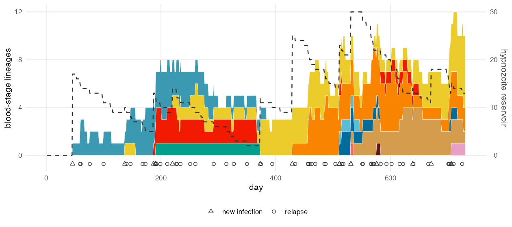

# malariafwd

<!-- badges: start -->
[](https://github.com/shaziaruybal/malariafwd/actions/workflows/R-CMD-check.yaml)
[](https://lifecycle.r-lib.org/articles/stages.html#experimental)
[](LICENSE)
<!-- badges: end -->

Forward simulation of *Plasmodium vivax* transmission and genetics — an R interface to a
[SLiM](https://messerlab.org/slim/) (Eidos) + [tskit](https://tskit.dev/) individual-based
model. The model simulates blood-stage infection, the **hypnozoite reservoir and relapses**,
meiotic recombination in the mosquito, and importation/interventions on a neutral
14-chromosome PvP01 genome, recording a tree sequence for **ground-truth identity-by-descent**.

An epidemiological model and a genetic model run together: each infection carries a real
genome, so a question about transmission can be answered with genetics against a known truth.

**Epidemiology.** One host over two years — stacked blood-stage lineages (one colour each),
the hypnozoite reservoir (dashed, right axis), and the onset of each new infection and relapse:



**Genetics.** The genealogy is recorded, so identity-by-descent is exact rather than inferred
from markers. Shared segments for four pairs of known relationship:


## Requirements

- **SLiM ≥ 5.0** on your `PATH` (or set `MALARIAFWD_SLIM`). Check with `slim_available()`.
- For IBD: **Python 3 with `tskit` + `pandas`** (via the `reticulate` package).

## Install

```r
# install.packages("remotes")
remotes::install_github("shaziaruybal/malariafwd")
```

## Check it works

`quickstart.R` installs the package, runs one simulation and writes the diagnostic and
model-output plots — about 15 seconds end to end:

```sh
Rscript quickstart.R                 # from a clone
Rscript quickstart.R --github        # install from GitHub instead
```

## Quick start

```r
library(malariafwd)
slim_version()                                    # e.g. "5.2"

# one run
p   <- vivax_params(N_HOSTS = 300, BITING_RATE = 0.09)   # 57 validated params; full genome by default
run <- run_sim(p, seed = 1, outdir = "runs/demo")

# tidy outputs
ev  <- load_events(run)
st  <- load_state(run)
summarise_run(run)                                  # prevalence, COI, relapse fraction, ...

# ground-truth IBD (tskit)
cs  <- classify_cases(ev)
idx <- ibd_index(ibd_pairs(run, ids = cs$pedigree_id))
ibd_relapse_origin(ev, idx)                       # relapses are clonal to their origin (IBD = 1)
new_infection_diversity(run)                       # relatedness of the transmitting population

# parallel sweep (see ?run_grid; use future::plan() for a cluster)
res <- run_grid(
  list(low = vivax_params(BITING_RATE = 0.06),
       hi  = vivax_params(BITING_RATE = 0.12)),
  seeds = 1:10, outdir_base = "runs/sweep", workers = 8)
```

## Checking and exploring a run

```r
plot_diagnostics(run)        # one-call health dashboard: prevalence, incidence + force of
                            # blood-stage infection by origin, COI, reservoir, lineage richness
event_types()         # what every event_type in events.tsv means
force_of_infection(run)     # FOI (mosquito-borne) vs molFOB (compound, incl. relapses)
```

## Genetics toolkit

```r
# pairwise IBD, and the segments behind it
idx <- ibd_index(ibd_pairs(run, ids = cs$pedigree_id))
ibd_segments(run, a, b)                  # the shared stretches, split by chromosome
plot_ibd_pair(run, a, b)                 # IBD "karyotype" -- 14 chromosomes, shared blocks
plot_relatedness_ladder(ibd_truth_pairs(run))   # IBD by known relationship vs the textbook rungs

# ARG-native (time-domain) views. The model is neutral, so SITE statistics are all zero and
# tskit BRANCH mode is the right tool -- but note the genealogy is a FOREST (see ?arg_summary).
arg_summary(run)                         # trees, edges, roots per tree, depth
arg_tmrca(run, a, b)                     # time to common ancestor + how much of the genome has one

# calibrating the uptake draws: LAMBDA_* is a PRE-truncation rate, not a mean count
uptake_moments(2, k = 1)                     # what a setting actually produces
uptake_calibrate(mean = 2.5, var = 6)        # target moments -> lambda, K
```

## How it works

The model runs as a **subprocess** (`processx`, shell-free) with parameters passed as `-d`
overrides; it writes `events.tsv`, `state.tsv`, `plasmo.trees`, and a provenance snapshot into
each run directory. `reticulate` + `tskit` are used only to compute IBD from the recorded tree
sequence. Multi-run sweeps parallelise via `future`/`furrr`. Set `VERBOSE = TRUE` to see the
full per-event narration; the default is quiet.

## Design history

The genome model, biology fixes, and interface choices are recorded as an append-only decision
log in [`DECISIONS.md`](DECISIONS.md).
