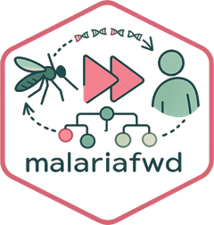
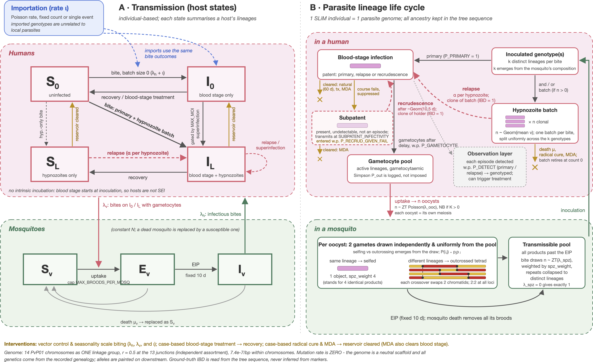

# malariafwd 

<!-- badges: start -->
[](https://github.com/shaziaruybal/malariafwd/actions/workflows/R-CMD-check.yaml)
[](https://lifecycle.r-lib.org/articles/stages.html#experimental)
[](LICENSE)
<!-- badges: end -->

> **Pre-release (0.1.0).** The package is under active development and both the interface and
> the model may change before 1.0.0. Work in progress includes a structured source population
> for imported infections (imports currently enter as unrelated founders, which makes them
> maximally distinguishable), post-treatment prophylaxis, and more extensive calibration of the
> treatment and recurrence machinery.
>
> If you are interested in using malariafwd or in contributing, please get in touch by opening
> an [issue](https://github.com/shaziaruybal/malariafwd/issues) or contacting
> Dr Shazia Ruybal-Pesántez (shazia.ruybal@isglobal.org).

Forward simulation of *Plasmodium vivax* transmission and genetics — an R interface to a
[SLiM](https://messerlab.org/slim/) (Eidos) + [tskit](https://tskit.dev/) individual-based
model. The model simulates blood-stage infection, the **hypnozoite reservoir and relapses**,
meiotic recombination in the mosquito, and importation/interventions on a neutral
14-chromosome PvP01 genome, recording a tree sequence for **ground-truth identity-by-descent**.

An epidemiological model and a genetic model run together: each infection carries a real
genome, so a question about transmission can be answered with genetics against a known truth.

Recurrence is **three-state** — relapse, reinfection and recrudescence — and every episode
carries a ground-truth label, so a method that tries to tell them apart can be scored against
the answer. Case management is modelled at the level of the **patient**: a course clears every
patent clone the host carries, radical cure is nested inside it, and a clone that survives can
be suppressed below patency and recrudesce later. All of it is off by default, so a bare run is
an untreated closed system.

**How the model fits together.** Host states and the mosquito cycle on the left; what happens to
a parasite lineage inside a human and inside a mosquito on the right — the hypnozoite reservoir,
the subpatent compartment a failed treatment course can push a clone into, and the recrudescence
that follows from it:



**Genetics.** The genealogy is recorded, so identity-by-descent is exact rather than inferred
from markers. Shared segments for pairs of known relationship:


## Requirements

- **SLiM ≥ 5.2** on your `PATH` (or set `MALARIAFWD_SLIM`).
- For the IBD and ARG functions: **Python with `tskit` (≥ 1.0), `pandas` and `numpy`**, through
  the `reticulate` package. Either route works. *Automatic*: with no Python chosen, reticulate
  sets up its own environment with these modules the first time an IBD function runs; this needs
  internet once and a few hundred MB in the user cache. *Your own Python*: set
  `RETICULATE_PYTHON=/path/to/python` (in `~/.Renviron` to keep it) before the first IBD call of a
  session.
- On a cluster whose compute nodes have no internet, run `check_setup()` once on a node that has
  it; later sessions that share the same user cache may then reuse the environment. If that does
  not work, use your own Python.

`check_setup()` reports what is found.

## Install

```r
# install.packages("remotes")
remotes::install_github("shaziaruybal/malariafwd", dependencies = TRUE)
```

## Check it works

`quickstart.R` installs the package, runs one simulation and writes the diagnostic and
model-output plots — under a minute end to end on a laptop:

```sh
Rscript quickstart.R                 # from a clone
Rscript quickstart.R --github        # install from GitHub instead
```

## Quick start

```r
library(malariafwd)
check_setup()                                     # SLiM, the model, and Python with tskit

# one run
p   <- vivax_params(N_HOSTS = 300, BITING_RATE = 0.09)   # validated params; full genome by default
run <- run_sim(p, seed = 1, outdir = "runs/demo")

# tidy outputs
ev  <- load_events(run)
st  <- load_state(run)                              # per-tick host state
summarise_run(run)                                  # prevalence, COI, relapse fraction, ...

# ground-truth IBD (tskit)
cs  <- classify_cases(ev)
idx <- ibd_index(ibd_pairs(run, ids = cs$pedigree_id))
ibd_relapse_origin(ev, idx)                       # relapses are clonal to their origin (IBD = 1)
new_infection_diversity(run)                       # relatedness of the transmitting population

# parallel sweep (see ?run_grid; use future::plan() for a cluster)
res <- run_grid(
  list(low = vivax_params(BITING_RATE = 0.06),
       hi  = vivax_params(BITING_RATE = 0.12)),
  seeds = 1:10, outdir_base = "runs/sweep", workers = 8)
```

## Checking and exploring a run

```r
plot_diagnostics(run)        # one-call health dashboard: prevalence, incidence + force of
                            # blood-stage infection by origin, COI, reservoir, lineage richness
event_types()         # what every event_type in events.tsv means
force_of_infection(run)     # FOI (mosquito-borne) vs molFOB (compound, incl. relapses)
```

## Genetics toolkit

```r
# pairwise IBD, and the segments behind it
idx <- ibd_index(ibd_pairs(run, ids = cs$pedigree_id))
ibd_segments(run, a, b)                  # the shared stretches, split by chromosome
plot_ibd_pair(run, a, b)                 # IBD "karyotype" -- 14 chromosomes, shared blocks
plot_relatedness_ladder(ibd_truth_pairs(run))   # IBD by known relationship vs the textbook rungs

# ARG-native (time-domain) views. The model is neutral, so SITE statistics are all zero and
# tskit BRANCH mode is the right tool -- but note the genealogy is a FOREST (see ?arg_summary).
arg_summary(run)                         # trees, edges, roots per tree, oldest root
arg_tmrca(run, a, b)                     # genealogical DEPTH to the common ancestor, plus
                                         # `coalesced`: how much of the genome has one at all

# calibrating the uptake draws: LAMBDA_* is a PRE-truncation rate, not a mean count
uptake_moments(2, k = 1)                     # what a setting actually produces
uptake_calibrate(mean = 2.5, var = 6)        # target moments -> lambda, K
```

## How it works

The model runs as a **subprocess** (`processx`, shell-free) with parameters passed as `-d`
overrides; it writes `events.tsv`, `state.tsv`, `plasmo.trees`, and a provenance snapshot into
each run directory. `reticulate` + `tskit` are used only to compute IBD from the recorded tree
sequence. Multi-run sweeps parallelise via `future`/`furrr`. Set `VERBOSE = TRUE` to see the
full per-event narration; the default is quiet.

## Limitations

Worth knowing before drawing a conclusion from a run. The full list, with the reasoning behind
each, is in [`MODEL_DESCRIPTION.md`](MODEL_DESCRIPTION.md).

* **Imported parasites are unrelated to local ones.** Imports are drawn as fresh founders, so
  they are maximally distinguishable — any import-detection result is an **upper bound**.
* **Co-transmission is impossible at the defaults.** `LAMBDA_OOCYSTS` and `LAMBDA_SPOROZOITES`
  are 0, giving exactly one genotype per bite. Raise them if you need several co-transmitted.
* **No within-host parasite densities.** Clones do not compete, detectability does not depend
  on parasitaemia, and infectiousness is a per-clone property.
* **The genome is neutral** (mutation rate 0): no selection, no drug resistance, no sequence
  divergence. IBD is exact because it is read from the genealogy rather than inferred.
* **Homogeneous mixing**, with no spatial structure or heterogeneous biting, and no
  post-treatment prophylaxis — so a treated host can be reinfected immediately.

## Citing and getting help

Please open an [issue](https://github.com/shaziaruybal/malariafwd/issues) for bugs and
questions, and get in touch before building on the package — see the pre-release note above.
A citation and archived DOI will accompany the first tagged release.

## Design history

The genome model, biology fixes, and interface choices are recorded as an append-only decision
log in [`DECISIONS.md`](DECISIONS.md).
