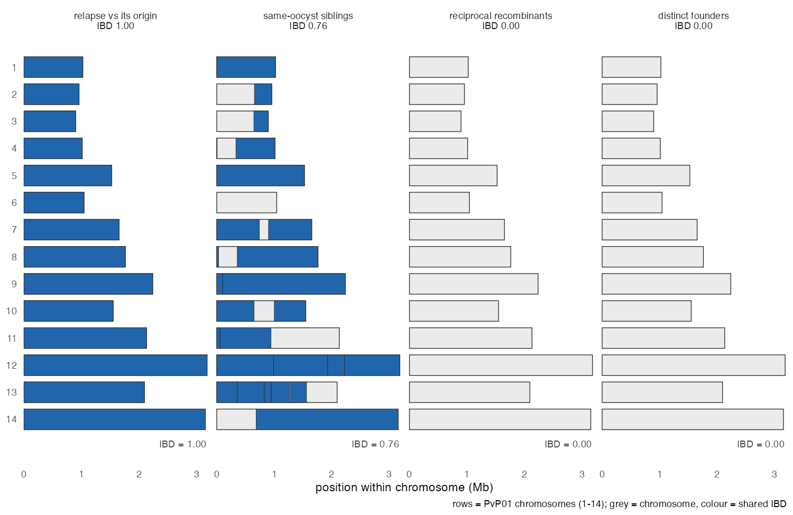

# malariafwd 

<!-- badges: start -->
[](https://github.com/shaziaruybal/malariafwd/actions/workflows/R-CMD-check.yaml)
[](https://lifecycle.r-lib.org/articles/stages.html#experimental)
[](https://shaziaruybal.github.io/malariafwd/LICENSE.html)
<!-- badges: end -->

> **Pre-release (0.1.0).** The package is under active development and both the interface and
> the model may change before 1.0.0. Work in progress includes hypnozoites genotyped
> independently of the bite's primary infections, a structured source population for imported
> infections (imports currently enter as unrelated founders, which makes them maximally
> distinguishable), post-treatment prophylaxis, and more extensive calibration of the treatment
> and recurrence machinery.
>
> If you are interested in using malariafwd or in contributing, please get in touch by opening
> an [issue](https://github.com/shaziaruybal/malariafwd/issues) or contacting
> Dr Shazia Ruybal-Pesántez (shazia.ruybal@isglobal.org).

Forward simulation of *Plasmodium vivax* transmission and genetics — an R interface to a
[SLiM](https://messerlab.org/slim/) (Eidos) + [tskit](https://tskit.dev/) individual-based
model. The model simulates blood-stage infection, the **hypnozoite reservoir and relapses**,
meiotic recombination in the mosquito, and importation/interventions on a neutral copy of the
14 chromosomes of the PvP01 reference genome, recording a tree sequence for **ground-truth
identity-by-descent (IBD)**.

An epidemiological model and a genetic model run together: each infection carries a real
genome, so a question about transmission can be answered with genetics against a known truth.

Recurrence is **three-state** — relapse, reinfection and recrudescence — and every episode
carries a ground-truth label, so a method that tries to tell them apart can be scored against
the answer. `recurrences()` pairs each recurrence with the earlier episodes of its host, with
their true origins and ground-truth IBD: the table such a method is scored against. Case
management is modelled at the level of the **patient**: a course clears every patent clone the
host carries, radical cure is nested inside it, and a clone that survives can be suppressed
below patency and recrudesce later. All of it is off by default, so a bare run is an untreated
closed system.

**How the model fits together.** Host states and the mosquito cycle on the left; what happens to
a parasite lineage inside a human and inside a mosquito on the right — the hypnozoite reservoir,
the subpatent compartment a failed treatment course can push a clone into, and the recrudescence
that follows from it:


**Genetics.** The genealogy is recorded, so identity-by-descent is exact rather than inferred
from markers. Shared segments for pairs of known relationship:



## Requirements

- **SLiM ≥ 5.2.** On any system, `conda install -c conda-forge slim` (builds for Linux, macOS on
  Intel or Apple silicon, and Windows). On macOS the installer from the
  [SLiM page](https://messerlab.org/slim/) works too; on Linux, conda or a build from source (the
  SLiM manual, chapter 2). On Debian and Ubuntu, `apt install slim` installs an unrelated login
  manager, not this SLiM. Windows is untested. If R cannot find SLiM (RStudio on macOS does not
  see the shell's `PATH`), add `MALARIAFWD_SLIM=/full/path/to/slim` to `~/.Renviron` and restart R.
- For the IBD and ancestral recombination graph (ARG) functions and `simulate_genotypes()`: **Python
  with `tskit` (≥ 1.0) and `numpy`**, through the `reticulate` package. Either route works.
  *Automatic*: with no Python chosen, reticulate sets up its own environment with these modules the
  first time an IBD function runs; this needs internet once and a few hundred MB in the user cache.
  *Your own Python*: set `RETICULATE_PYTHON=/path/to/python` (in `~/.Renviron` to keep it) before
  the first IBD call of a session.
- On a cluster whose compute nodes have no internet, run `check_setup()` once on a node that has
  it; later sessions that share the same user cache may then reuse the environment. If that does
  not work, use your own Python.

`check_setup()` reports what is found.

## Install

```r
# install.packages("pak")
pak::pak("shaziaruybal/malariafwd", dependencies = TRUE)
```

`dependencies = TRUE` also installs the suggested packages that the plots and the IBD functions
use (ggplot2, patchwork and reticulate); without it you get only what the package needs to load,
and the first plot or IBD call fails. `remotes::install_github("shaziaruybal/malariafwd",
dependencies = TRUE)` does the same thing. The vignettes are on the
[website](https://shaziaruybal.github.io/malariafwd/); to install them as well, use remotes, which
can build them:

```r
remotes::install_github("shaziaruybal/malariafwd", dependencies = TRUE, build_vignettes = TRUE)
```

which needs pandoc (RStudio includes it).

## Check it works

[`quickstart.R`](https://github.com/shaziaruybal/malariafwd/blob/main/quickstart.R) installs the
package into your R library, runs one simulation and writes the diagnostic and model-output plots,
in under a minute on a laptop:

```sh
Rscript quickstart.R                 # from a clone
curl -O https://raw.githubusercontent.com/shaziaruybal/malariafwd/main/quickstart.R
Rscript quickstart.R --github        # or the script alone, installing from GitHub
```

## Quick start

```r
library(malariafwd)
check_setup()                                     # SLiM, the model, and Python with tskit

# no SLiM yet? every function below also takes the run that ships with the package:
# run <- example_run()

# one run: 100 hosts and 250 mosquitoes for 18 months, a few seconds on a laptop. Transmission
# rises with BITING_RATE * N_MOSQ / N_HOSTS, so more hosts alone means less of it.
p   <- vivax_params(N_HOSTS = 100, N_MOSQ = 250, BITING_RATE = 0.1, SIM_DAYS = 548)
# every parameter, its unit and the values it may take: ?vivax_params or param_info()
run <- run_sim(p, seed = 1, outdir = file.path(tempdir(), "demo"))
# the run's directory appears when the run has finished; a second run into it is refused
# unless overwrite = TRUE (or skip_existing = TRUE, which returns the same run)

# tidy outputs
ev  <- load_events(run)                             # one row per event; ?events.tsv describes the columns
st  <- load_state(run)                              # per-tick host state; ?state.tsv
summarise_run(run)     # over the second half of the run: prevalence, complexity of infection (COI),
                       # entomological inoculation rate (EIR), force of infection (FOI), molecular
                       # force of blood-stage infection (molFOB), relapses

# ground-truth IBD (tskit)
cs  <- classify_cases(ev)
x   <- ibd_pairs(run, ids = cs$pedigree_id)       # keyed by pedigree id; read with ibd_lookup()
recurrences(ev, ibd = x)                          # each recurrence vs its host's earlier episodes
new_infection_diversity(run)                       # relatedness of the transmitting population

# parallel sweep (see ?run_grid; use future::plan() for a cluster). Calling it again resumes:
# cells that already hold their run are not run again
res <- run_grid(
  list(low = vivax_params(BITING_RATE = 0.06),
       hi  = vivax_params(BITING_RATE = 0.12)),
  seeds = 1:10, outdir_base = file.path(tempdir(), "sweep"), workers = 2)
load_grid(file.path(tempdir(), "sweep"))           # the grid's record, grid.tsv
```

## Checking and exploring a run

```r
plot_diagnostics(run)        # one-call health dashboard: prevalence, incidence + force of
                            # blood-stage infection by origin, COI, reservoir, lineage richness
event_types()         # what every event_type in events.tsv means
force_of_infection(run)     # rows by window and origin: imported + local = FOI, + relapses = molFOB
classify_chain(ev)          # each case's WHO class from its true chain back to an import
classify_travel(ev)         # what a travel-history rule concludes instead, to score against it
```

## Genetics toolkit

```r
# a relapse and the batch of hypnozoites it came from, by pedigree id (the tree sequence's key)
rel <- ev[event_type == "hypnozoite_activation" & parent1_pedigree_id != -1][1]
a <- rel$pedigree_id; b <- rel$parent1_pedigree_id

# pairwise IBD, and the segments behind it
m <- as.matrix(x); m[1:4, 1:4]           # the quick start's x as a matrix, one row per genome
ibd_segments(run, a, b)                  # the shared stretches, split by chromosome
plot_ibd_pair(run, a, b)                 # IBD "karyotype" -- 14 chromosomes, shared blocks
plot_relatedness_ladder(ibd_truth_pairs(run))   # IBD by known relationship vs the textbook rungs

# marker genotypes painted on the genealogy, with the truth behind every call
loci <- data.frame(chrom = 1:14, pos = 1e5, plaf = 0.3)
g <- simulate_genotypes(run, cs$pedigree_id, loci, error = 0.01, seed = 1)
write_vcf(g, "cases.vcf")

# the ARG itself, in time. The genealogy is a FOREST (see ?arg_summary), so tskit's branch
# statistics are no relatedness measure on it; arg_tmrca() is.
arg_summary(run)                         # trees, edges, roots per tree, oldest root
arg_tmrca(run, a, b)                     # genealogical DEPTH to the common ancestor, plus
                                         # `coalesced`: how much of the genome has one at all

# calibrating the uptake draws: LAMBDA_* is a PRE-truncation rate, not a mean count
uptake_moments(2, k = 1)                     # what a setting actually produces
uptake_calibrate(mean = 2.5, var = 6)        # target moments -> lambda, K
```

## Learn more

- [Getting started](https://shaziaruybal.github.io/malariafwd/articles/malariafwd.html): a run,
  from its parameters to its ground truth and IBD.
- [Choosing parameters](https://shaziaruybal.github.io/malariafwd/articles/parameters.html): the
  parameters that are easy to get wrong, and how to choose a value for each.
- [Reading the outputs](https://shaziaruybal.github.io/malariafwd/articles/anatomy.html): what
  each output holds, and how to read it.
- [Reference](https://shaziaruybal.github.io/malariafwd/reference/): every function, starting with
  the terms they share (`?malariafwd`).
- [Model description](https://shaziaruybal.github.io/malariafwd/MODEL_DESCRIPTION.html): the
  model in full, with its parameters and assumptions.
- [Design decisions](https://shaziaruybal.github.io/malariafwd/DECISIONS.html): why each
  modelling choice was made.
- [Validation](https://shaziaruybal.github.io/malariafwd/VALIDATION.html): how the model is
  checked, and what each check found.
- [Derived metrics](https://shaziaruybal.github.io/malariafwd/METRICS.html): what each number a run
  yields means, and how it is counted.
- [Ongoing and future work](https://shaziaruybal.github.io/malariafwd/ROADMAP.html): the sensitivity
  analyses still needed and the extensions planned.
- The validation scripts are installed with the package, with the results of their last run in
  `RESULTS.md`: list them with `dir(system.file("validation", package = "malariafwd"))` and run
  one with `source()`, for example
  `source(system.file("validation", "audit_events_and_ibd.R", package = "malariafwd"))`.

## How it works

The model runs as a **subprocess** (`processx`, shell-free) with parameters passed as `-d`
overrides; it writes `events.tsv`, `state.tsv`, `plasmo.trees`, and a provenance snapshot into
each run directory (`?events.tsv` and `?state.tsv` describe the columns). `reticulate` + `tskit` are used only to compute IBD from the recorded tree
sequence. Multi-run sweeps parallelise via `future`. Set `VERBOSE = TRUE` to see the
full per-event narration; the default is quiet.

## Limitations

Worth knowing before drawing a conclusion from a run. The full list, with the reasoning behind each,
is in the [model description](https://shaziaruybal.github.io/malariafwd/MODEL_DESCRIPTION.html).

* **Imported parasites are unrelated to local ones.** Imports are drawn as fresh founders, so
  they are maximally distinguishable — any import-detection result is an **upper bound**.
* **Genotypes per bite is an assumption.** No study has measured how many genotypes a natural
  bite delivers. At the defaults (`LAMBDA_OOCYSTS` and `LAMBDA_SPOROZOITES` of 2) a bite can
  co-transmit several; set both to 0 for one genotype per bite, and sweep them.
* **No within-host parasite densities.** Clones do not compete, detectability does not depend
  on parasitaemia, and infectiousness is a per-clone property.
* **The genome is neutral** (mutation rate 0): no selection, no drug resistance, no sequence
  divergence. IBD is exact because it is read from the genealogy rather than inferred.
* **Genotypes are painted, not drawn from a real population.** `simulate_genotypes()` gives each
  founder template and import independent alleles from the frequencies you supply, so there is
  no background relatedness or linkage disequilibrium among them.
* **Homogeneous mixing**, with no spatial structure or heterogeneous biting, and no
  post-treatment prophylaxis — so a treated host can be reinfected immediately.

## Citing and getting help

Please open an [issue](https://github.com/shaziaruybal/malariafwd/issues) for bugs and questions,
and get in touch before building on the package — see the pre-release note above. The
[contributing guide](https://shaziaruybal.github.io/malariafwd/CONTRIBUTING.html) says what a bug
report needs. The project is released with a
[Contributor Code of Conduct](https://shaziaruybal.github.io/malariafwd/CODE_OF_CONDUCT.html); by
contributing to it, you agree to abide by its terms. Cite malariafwd with `citation("malariafwd")`;
it also lists the papers for SLiM and tskit, which run the model and record its genealogy. An
archived DOI will be added at the first tagged release.

## Funding

This work was supported by the "la Caixa" Foundation (ID 100010434), Junior Leader Fellowship
LCF/BQ/PI25/12100035.
