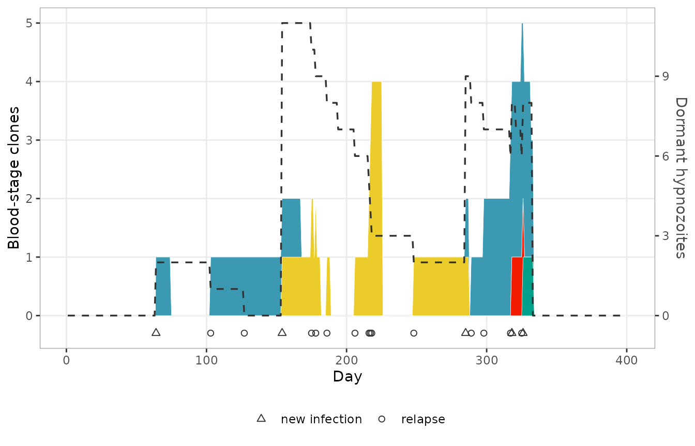
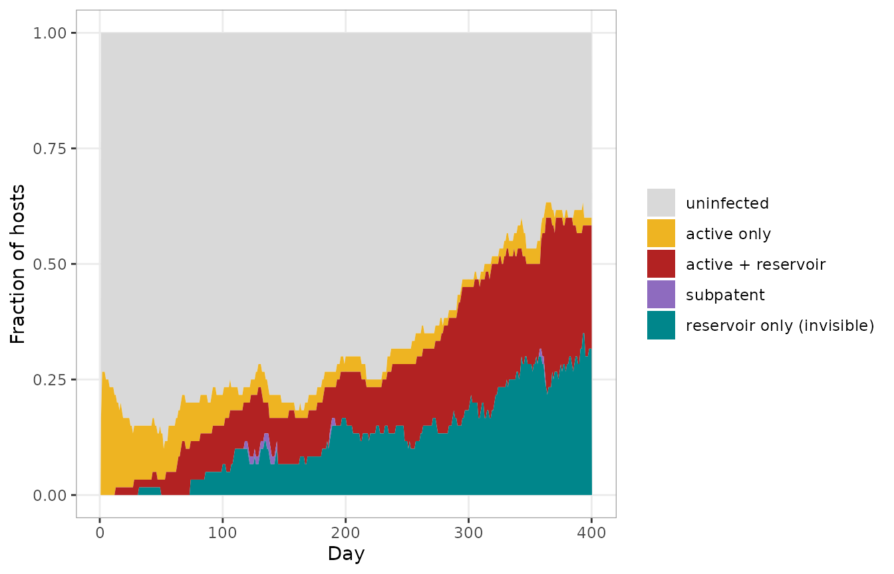
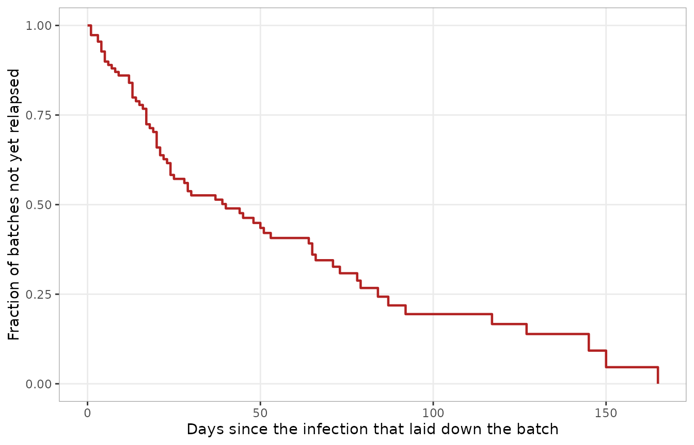
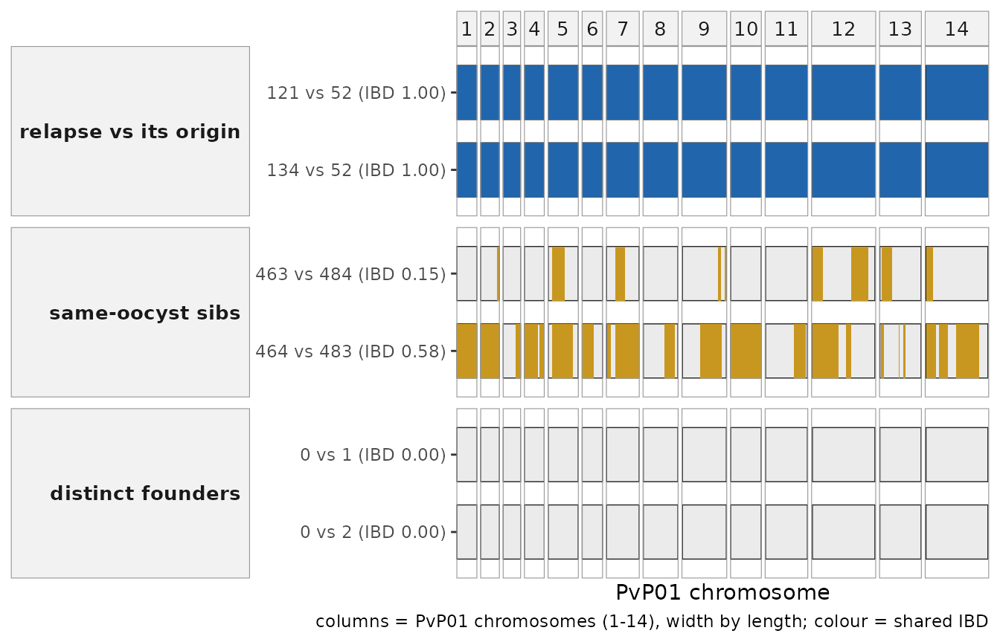
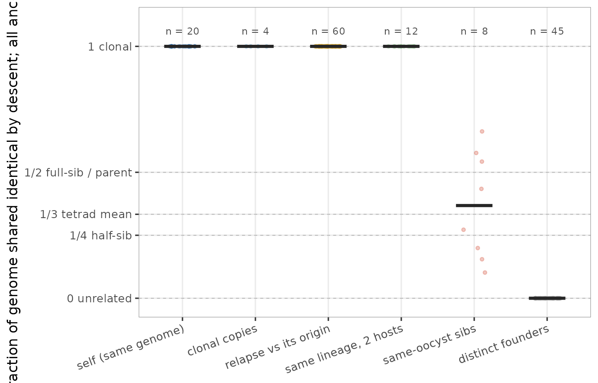

# Reading the outputs

A single `malariafwd` run writes a handful of files into its output
directory. This vignette tours them — what each output means and how to
explore it. It reads
[`example_run()`](https://shaziaruybal.github.io/malariafwd/reference/example_run.md),
a run that ships with the package: 60 hosts and 150 mosquitoes for 400
days, with imports, case management, recrudescence and co-transmission
(several genotypes in a bite) switched on, so that every kind of case
occurs. The chunks that read the tree sequence need Python with tskit
(see
[`check_setup()`](https://shaziaruybal.github.io/malariafwd/reference/check_setup.md)).

## Run one simulation

With SLiM, a run of your own is one call (not run here):

``` r

p   <- vivax_params(N_HOSTS = 100, N_MOSQ = 250, BITING_RATE = 0.1, SIM_DAYS = 548)
run <- run_sim(p, seed = 1, outdir = file.path(tempdir(), "anatomy"))   # a few seconds on a laptop
```

Here, the bundled run:

``` r

library(malariafwd)
run <- example_run()
dir(run$outdir)
#> [1] "cmdline.txt"  "DONE"         "events.tsv"   "model.slim"   "params.tsv"  
#> [6] "plasmo.trees" "run.log"      "state.tsv"
```

`run` points at the output directory, which holds:

- `events.tsv` — every discrete event (infections, clearances, relapses,
  mosquito uptake …)
- `state.tsv` — per-tick state of every host and mosquito
- `plasmo.trees` — the tskit tree sequence (the genealogy behind IBD)
- `params.tsv`, `cmdline.txt`, `model.slim`, `run.log` — provenance of
  the run
- `DONE` — written last: when the run finished, a key of its parameters
  and seed, and the size of every file, so a directory that is not a
  whole run can be told from one that is

[`?events.tsv`](https://shaziaruybal.github.io/malariafwd/reference/malariafwd-outputs.md)
and
[`?state.tsv`](https://shaziaruybal.github.io/malariafwd/reference/malariafwd-outputs.md)
describe every column.

## The event log

Every row of `events.tsv` carries an `event_type`.
[`event_types()`](https://shaziaruybal.github.io/malariafwd/reference/event_types.md)
is the dictionary:

``` r

event_types()
#>                        event_type  stage ends_episode is_onset
#>                            <char> <char>       <lgcl>   <lgcl>
#>  1:                vh_inoculation  blood        FALSE     TRUE
#>  2:         vh_inoculation_import  blood        FALSE     TRUE
#>  3:           vh_inoculation_seed  blood        FALSE     TRUE
#>  4:        vh_inoculation_no_take  blood        FALSE    FALSE
#>  5: vh_inoculation_import_no_take  blood        FALSE    FALSE
#>  6:         hypnozoite_activation  blood        FALSE     TRUE
#>  7:                 recrudescence  blood        FALSE     TRUE
#>  8:               human_clearance  blood         TRUE    FALSE
#>  9:         case_bloodstage_clear  blood         TRUE    FALSE
#> 10:          mda_bloodstage_clear  blood         TRUE    FALSE
#> 11:           mda_subpatent_clear  blood        FALSE    FALSE
#> 12:           bloodcure_subpatent  blood         TRUE    FALSE
#> 13:               bloodcure_given  blood        FALSE    FALSE
#> 14:                 radcure_given  liver        FALSE    FALSE
#> 15:               radcure_failure  liver        FALSE    FALSE
#> 16:             bloodcure_persist  blood        FALSE    FALSE
#> 17:           mda_bloodcure_given  blood        FALSE    FALSE
#> 18:             mda_radcure_given  liver        FALSE    FALSE
#> 19:           mda_radcure_failure  liver        FALSE    FALSE
#> 20:          hypnozoite_clearance  liver        FALSE    FALSE
#> 21:      radcure_hypnozoite_clear  liver        FALSE    FALSE
#> 22:          mda_hypnozoite_clear  liver        FALSE    FALSE
#> 23:              hv_uptake_clonal vector        FALSE    FALSE
#> 24:         hv_uptake_recombinant vector        FALSE    FALSE
#> 25:                    mosq_death vector        FALSE    FALSE
#>                        event_type  stage ends_episode is_onset
#>                            <char> <char>       <lgcl>   <lgcl>
#>                                                                                                                                                                                                    description
#>                                                                                                                                                                                                         <char>
#>  1:                                                                                                                                                             new local mosquito-borne blood-stage infection
#>  2:                                                                                                                                                                             imported blood-stage infection
#>  3:                                                                                                                                                            founder blood-stage infection (burn-in seeding)
#>  4:                                                                                                 a bite established neither a blood-stage infection nor hypnozoites (P_PRIMARY failed and the batch drew 0)
#>  5:                                                                                         an importation established neither compartment (P_PRIMARY failed and the batch drew 0), or its host was at MAX_MOI
#>  6:                                                                                                                                       hypnozoite activates -> a blood-stage relapse (clonal to its origin)
#>  7:                                                                              a suppressed clone re-expands to patency after a failed course; mints a new genome clonal to the holder (P_RECRUD_GIVEN_FAIL)
#>  8:                                                                                                                                                                     blood-stage infection clears naturally
#>  9:                                                                                                                                 blood-stage infection cleared by case-based treatment (BLOODCURE_COVERAGE)
#> 10:                                              blood-stage infection cleared by mass drug administration (MDA_TICK), also one that became patent earlier that day (the day's imports arrive after the round)
#> 11:                                                                                    a suppressed clone cleared by MDA, so it never recrudesces; its patent episode had already ended at bloodcure_subpatent
#> 12: a clone survived treatment but was suppressed BELOW PATENCY; the patent episode ends here and the clone recrudesces later (P_RECRUD_GIVEN_FAIL), unless an MDA round clears it first (mda_subpatent_clear)
#> 13:                                                                                                                                               a blood-stage course is given to a host (BLOODCURE_COVERAGE)
#> 14:                                                                                                                                        radical cure is given to a host, nested inside a blood-stage course
#> 15:                                                                                                                            radical cure was given but the whole reservoir survived (RADCURE_MODE = person)
#> 16:                                                                                                                a blood-stage clone survived treatment and continues at full density (P_BLOODCURE_SURVIVAL)
#> 17:                                                                                                                       a blood-stage course is given by MDA to a host not empty at the round (MDA_COVERAGE)
#> 18:                                                                                                                                                                               radical cure is given by MDA
#> 19:                                                                                                                                                    MDA radical cure given but the whole reservoir survived
#> 20:                                                                                                                                                                    a hypnozoite dies / clears in the liver
#> 21:                                                                                                                                 hypnozoite reservoir thinned by case-based radical cure (RADCURE_COVERAGE)
#> 22:                                                                                                                                                                        hypnozoite reservoir thinned by MDA
#> 23:                                                                                                                                                        mosquito takes up a clonal (selfed) oocyst genotype
#> 24:                                                                                                                                               mosquito takes up a recombinant (outcrossed) oocyst genotype
#> 25:                                                                                                                       a parasite genome lost when an infected mosquito dies: one row per genome it carried
#>                                                                                                                                                                                                    description
#>                                                                                                                                                                                                         <char>

ev <- load_events(run)                 # a data.table
ev[, .N, by = event_type][order(-N)]   # how many of each event type
#>                   event_type     N
#>                       <char> <int>
#>  1:               mosq_death  1206
#>  2:         hv_uptake_clonal   797
#>  3:           vh_inoculation   206
#>  4:    hypnozoite_activation   158
#>  5:          human_clearance   140
#>  6:    case_bloodstage_clear   138
#>  7:    hv_uptake_recombinant   114
#>  8:          bloodcure_given    83
#>  9:     hypnozoite_clearance    47
#> 10:    vh_inoculation_import    41
#> 11: radcure_hypnozoite_clear    29
#> 12:            radcure_given    22
#> 13:      vh_inoculation_seed    16
#> 14:        bloodcure_persist    11
#> 15:          radcure_failure     5
#> 16:      bloodcure_subpatent     5
#> 17:            recrudescence     5
```

Classify each blood-stage clone onset (“case”) by its true origin: one
row per clone, and the clones that became patent in one host on one day
share an `episode_id`. There are **four** origins: `relapse` (a
hypnozoite activated), `imported`, `local reinfection`, and
`recrudescence` (a clone that survived a treatment course, was
suppressed below patency, and re-expanded). The fourth only appears when
treatment can fail *and* `P_RECRUD_GIVEN_FAIL > 0`. At the shipped
defaults there is no treatment at all, so a default run shows three; the
example run has case management with recrudescence on, so it shows all
four:

``` r

cs <- classify_cases(ev)
cs[, .N, by = origin]
#>               origin     N
#>               <char> <int>
#> 1: local reinfection   113
#> 2:          imported    23
#> 3:           relapse   158
#> 4:     recrudescence     5
```

Every episode of a host after its first is a recurrence.
[`recurrences()`](https://shaziaruybal.github.io/malariafwd/reference/recurrences.md)
pairs each with the host’s earlier episodes, with both sides’ true
origins;
[`episodes()`](https://shaziaruybal.github.io/malariafwd/reference/episodes.md)
gives every clone’s span.

``` r

rec <- recurrences(ev)
rec[, .N, by = .(origin, prior_origin)]
#>                origin      prior_origin     N
#>                <char>            <char> <int>
#>  1:           relapse local reinfection   339
#>  2: local reinfection local reinfection   112
#>  3: local reinfection           relapse   158
#>  4:           relapse           relapse   428
#>  5:          imported local reinfection    10
#>  6:          imported           relapse     8
#>  7:           relapse          imported    57
#>  8:     recrudescence local reinfection    11
#>  9:     recrudescence           relapse    19
#> 10:     recrudescence          imported     2
#> 11: local reinfection          imported    24
#> 12:           relapse     recrudescence     6
#> 13: local reinfection     recrudescence     3
#> 14:          imported          imported     1
```

## Epidemiology over time

[`summarise_run()`](https://shaziaruybal.github.io/malariafwd/reference/summarise_run.md)
gives prevalence, the complexity of infection (COI, the distinct
lineages in an infected host), the entomological inoculation rate (EIR),
the force of infection from bites and imports (FOI) and the molecular
force of blood-stage infection, which adds the relapses (molFOB):

``` r

summarise_run(run)     # over the second half of the run
#>    from_tick to_tick n_days exclude_masked extinct extinct_tick never_started
#>        <int>   <int>  <int>         <lgcl>  <lgcl>        <int>        <lgcl>
#> 1:       201     400    200          FALSE   FALSE           NA         FALSE
#>    prevalence_frac coi_mean coi_median polyclonal_frac hypnozoites_per_host
#>              <num>    <num>      <num>           <num>                <num>
#> 1:       0.2503333 1.338549          1       0.2563249             1.705667
#>    eir_per_py foi_per_py molfob_clones_per_py molfob_episodes_per_py
#>         <num>      <num>                <num>                  <num>
#> 1:   3.680417       2.92             6.722083               6.782917
#>    relapses_per_py_at_risk relapse_frac_episodes relapse_frac_acquisitions
#>                      <num>                 <num>                     <num>
#> 1:                 5.55657             0.5605381                 0.5656109
#>    imported_frac n_imported n_local_reinfection n_relapse n_relapse_masked
#>            <num>      <int>               <int>     <int>            <int>
#> 1:     0.1354167         13                  83       125               69
#>    n_recrudescence n_bloodstage_courses person_years person_years_at_risk
#>              <int>                <int>        <num>                <num>
#> 1:               2                   58     32.87671             22.49589
fo <- force_of_infection(run, split_imported = FALSE)
fo[win %in% c(0, 180, 390), .(win, origin, n)]   # new cases in three 30-day windows, by origin
#> Key: <win>
#>       win            origin     n
#>     <int>            <fctr> <int>
#>  1:     0          imported     1
#>  2:     0 local reinfection     2
#>  3:     0           relapse     0
#>  4:     0     recrudescence     0
#>  5:   180          imported     1
#>  6:   180 local reinfection     6
#>  7:   180           relapse     6
#>  8:   180     recrudescence     1
#>  9:   390          imported     0
#> 10:   390 local reinfection     6
#> 11:   390           relapse     6
#> 12:   390     recrudescence     0
```

## Who infected whom

Every local infection has a true infector: the genome a mosquito took up
before the bite. A bite can also leave hypnozoites, so a link runs to
each relapse the bite causes later, often months on.

``` r

links <- transmission_links(ev)
links[, .(infected = sum(weight)), by = kind]     # through a bite's blood stage, or a relapse
#>      kind infected
#>    <char>    <num>
#> 1: direct      113
#> 2:  liver      132
rc_by_origin(run, from = 100, followup = 100)    # secondary cases per case, by true origin
#>               origin n_cases n_secondary       Rc onward_frac
#>               <fctr>   <int>       <num>    <num>       <num>
#> 1:          imported       9         0.0 0.000000   0.0000000
#> 2: local reinfection      35        50.5 1.442857   0.3714286
#> 3:           relapse      67        81.0 1.208955   0.2985075
#> 4:     recrudescence       3         0.0 0.000000   0.0000000
```

## A single host’s trajectory

`state.tsv` records every host each tick. Take the host with the most
relapses and plot its blood-stage clones, a colour for each lineage, and
its dormant hypnozoites through time:

``` r

st <- load_state(run)      # each host's state, day by day
h  <- ev[event_type == "hypnozoite_activation", .N, by = human_id][order(-N), human_id[1]]
plot_host_trajectory(run, host_id = h)
```



Hosts by state over time: uninfected, patent without or with
hypnozoites, subpatent only, and hypnozoites only:

``` r

plot_host_state_prevalence(host_state_prevalence(st))
```



## The reservoir and relapses

The hypnozoite reservoir is the model’s distinctive,
otherwise-unobservable compartment:

``` r

st <- load_state(run)
hs <- unique(host_state_prevalence(st)[, .(tick, hypnozoites_per_host)])
hs[tick %% 50 == 0]                          # mean hypnozoites per host, every 50 days
#>     tick hypnozoites_per_host
#>    <int>                <num>
#> 1:    50            0.1500000
#> 2:   100            0.5333333
#> 3:   150            0.5500000
#> 4:   200            0.8166667
#> 5:   250            0.8000000
#> 6:   300            1.8833333
#> 7:   350            2.4333333
#> 8:   400            2.3000000
relapse_fraction(ev)                         # two readings, per episode and per acquisition: equal unless recrudescence is on
#>    n_relapse n_new_infection n_recrudescence relapse_frac_episodes
#>        <int>           <int>           <int>                 <num>
#> 1:       158             136               5             0.5284281
#>    relapse_frac_acquisitions
#>                        <num>
#> 1:                  0.537415
coi_distribution(st)                         # COI over the infected host-days: counts and shares
#>    moi_active     n        frac
#>         <int> <int>       <num>
#> 1:          1  3842 0.792164948
#> 2:          2   820 0.169072165
#> 3:          3   132 0.027216495
#> 4:          4    47 0.009690722
#> 5:          5     9 0.001855670
```

``` r

plot_relapse_km(time_to_relapse(run))        # time to each batch's first relapse (Kaplan-Meier)
```



## Ground-truth relatedness

Because the full genealogy is recorded, identity-by-descent is exact
rather than inferred:

``` r

rel <- ev[event_type == "hypnozoite_activation" & parent1_pedigree_id != -1]
x <- ibd_pairs(run, pairs = data.frame(a = rel$pedigree_id, b = rel$parent1_pedigree_id))
summary(ibd_lookup(x, rel$pedigree_id, rel$parent1_pedigree_id))   # each relapse vs its batch: IBD 1
#>    Min. 1st Qu.  Median    Mean 3rd Qu.    Max. 
#>       1       1       1       1       1       1
```

Only the listed pairs are computed. To compare every pair among a set of
genomes, pass `ids` instead, which costs the square of their number.

The relatedness of the newly acquired infections follows transmission,
quarter by quarter:

``` r

new_infection_diversity(run, bin = 90, cap = 40)   # mean IBD, clonal share and lineages, by quarter
#>      win  days     n n_pairs   mean_ibd clonal_frac n_lineages
#>    <int> <int> <int>   <int>      <num>       <num>      <int>
#> 1:   180    69     9      36 0.05555556  0.05555556          7
#> 2:   270    90    40     780 0.17065198  0.16666667         26
#> 3:   360    41    23     253 0.16558117  0.18972332         13
```

## Seeing the relatedness, not just the number

[`ibd_pairs()`](https://shaziaruybal.github.io/malariafwd/reference/ibd_pairs.md)
gives one number per pair.
[`ibd_segments()`](https://shaziaruybal.github.io/malariafwd/reference/ibd_segments.md)
gives the stretches behind it, and
[`plot_ibd_pair()`](https://shaziaruybal.github.io/malariafwd/reference/plot_ibd_pair.md)
draws them along the chromosomes. Its `group` sets kinds of pair side by
side: a clonal pair (or a relapse against its origin) is shared end to
end, same-oocyst siblings show a recombination mosaic, unrelated genomes
share nothing:

``` r

tp <- ibd_truth_pairs(run)   # pairs whose true relationship the event log gives
show <- tp[cls %in% c("relapse vs its origin", "same-oocyst sibs", "distinct founders"),
           head(.SD, 2), by = cls]
plot_ibd_pair(run, show$a, show$b, group = show$cls)
```



``` r


# and the model-validation view: IBD by known relationship against the textbook rungs
plot_relatedness_ladder(tp)
```



## The ancestral recombination graph (ARG)

The model is neutral (mutation rate 0), so every *site* statistic is
zero; tskit’s **branch** mode measures the genealogy directly. One
caveat matters: the recorded genealogy is a **forest** – each founder
lineage and each import is an independent root, so most pairs never
coalesce. Branch *divergence* therefore does not behave as a relatedness
measure here; use
[`arg_tmrca()`](https://shaziaruybal.github.io/malariafwd/reference/arg_tmrca.md),
which reports the time to the common ancestor together with `coalesced`,
the fraction of the genome over which one exists.

`tmrca` is a **depth** – ticks from the older of the two genomes back to
their shared ancestor – so a relapse and the hypnozoite it activated
from give 0 no matter when in the run they occurred. The raw tskit node
time (ticks before the *end of the run*) is reported separately as
`tmrca_node_time`; it moves with sampling date rather than with
relatedness.

``` r

rel <- ev[event_type == "hypnozoite_activation" & parent1_pedigree_id != -1][1]
arg_summary(run)                                   # trees, edges, roots/tree, oldest root
#>    num_trees num_nodes num_edges num_samples seq_length_mb roots_min
#>        <int>     <int>     <int>       <int>         <num>     <int>
#> 1:      4124      1679     12850        1679      24.21467        33
#>    roots_median roots_max pct_trees_coalesced max_root_time
#>           <num>     <int>               <num>         <num>
#> 1:           33        33                   0           399
arg_tmrca(run, rel$pedigree_id, rel$parent1_pedigree_id)   # coalesced = 1, tmrca = 0
#>        a     b coalesced tmrca tmrca_node_time
#>    <int> <int>     <num> <num>           <num>
#> 1:   121    52         1     0             387
```

## Calibrating the uptake draws

`LAMBDA_OOCYSTS` / `LAMBDA_SPOROZOITES` are **pre-truncation** rates, so
they are not the mean counts a feeding study reports – conditioning away
the zeros pulls the realised mean up:

``` r

uptake_moments(2)                      # Poisson lambda = 2 -> realised mean 2.31
#>     mean      var 
#> 2.313035 1.588974
uptake_moments(2, k = 1)               # overdispersed    -> realised mean 3.00
#> mean  var 
#>    3    6
uptake_calibrate(mean = 2.5, var = 6)  # a target -> the lambda / K to set
#> $lambda
#> [1] 0.2391864
#> 
#> $k
#> [1] 0.06533696
#> 
#> $achieved
#> mean  var 
#>  2.5  6.0
```

## Repeating a run exactly

`SEED` is recorded as `ACTUAL_SEED` in `params.tsv`, alongside every
resolved parameter, the derived `GENOME_LENGTH` / `N_CHROMOSOMES` /
`RECOMB_WITHIN`, and the SLiM and package versions (`SLIM_VERSION`,
`MALARIAFWD_VERSION`). Floats are recorded to 15 significant digits, the
precision
[`run_sim()`](https://shaziaruybal.github.io/malariafwd/reference/run_sim.md)
passes to SLiM. An extinct run’s file ends with an `EXTINCT_TICK` row,
and a run that never started with a `NEVER_STARTED` row.
[`load_params()`](https://shaziaruybal.github.io/malariafwd/reference/load_params.md)
reads the parameters back into the
[`vivax_params()`](https://shaziaruybal.github.io/malariafwd/reference/vivax_params.md)
set the run was made from, each of its type, so
`run_sim(load_params(run), seed = run$seed, outdir = ...)` repeats a run
started from R exactly when each of its non-zero floats lies between
1e-130 and 1e15 in magnitude: the same files, all but the tree
sequence’s provenance row, where SLiM records when the run was made and
the time and memory it took. The seed, the versions, the derived genome
and the outcome rows are on the
[`load_run()`](https://shaziaruybal.github.io/malariafwd/reference/load_run.md)
object (`seed`, `slim_version`, `malariafwd_version`, `genome_length`,
`n_chromosomes`, `recomb_within`, `extinct_tick`, `never_started`).

`DONE` records when the run finished, how long it took, its seed, a key
of its parameters and seed (the md5 of the arguments SLiM was given,
without `OUTDIR` and `VERBOSE`), the md5 of the model, the versions, and
the size of every file;
[`load_run()`](https://shaziaruybal.github.io/malariafwd/reference/load_run.md)
reports a directory whose `DONE` is missing or whose files have changed
since. SLiM runs in the run’s directory on its copy of the model, so
running `slim` with the arguments in `cmdline.txt` from a directory
holding `model.slim` repeats the run.

Reproducing a run needs SLiM \>= 5.2 on `PATH` and, for IBD and the ARG
functions, Python with `tskit` (\>= 1.0) and `numpy` through reticulate;
[`check_setup()`](https://shaziaruybal.github.io/malariafwd/reference/check_setup.md)
reports both. `RETAIN_FULL_HISTORY = T` is required for IBD to
already-cleared infections – without it, most earlier genomes leave the
tree, and
[`ibd_pairs()`](https://shaziaruybal.github.io/malariafwd/reference/ibd_pairs.md)
warns about the ids it was asked for that are gone and gives them `NA`.

See the *Getting started* vignette for parameter sweeps with
[`run_grid()`](https://shaziaruybal.github.io/malariafwd/reference/run_grid.md),
and
[`?event_types`](https://shaziaruybal.github.io/malariafwd/reference/event_types.md)
for the full event-type dictionary.
