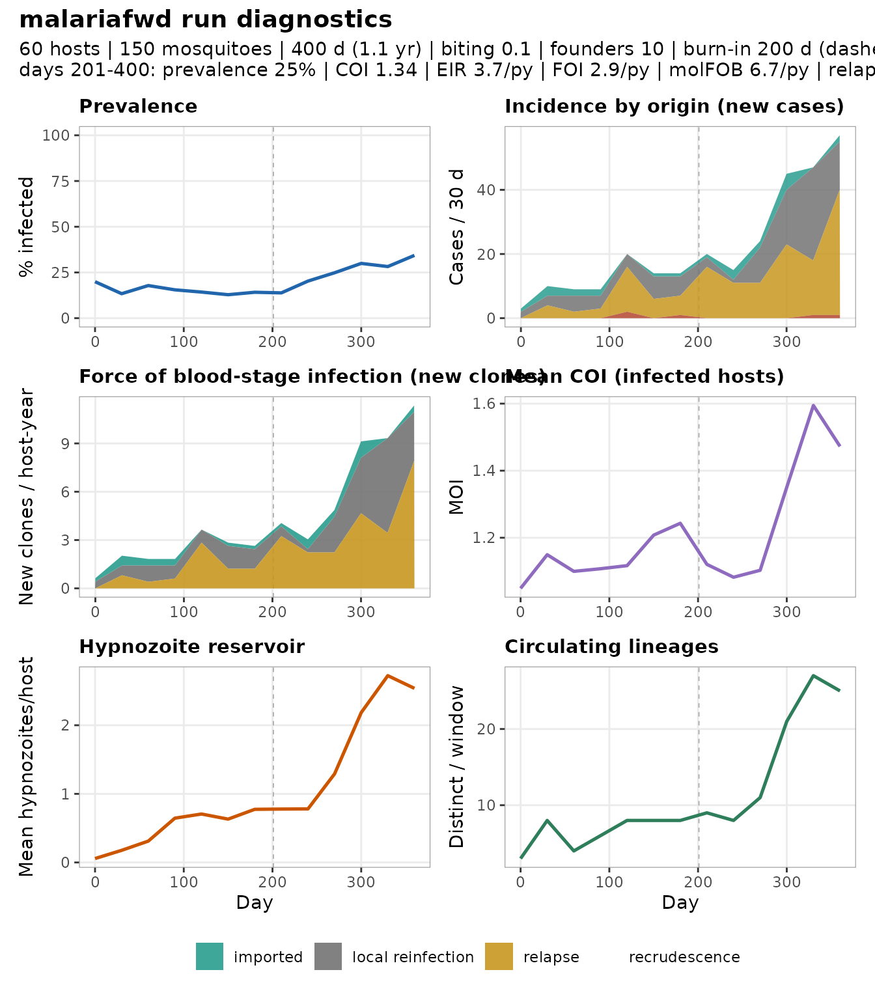
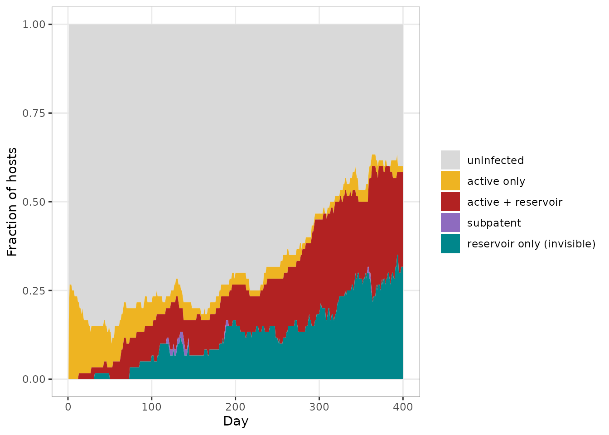
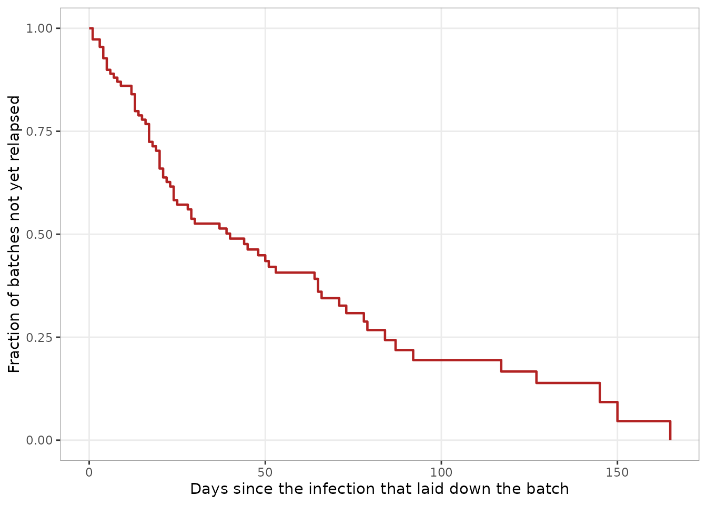

# Getting started with malariafwd

`malariafwd` is an R interface to a SLiM + tskit forward simulator of
*Plasmodium vivax*. You run the model from R and analyse its outputs —
including **ground-truth identity-by-descent** from the recorded tree
sequence.

The analysis below reads
[`example_run()`](https://shaziaruybal.github.io/malariafwd/reference/example_run.md),
a small run that ships with the package, so this page shows real output.
The chunks that run the model are shown but not run here, since they
need SLiM; run them yourself after checking your setup.

## Setup

The model runs the external `slim` binary (SLiM ≥ 5.2) as a subprocess.
The functions for identity by descent (IBD) and the ancestral
recombination graph (ARG) also need Python with `tskit` (≥ 1.0) and
`numpy`, through `reticulate`: with no Python chosen, reticulate sets up
its own environment with them the first time one of these functions runs
(this needs internet once), or set `RETICULATE_PYTHON` to a Python that
has them. Without SLiM you can still read
[`example_run()`](https://shaziaruybal.github.io/malariafwd/reference/example_run.md);
without Python only the IBD and ARG sections stop. Check both:

``` r

library(malariafwd)
check_setup()
```

## One simulation

[`vivax_params()`](https://shaziaruybal.github.io/malariafwd/reference/vivax_params.md)
gives a validated parameter set (all defaults mirror the model);
override what you need.
[`run_sim()`](https://shaziaruybal.github.io/malariafwd/reference/run_sim.md)
launches SLiM and returns a `vivax_run` pointing at the outputs. The
run’s directory appears when the run has finished, and a directory that
already holds a run is not replaced unless you pass `overwrite = TRUE`.

``` r

p   <- vivax_params(N_HOSTS = 100, N_MOSQ = 250, BITING_RATE = 0.1, SIM_DAYS = 548)
run <- run_sim(p, seed = 1, outdir = file.path(tempdir(), "demo"))   # a few seconds on a laptop
```

Every parameter, with its unit and the values it may take, is in
[`?vivax_params`](https://shaziaruybal.github.io/malariafwd/reference/vivax_params.md)
and
[`param_info()`](https://shaziaruybal.github.io/malariafwd/reference/param_info.md).
Here the run is the bundled one, 60 hosts and 150 mosquitoes for 400
days with imports, case management, recrudescence and co-transmission
(several genotypes in a bite) switched on.
[`summarise_run()`](https://shaziaruybal.github.io/malariafwd/reference/summarise_run.md)
gives its epidemiology: prevalence, the complexity of infection (COI,
the distinct lineages in an infected host), the entomological
inoculation rate (EIR, infectious bites per person-year), the force of
infection (FOI, new clones from bites and imports) and the molecular
force of blood-stage infection (molFOB, new clones from bites, imports
and relapses):

``` r

library(malariafwd)
param_info(c("N_HOSTS", "BITING_RATE"))
#>           name        group default         type                 unit
#>         <char>       <char>  <char>       <char>               <char>
#> 1:     N_HOSTS   Population      40 whole number                hosts
#> 2: BITING_RATE Transmission     0.1       number per mosquito per day
#>                                                                                                                                                          allowed
#>                                                                                                                                                           <char>
#> 1:                                                                                                                                             whole number >= 1
#> 2: number > 0; a mosquito bites at most once a day, so it warns when the peak over the run, with its seasonal, intervention and resurgence multipliers, passes 1
#>                                                                                                                 meaning
#>                                                                                                                  <char>
#> 1:                                                                                      Humans; the number is constant.
#> 2: Daily probability that a mosquito bites. Bites per human per day are BITING_RATE x N_MOSQ / N_HOSTS, not this value.
#>    source
#>    <char>
#> 1:   <NA>
#> 2:   <NA>
#>                                                                                                                                                                                                                      setting
#>                                                                                                                                                                                                                       <char>
#> 1:                                                      prevalence and COI are scale-dependent, so a transmission rate fitted at one population size does not transfer: calibrate at the size you will publish (roadmap S10)
#> 2: the main transmission knob, but prevalence and complexity of infection are scale-dependent, so a value fitted on a small population does not transfer: calibrate it at the population size you will publish (roadmap S10)
run <- example_run()
run
#> <vivax_run> seed 2 
#>   outdir: <tempdir>/malariafwd-example-run-60b2e786 
#>   400 days, 60 hosts, 150 mosquitoes
#>   non-default:
#>     SIM_DAYS                 = 400
#>     N_HOSTS                  = 60
#>     N_FOUNDER_HOSTS          = 16
#>     N_FOUNDER_LINEAGES       = 10
#>     N_MOSQ                   = 150
#>     LAMBDA_OOCYSTS           = 1
#>     LAMBDA_SPOROZOITES       = 1.5
#>     RADCURE_COVERAGE         = 0.3
#>     BLOODCURE_COVERAGE       = 0.5
#>     P_BLOODCURE_SURVIVAL     = 0.1
#>     P_RECRUD_GIVEN_FAIL      = 0.5
#>     P_DETECT_RELAPSE         = 0.5
#>     IMPORT_START             = 1
#>     IMPORT_RATE_PER_TICK     = 0.05
#>   SLiM 5.2, malariafwd 0.1.0

ev <- load_events(run)      # one row per event; ?events.tsv describes the columns
st <- load_state(run)       # per-tick host state
summarise_run(run)          # over the second half of the run
#>    from_tick to_tick n_days exclude_masked extinct extinct_tick never_started
#>        <int>   <int>  <int>         <lgcl>  <lgcl>        <int>        <lgcl>
#> 1:       201     400    200          FALSE   FALSE           NA         FALSE
#>    prevalence_frac coi_mean coi_median polyclonal_frac hypnozoites_per_host
#>              <num>    <num>      <num>           <num>                <num>
#> 1:       0.2503333 1.338549          1       0.2563249             1.705667
#>    eir_per_py foi_per_py molfob_clones_per_py molfob_episodes_per_py
#>         <num>      <num>                <num>                  <num>
#> 1:   3.680417       2.92             6.722083               6.782917
#>    relapses_per_py_at_risk relapse_frac_episodes relapse_frac_acquisitions
#>                      <num>                 <num>                     <num>
#> 1:                 5.55657             0.5605381                 0.5656109
#>    imported_frac n_imported n_local_reinfection n_relapse n_relapse_masked
#>            <num>      <int>               <int>     <int>            <int>
#> 1:     0.1354167         13                  83       125               69
#>    n_recrudescence n_bloodstage_courses person_years person_years_at_risk
#>              <int>                <int>        <num>                <num>
#> 1:               2                   58     32.87671             22.49589
```

## Sense-check the run

[`plot_diagnostics()`](https://shaziaruybal.github.io/malariafwd/reference/plot_diagnostics.md)
is a one-call health dashboard — prevalence, incidence and force of
infection by origin (FOI vs molFOB), COI, the hypnozoite reservoir, and
circulating-lineage richness over time — so you can spot extinction,
saturation, or non-stationarity at a glance.

``` r

plot_diagnostics(run)
```



## Ground-truth IBD

[`ibd_pairs()`](https://shaziaruybal.github.io/malariafwd/reference/ibd_pairs.md)
computes genome-wide IBD from the tree sequence, keyed by pedigree id,
and
[`ibd_lookup()`](https://shaziaruybal.github.io/malariafwd/reference/ibd_lookup.md)
reads a pair’s value (`NA` for a genome the object does not hold). A
relapse is clonal to the hypnozoite batch it woke from (IBD = 1). These
chunks need Python with tskit:

``` r

cs <- classify_cases(ev)                           # each case by TRUE origin
x  <- ibd_pairs(run, ids = cs$pedigree_id)
x                                                  # genomes, pairs, and where they came from
#> <vivax_ibd> 299 genomes, 44551 pairs, min_span 1000 bp
#>   segments: not computed
#>   from <tempdir>/malariafwd-example-run-60b2e786/plasmo.trees, ending on tick 400
ibd_lookup(x, cs$pedigree_id[1], cs$pedigree_id[2])
#> [1] 0
ibd_truth_pairs(run)[cls == "relapse vs its origin", summary(ibd)]   # up to 60 relapses vs their batches: 1
#>    Min. 1st Qu.  Median    Mean 3rd Qu.    Max. 
#>       1       1       1       1       1       1
head(recurrences(ev, ibd = x))                     # each recurrence vs the host's earlier episodes
#>    human_id episode_id  tick pedigree_id lineage_id            origin imported
#>       <int>     <char> <int>       <int>     <char>            <char>   <lgcl>
#> 1:        2      2:237   237         596          2           relapse    FALSE
#> 2:        2      2:284   284         766          7 local reinfection    FALSE
#> 3:        2      2:284   284         766          7 local reinfection    FALSE
#> 4:        2      2:298   298         828          2           relapse    FALSE
#> 5:        2      2:298   298         828          2           relapse    FALSE
#> 6:        2      2:298   298         828          2           relapse    FALSE
#>    detected into_patent_lineage prior_episode_id prior_tick prior_pedigree_id
#>       <int>              <lgcl>           <char>      <int>             <int>
#> 1:        1                TRUE            2:230        230               577
#> 2:        1               FALSE            2:230        230               577
#> 3:        1               FALSE            2:237        237               596
#> 4:        0               FALSE            2:230        230               577
#> 5:        0               FALSE            2:237        237               596
#> 6:        0               FALSE            2:284        284               766
#>    prior_lineage_id      prior_origin prior_imported prior_detected days_since
#>              <char>            <char>         <lgcl>          <int>      <int>
#> 1:                2 local reinfection          FALSE              1          7
#> 2:                2 local reinfection          FALSE              1         54
#> 3:                2           relapse          FALSE              1         47
#> 4:                2 local reinfection          FALSE              1         68
#> 5:                2           relapse          FALSE              1         61
#> 6:                7 local reinfection          FALSE              1         14
#>      ibd
#>    <num>
#> 1:     1
#> 2:     0
#> 3:     0
#> 4:     1
#> 5:     1
#> 6:     0
new_infection_diversity(run)                       # relatedness of the transmitting population
#>      win  days     n n_pairs  mean_ibd clonal_frac n_lineages
#>    <int> <int> <int>   <int>     <num>       <num>      <int>
#> 1:   201   200    96    4560 0.1263772   0.1243421         43
```

[`ibd_pairs()`](https://shaziaruybal.github.io/malariafwd/reference/ibd_pairs.md)
counts all shared ancestry, however far back it goes. Ask for `segments`
to get the shared blocks themselves: each a maximal stretch inherited
from one common ancestor, cut at the chromosome junctions, and tagged
with that ancestor:

``` r

sg <- ibd_pairs(run, ids = cs$pedigree_id[1:50], segments = TRUE)
head(sg$segments)    # a, b, chrom, start, end, gstart, gend, length, mrca_id, mrca_time, depth
#>        a     b chrom start     end  gstart    gend  length mrca_id mrca_time
#>    <int> <int> <int> <num>   <num>   <num>   <num>   <num>   <int>     <num>
#> 1:    51   121     1     0 1021664       0 1021664 1021664      23       397
#> 2:    51   121     2     0  956327 1021664 1977991  956327      23       397
#> 3:    51   121     3     0  896704 1977991 2874695  896704      23       397
#> 4:    51   121     4     0 1012024 2874695 3886719 1012024      23       397
#> 5:    51   121     5     0 1524814 3886719 5411533 1524814      23       397
#> 6:    51   121     6     0 1042791 5411533 6454324 1042791      23       397
#>    depth
#>    <num>
#> 1:    10
#> 2:    10
#> 3:    10
#> 4:    10
#> 5:    10
#> 6:    10
## IBD from ancestors of the last six months only
head(sg$segments[depth <= 180, .(ibd_180 = sum(length) / sg$sequence_length), by = .(a, b)])
#>        a     b   ibd_180
#>    <int> <int>     <num>
#> 1:    51   121 1.0000000
#> 2:    51   134 1.0000000
#> 3:    51   152 1.0000000
#> 4:    51   253 0.4667196
#> 5:    51   261 0.4667196
#> 6:    51   281 1.0000000
```

`mrca_time` is a tskit node time – ticks before the **end of the run**,
not an age. A “recent ancestry only” variant filters on `depth`, the age
of each segment’s common ancestor measured from the pair itself (for
example `sg$segments[depth <= 180]`), never on `mrca_time` alone: that
scores a pair by when its lineage last branched rather than by how
related the two genomes are, which inverts the relapse-vs-reinfection
comparison. See
[`?ibd_pairs`](https://shaziaruybal.github.io/malariafwd/reference/ibd_pairs.md).

## Parallel sweeps

[`run_grid()`](https://shaziaruybal.github.io/malariafwd/reference/run_grid.md)
runs every (parameter set × seed) in parallel via the `future` backend.
Set `workers` to the cores you can spare for a quick local multisession;
for a cluster, set
[`future::plan()`](https://future.futureverse.org/reference/plan.html)
yourself and leave `workers = NULL`. Every set, and every cell’s
directory, is checked before any cell starts. A cell that already holds
its run is not run again, so calling
[`run_grid()`](https://shaziaruybal.github.io/malariafwd/reference/run_grid.md)
again with the same arguments resumes a grid that stopped part-way, and
adding seeds runs only the new cells. `grid.tsv` in the grid’s directory
records every cell, and
[`load_grid()`](https://shaziaruybal.github.io/malariafwd/reference/load_grid.md)
reads it back.

``` r

sets <- list(
  low  = vivax_params(BITING_RATE = 0.06),
  high = vivax_params(BITING_RATE = 0.12)
)
base <- file.path(tempdir(), "sweep")
res  <- run_grid(sets, seeds = 1:10, outdir_base = base, workers = 2)   # 20 short runs, about 10 s
res   # one row per cell: set, seed, outdir, ok, skipped, error, extinct_tick, never_started,
      # elapsed_s, finished, slim_version, malariafwd_version, and BITING_RATE, which varies
load_grid(base)   # the same table, from grid.tsv
```

## Plots

``` r

plot_host_state_prevalence(host_state_prevalence(st))
```



``` r

plot_relapse_km(time_to_relapse(run))
```



See
[`?run_sim`](https://shaziaruybal.github.io/malariafwd/reference/run_sim.md),
[`?ibd_pairs`](https://shaziaruybal.github.io/malariafwd/reference/ibd_pairs.md)
and
[`?malariafwd`](https://shaziaruybal.github.io/malariafwd/reference/malariafwd-package.md),
the [model
description](https://shaziaruybal.github.io/malariafwd/MODEL_DESCRIPTION.html),
and the [design
decisions](https://shaziaruybal.github.io/malariafwd/DECISIONS.html) for
more.
